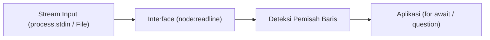

# Readline

> Ringkasan
> - Tingkat: Pendukung
> - Fungsi: Membaca data baris demi baris dari stream input secara asinkron.
> - Digunakan saat: Membangun aplikasi CLI interaktif, meminta input teks dari terminal, atau memproses file log berukuran besar baris demi baris tanpa menghabiskan memori RAM.
> - Aturan praktis: Gunakan `import { createInterface } from "node:readline/promises"` bersama perulangan `for await...of` untuk membaca baris secara bersih tanpa callback.

## Cheat Sheet

| Tugas | Kode |
| :--- | :--- |
| Menyiapkan antarmuka readline berbasis Promise | `const rl = createInterface({ input, output });` |
| Membaca baris dengan async iterator | `for await (const line of rl) { ... }` |
| Mengajukan pertanyaan ke user terminal | `const answer = await rl.question("Nama: ");` |
| Mengajukan pertanyaan dengan batas waktu (abort signal) | `await rl.question("Konfirmasi: ", { signal });` |
| Mengatur teks prompt kustom | `rl.setPrompt("app> ");` |
| Menampilkan prompt ke output | `rl.prompt();` |
| Menutup antarmuka dan melepas listener stream | `rl.close();` |

## Tujuan Belajar

- Menyiapkan antarmuka `Interface` untuk memecah stream input menjadi potongan baris teks.
- Membaca baris teks secara streaming dengan perulangan asinkron `for await...of`.
- Mengajukan pertanyaan interaktif di terminal dengan metode `rl.question()`.
- Mengendalikan pembatalan input pertanyaan memakai `AbortSignal`.
- Menutup sesi pembacaan readline dengan benar agar proses Node.js dapat keluar secara bersih.

## Konsep

Bayangkan jalur conveyor belt belanjaan di kasir swalayan. Pelanggan meletakkan banyak barang sekaligus di atas belt (stream data mentah). Kasir tidak memegang seluruh belanjaan sekaligus di tangannya, melainkan menunggu pemisah antrean belanjaan lalu memindai barang satu demi satu (baris demi baris). Modul `node:readline` bekerja persis seperti kasir tersebut: modul ini menerima stream data mentah dari stream input, mendeteksi pemisah baris (`\n` atau `\r\n`), lalu meneruskannya satu per satu ke kode aplikasi agar memori RAM tetap hemat.



## Referensi

| Item | Fungsi | Catatan |
| :--- | :--- | :--- |
| `createInterface(options)` | Menyiapkan instance antarmuka pembaca baris | Menerima konfigurasi stream input dan output |
| `rl[Symbol.asyncIterator]()` | Mengalirkan setiap baris teks sebagai async iterable | Dipakai dengan perulangan `for await...of` |
| `rl.question(query, options)` | Menampilkan pertanyaan dan menunggu baris jawaban user | Mengembalikan Promise string jawaban |
| `rl.close()` | Menutup antarmuka dan melepas pengait ke stream | Wajib dipanggil agar proses tidak menggantung |
| `rl.setPrompt(prompt)` | Mengatur string penanda prompt terminal | Berguna untuk aplikasi terminal interaktif |
| `rl.prompt(preserveCursor)` | Menuliskan prompt ke stream output | Memposisikan kursor input untuk user |

### `createInterface(options)`

`createInterface()` menyiapkan instance `Interface` baru untuk mengonsumsi stream input dan memecahnya menjadi event baris teks.

Struktur parameter: `createInterface(options)`

- `options` (object, wajib): konfigurasi koneksi antarmuka.
  - `input` (ReadableStream, wajib): stream sumber data yang ingin dibaca.
  - `output` (WritableStream, opsional, default: `null`): stream tujuan penulisan respons dan prompt.
  - `crlfDelay` (number, opsional, default: `100`): toleransi waktu dalam milidetik untuk menggabungkan `\r` dan `\n`. Beri nilai `Infinity` untuk memperlakukan `\r\n` sebagai satu penanda baris baru tunggal.

Nilai kembalian: instance pembaca baris (`Interface`).

```javascript
import { createInterface } from "node:readline/promises";
import { Readable } from "node:stream";

const source = Readable.from(["baris 1\n", "baris 2\n"]);
const rl = createInterface({ input: source, crlfDelay: Infinity });

console.log(typeof rl.question);
// Output: function
rl.close();
```

Kondisi khusus dan penanganan error: jika `input` bukan Readable stream yang valid, fungsi melempar `TypeError [ERR_INVALID_ARG_TYPE]`.

### `rl[Symbol.asyncIterator]()`

Instance antarmuka readline menyediakan async iterator bawaan untuk menelusuri baris demi baris secara asinkron.

Struktur parameter: dipanggil otomatis oleh sintaks `for await...of` tanpa argumen manual.

Nilai kembalian: async iterator yang menghasilkan baris string teks (`AsyncIterator<string>`).

```javascript
import { createInterface } from "node:readline/promises";
import { Readable } from "node:stream";

const source = Readable.from(["data: alpha\n", "data: beta\n"]);
const rl = createInterface({ input: source, crlfDelay: Infinity });

const lines = [];
for await (const line of rl) {
  lines.push(line);
}

console.log(lines.length);
// Output: 2
console.log(lines[0]);
// Output: data: alpha
```

Kondisi khusus dan penanganan error: perulangan berhenti secara otomatis saat stream input memicu event `'end'` atau antarmuka ditutup lewat `rl.close()`.

### `rl.question(query, options)`

`rl.question()` menuliskan prompt pertanyaan ke stream output lalu menunggu user mengetikkan jawaban dan menekan tombol Enter.

Struktur parameter: `rl.question(query, options)`

- `query` (string, wajib): teks pertanyaan yang ditampilkan ke user.
- `options` (object, opsional, default: `{}`): opsi kontrol pembacaan.
  - `signal` (AbortSignal, opsional): sinyal pembatalan untuk menghentikan penungguan input.

Nilai kembalian: Promise berisi teks jawaban user tanpa karakter baris baru di ujungnya (`Promise<string>`).

```javascript
import { createInterface } from "node:readline/promises";
import { Readable, Writable } from "node:stream";

const inputData = Readable.from(["Admin\n"]);
let outputText = "";
const outputStream = new Writable({
  write(chunk, encoding, callback) {
    outputText += chunk.toString();
    callback();
  },
});

const rl = createInterface({ input: inputData, output: outputStream });
const role = await rl.question("Masukkan role: ");
rl.close();

console.log(role);
// Output: Admin
```

Kondisi khusus dan penanganan error: jika sinyal pada `options.signal` dibatalkan sebelum user menjawab, Promise melempar error dengan nama `AbortError`.

### `rl.close()`

`rl.close()` menutup antarmuka readline, melepas listener pada stream input dan output, serta merelakan kendali terminal.

Struktur parameter: dipanggil tanpa argumen.

Nilai kembalian: tidak mengembalikan nilai (`undefined`).

```javascript
import { createInterface } from "node:readline/promises";
import { Readable } from "node:stream";

const rl = createInterface({ input: Readable.from(["teks\n"]) });
console.log(rl.closed);
// Output: false
rl.close();
console.log(rl.closed);
// Output: true
```

Kondisi khusus dan penanganan error: memanggil `rl.close()` berulang kali aman dan tidak melempar error tambahan.

### `rl.setPrompt(prompt)` dan `rl.prompt(preserveCursor)`

`rl.setPrompt()` menentukan teks awalan prompt baris, sedangkan `rl.prompt()` menampilkannya ke output stream.

Struktur parameter: `rl.setPrompt(prompt)` menerima `prompt` (string, wajib), dan `rl.prompt(preserveCursor)` menerima `preserveCursor` (boolean, opsional, default: `false`).

Nilai kembalian: kedua metode mengembalikan instance `Interface` untuk method chaining.

```javascript
import { createInterface } from "node:readline/promises";
import { Readable, Writable } from "node:stream";

let buffer = "";
const out = new Writable({
  write(chunk, enc, cb) {
    buffer += chunk.toString();
    cb();
  },
});

const rl = createInterface({ input: Readable.from([]), output: out });
rl.setPrompt("custom> ");
rl.prompt();
rl.close();

console.log(buffer);
// Output: custom> 
```

Kondisi khusus dan penanganan error: jika opsi `output` bernilai `null` saat inisialisasi, `rl.prompt()` tidak menuliskan apa pun ke mana pun.

## Kesalahan Umum

### Lupa Memanggil `rl.close()` di Terminal CLI

Ketika membaca input dari `process.stdin`, runtime Node.js menjaga event loop tetap aktif selama listener stream belum dilepas. Jika lupa memanggil `rl.close()`, program tidak pernah selesai dan menggantung terus di terminal.

```javascript
// Salah: rl tidak pernah ditutup, proses menggantung di terminal
const rl = createInterface({ input: process.stdin, output: process.stdout });
const name = await rl.question("Siapa nama kamu? ");
console.log(`Halo ${name}`);
```

```javascript
// Benar: bungkus interaksi dengan try...finally dan panggil rl.close()
const rl = createInterface({ input: process.stdin, output: process.stdout });
try {
  const name = await rl.question("Siapa nama kamu? ");
  console.log(`Halo ${name}`);
} finally {
  rl.close();
}
```

### Mencampur Event `'line'` dengan `for await...of`

Menggunakan listener event konvensional `rl.on("line")` bersamaan dengan perulangan `for await...of` menyebabkan perebutan konsumsi stream. Data baris bisa terbaca ganda atau hilang di salah satu alur.

```javascript
// Salah: dua konsumen membaca stream secara bersamaan
rl.on("line", (line) => console.log("Event:", line));
for await (const line of rl) {
  console.log("Async:", line);
}
```

```javascript
// Benar: pilih satu gaya pembacaan, utamakan for await...of
for await (const line of rl) {
  console.log("Baris:", line);
}
```

## Studi Kasus

Skenario: Pemindai log audit server (`AuditLogScanner`) untuk mendeteksi baris insiden berstatus `[ERROR]` dari stream data besar tanpa memuat seluruh file ke memori.

```javascript
import { createInterface } from "node:readline/promises";
import { Readable } from "node:stream";

class AuditLogScanner {
  constructor(inputStream) {
    this.inputStream = inputStream;
  }

  async scanErrors() {
    const rl = createInterface({
      input: this.inputStream,
      crlfDelay: Infinity,
    });

    const errorEntries = [];
    let lineCount = 0;

    for await (const line of rl) {
      lineCount++;
      if (line.includes("[ERROR]")) {
        const parts = line.split(" - ");
        errorEntries.push({
          line: lineCount,
          message: parts[1] || line,
        });
      }
    }

    return {
      totalScanned: lineCount,
      totalErrors: errorEntries.length,
      errors: errorEntries,
    };
  }
}

const mockLogStream = Readable.from([
  "2026-03-29 10:00:00 [INFO] - Server berjalan di port 3000\n",
  "2026-03-29 10:01:15 [ERROR] - Koneksi database terputus\n",
  "2026-03-29 10:02:00 [INFO] - Heartbeat check berhasil\n",
  "2026-03-29 10:03:22 [ERROR] - Gagal menulis file cache\n",
]);

const scanner = new AuditLogScanner(mockLogStream);
const report = await scanner.scanErrors();

console.log(report.totalScanned);
// Output: 4
console.log(report.totalErrors);
// Output: 2
console.log(report.errors[0].message);
// Output: Koneksi database terputus
```

Pola ini menjaga penggunaan memori tetap datar karena hanya satu baris teks yang diproses pada satu satuan waktu.

## Latihan Mandiri

Buat fungsi `parseConfigStream(inputStream, options = {})` untuk memproses konfigurasi berformat baris teks dari stream input.

- **Level 1 (Dasar):** Baca `inputStream` baris demi baris memakai `createInterface` dan perulangan `for await...of`. Abaikan baris kosong atau baris komentar yang diawali tanda pagar `#`.
- **Level 2 (Menengah):** Urai setiap baris menjadi pasangan kunci dan nilai dengan format `KEY=VALUE`. Simpan nilainya ke dalam satu objek konfigurasi `{ [key]: value }` dengan whitespace terpotong rapi.
- **Level 3 (Menantang):** Dukung opsi `options.requiredKeys` (array string) dan `options.signal` (instance AbortSignal). Jika ada kunci pada `requiredKeys` yang tidak ditemukan di akhir parsing, lempar `Error("Konfigurasi wajib tidak lengkap: [daftarKunci]")`. Jika `options.signal` dibatalkan di tengah proses, hentikan pembacaan dan lempar `Error("Proses pembacaan konfigurasi dibatalkan")`. Pastikan `rl.close()` selalu dipanggil dalam blok `finally`.

Contoh input dan output normal:

```javascript
import { Readable } from "node:stream";

const sampleStream = Readable.from([
  "# Pengaturan Aplikasi\n",
  "PORT=8080\n",
  "\n",
  "HOST=127.0.0.1\n",
  "# Mode Environment\n",
  "NODE_ENV=production\n",
]);

const cfg = await parseConfigStream(sampleStream, { requiredKeys: ["PORT", "HOST"] });

console.log(cfg.PORT);
// Output: 8080
console.log(cfg.HOST);
// Output: 127.0.0.1
console.log(cfg.NODE_ENV);
// Output: production
```

Contoh input dan penanganan error:

```javascript
import { Readable } from "node:stream";

const incompleteStream = Readable.from(["PORT=3000\n"]);
try {
  await parseConfigStream(incompleteStream, { requiredKeys: ["PORT", "DATABASE_URL"] });
} catch (err) {
  console.log(err.message);
  // Output: Konfigurasi wajib tidak lengkap: DATABASE_URL
}

const abortController = new AbortController();
abortController.abort();
const streamBatal = Readable.from(["PORT=3000\n"]);
try {
  await parseConfigStream(streamBatal, { signal: abortController.signal });
} catch (err) {
  console.log(err.message);
  // Output: Proses pembacaan konfigurasi dibatalkan
}
```

Tanda selesai:
- [ ] Baris kosong dan komentar bertanda `#` terfilter tanpa masuk ke hasil akhir.
- [ ] Pasangan kunci dan nilai berformat `KEY=VALUE` berhasil dipetakan ke properti objek.
- [ ] Validasi kunci wajib melempar error informatif jika ada konfigurasi yang hilang.
- [ ] Sinyal pembatalan `AbortSignal` menghentikan proses pembacaan stream dan melempar error.
- [ ] Sesi pembacaan `createInterface` selalu ditutup dengan `rl.close()` pada blok `finally`.

---

## Navigasi

[Sebelumnya: Zlib](../15-zlib/README.md) | [Selanjutnya: Console](../17-console/README.md) | [Daftar Isi](../README.md)
