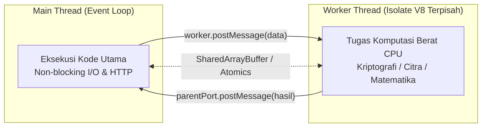

# Worker Threads

> Ringkasan
> - Fungsi: Menjalankan tugas komputasi berat (*CPU-intensive tasks*) pada thread latar belakang terpisah tanpa memblokir thread utama (*Event Loop*) Node.js.
> - Digunakan saat: Enkripsi kriptografi berat, kompresi berkas raksasa, manipulasi pengolahan citra/video, komputasi matematika rumit, atau parsing dataset JSON berukuran masif.
> - Aturan praktis: Jangan gunakan Worker Threads untuk tugas I/O (seperti kueri basis data atau pembacaan berkas); model non-blocking asinkron bawaan Node.js jauh lebih efisien untuk operasi I/O. Gunakan Worker Threads khusus untuk beban CPU-bound.

---

## Tujuan Belajar

- Membedakan karakteristik beban kerja *I/O-bound* dengan *CPU-bound* dalam ekosistem Node.js.
- Membedakan arsitektur multi-proses `node:cluster` dengan model multi-threading `node:worker_threads`.
- Menginisialisasi dan mengeksekusi thread pekerja menggunakan kelas `Worker`.
- Mengirim dan menerima data antar thread melalui `postMessage`, `parentPort`, dan event `'message'`.
- Memanfaatkan `workerData` untuk pengiriman data inisialisasi awal ke thread pekerja.
- Membagi memori secara langsung antar thread menggunakan `SharedArrayBuffer` dan `Atomics`.

---

## Konsep

> Worker Threads dianalogikan seperti pembagian kerja di sebuah restoran cepat saji. Kasir utama bertindak sebagai Main Thread (Event Loop) yang melayani tamu di meja depan dengan gesit. Menunggu oven microwave berbunyi adalah tugas I/O yang tidak menguras tenaga fisik kasir, kasir hanya menunggu alarm berdering sambil melayani tamu lain. Namun jika kasir tiba-tiba harus menggiling 5 karung gandum (tugas CPU-bound berat), antrean pembeli di depan akan terhenti total selama 30 menit. Dengan Worker Threads, kasir mempekerjakan asisten dapur di ruangan belakang khusus untuk menggiling gandum. Kasir tetap melayani tamu di depan tanpa gangguan, dan asisten menyerahkan hasil gilingan saat selesai.



---

## Referensi

| Item | Fungsi | Catatan |
| :--- | :--- | :--- |
| **`new Worker()`** | Membuat dan menjalankan thread pekerja baru | Menerima berkas jalur skrip atau string kode dengan opsi `eval` |
| **`isMainThread`** | Menandai apakah kode sedang berjalan di thread utama | Bernilai `true` saat dieksekusi di proses induk utama |
| **`parentPort`** | Saluran komunikasi dua arah menuju thread pembuat | Bernilai `null` jika diakses langsung di thread utama |
| **`workerData`** | Meneruskan data inisialisasi awal saat pembuatan thread | Tersedia seketika di thread pekerja tanpa menunggu event pesan |
| **`MessageChannel`** | Membuat saluran komunikasi dua arah independen | Menyediakan sepasang port (`port1` dan `port2`) yang dapat ditransfer |
| **`SharedArrayBuffer`** | Mengalokasikan blok memori biner bersama antar thread | Objek global JavaScript untuk manipulasi data langsung tanpa kloning |
| **`Atomics`** | Menyediakan operasi baca-tulis memori secara atomik | Mencegah kondisi balapan (*race condition*) pada array memori bersama |

### `new Worker()`

Kelas `new Worker()` digunakan untuk melahirkan dan menjalankan thread pekerja baru. Thread ini memiliki konteks eksekusi V8 Isolate dan alokasi event loop sendiri yang terpisah dari thread pemanggilnya.

```javascript
import { Worker } from 'node:worker_threads';

const worker = new Worker(`
  import { parentPort } from 'node:worker_threads';
  parentPort.postMessage('Worker thread active');
`, { eval: true });

worker.on('message', (message) => {
  console.log(message);
  // Output: Worker thread active
});
```

Kasus lain: Menangkap event `'error'` saat thread pekerja melempar galat yang tidak tertangani.

```javascript
import { Worker } from 'node:worker_threads';

const worker = new Worker(`
  throw new Error('Worker failure');
`, { eval: true });

worker.on('error', (error) => {
  console.log(error.message);
  // Output: Worker failure
});
```

### `isMainThread`

Properti boolean `isMainThread` bernilai `true` jika kode saat ini sedang dieksekusi di dalam thread induk utama Node.js, dan bernilai `false` jika sedang dieksekusi di dalam thread pekerja.

```javascript
import { isMainThread } from 'node:worker_threads';

console.log(isMainThread);
// Output: true
```

Kasus lain: Menjalankan logika thread utama dan thread pekerja di dalam berkas skrip yang sama menggunakan percabangan kondisi `isMainThread`.

```javascript
import { Worker, isMainThread } from 'node:worker_threads';

if (isMainThread) {
  const worker = new Worker(`
    import { isMainThread, parentPort } from 'node:worker_threads';
    parentPort.postMessage(isMainThread);
  `, { eval: true });

  worker.on('message', (status) => {
    console.log('Worker isMainThread status:', status);
    // Output: Worker isMainThread status: false
  });
}
```

### `parentPort`

Objek `parentPort` adalah instans `MessagePort` yang digunakan oleh thread pekerja untuk berkomunikasi kembali ke thread utama yang melahirkannya. Jika diakses di thread utama, nilainya adalah `null`.

```javascript
import { parentPort } from 'node:worker_threads';

console.log(parentPort === null);
// Output: true
```

Kasus lain: Menangani aliran pesan masuk dari thread utama dan membalasnya menggunakan `parentPort.postMessage()`.

```javascript
import { Worker } from 'node:worker_threads';

const worker = new Worker(`
  import { parentPort } from 'node:worker_threads';
  parentPort.on('message', (number) => {
    parentPort.postMessage(number * 3);
  });
`, { eval: true });

worker.postMessage(10);
worker.on('message', (result) => {
  console.log(result);
  // Output: 30
  worker.terminate();
});
```

### `workerData`

Objek `workerData` digunakan untuk mengirimkan data konfigurasi atau muatan komputasi awal pada saat pembuatan instans `Worker`. Data ini dikloning secara otomatis dan langsung tersedia saat thread pekerja pertama kali berjalan.

```javascript
import { Worker } from 'node:worker_threads';

const worker = new Worker(`
  import { parentPort, workerData } from 'node:worker_threads';
  parentPort.postMessage(workerData.category);
`, {
  eval: true,
  workerData: { category: 'cryptography' },
});

worker.on('message', (data) => {
  console.log(data);
  // Output: cryptography
});
```

Kasus lain: Membuktikan sifat kloning terisolasi pada `workerData` di mana modifikasi properti di thread pekerja tidak mengubah nilai asli di thread utama.

```javascript
import { Worker } from 'node:worker_threads';

const originalData = { score: 100 };
const worker = new Worker(`
  import { workerData, parentPort } from 'node:worker_threads';
  workerData.score = 999;
  parentPort.postMessage('done');
`, {
  eval: true,
  workerData: originalData,
});

worker.on('message', () => {
  console.log(originalData.score);
  // Output: 100
});
```

### `MessageChannel`

Kelas `MessageChannel` digunakan untuk membuat saluran komunikasi dua arah terpisah yang terdiri dari sepasang objek port (`port1` dan `port2`). Port ini dapat dipindahkan (*transfer*) ke thread pekerja lain untuk membuka komunikasi langsung antar worker.

```javascript
import { MessageChannel } from 'node:worker_threads';

const { port1, port2 } = new MessageChannel();

port2.on('message', (message) => {
  console.log(message);
  // Output: Direct channel message
  port1.close();
  port2.close();
});

port1.postMessage('Direct channel message');
```

Kasus lain: Mentransfer kepemilikan salah satu port ke instans worker menggunakan daftar transfer (*transferList*).

```javascript
import { Worker, MessageChannel } from 'node:worker_threads';

const { port1, port2 } = new MessageChannel();
const worker = new Worker(`
  import { parentPort } from 'node:worker_threads';
  parentPort.on('message', (event) => {
    event.port.postMessage('Connected via custom channel');
  });
`, { eval: true });

port1.on('message', (message) => {
  console.log(message);
  // Output: Connected via custom channel
  port1.close();
  worker.terminate();
});

worker.postMessage({ port: port2 }, [port2]);
```

### `SharedArrayBuffer`

Objek `SharedArrayBuffer` digunakan untuk mengalokasikan blok memori biner bersama yang dapat diakses dan dimanipulasi secara langsung oleh banyak thread tanpa melalui proses serialisasi kloning data.

```javascript
const sharedBuffer = new SharedArrayBuffer(8);
console.log(sharedBuffer.byteLength);
// Output: 8
```

Kasus lain: Mengakses dan memodifikasi isi memori bersama dari thread pekerja secara instan.

```javascript
import { Worker } from 'node:worker_threads';

const sharedBuffer = new SharedArrayBuffer(4);
const intArray = new Int32Array(sharedBuffer);
intArray[0] = 10;

const worker = new Worker(`
  import { workerData, parentPort } from 'node:worker_threads';
  const shared = new Int32Array(workerData);
  shared[0] = 50;
  parentPort.postMessage('done');
`, {
  eval: true,
  workerData: sharedBuffer,
});

worker.on('message', () => {
  console.log(intArray[0]);
  // Output: 50
});
```

### `Atomics`

Objek `Atomics` menyediakan operasi manipulasi memori secara atomik pada instans `TypedArray` yang didukung oleh `SharedArrayBuffer` guna mencegah kondisi balapan (*race condition*) ketika beberapa thread menulis ke lokasi memori yang sama secara serentak.

```javascript
const sharedBuffer = new SharedArrayBuffer(4);
const intArray = new Int32Array(sharedBuffer);

Atomics.store(intArray, 0, 50);
console.log(Atomics.load(intArray, 0));
// Output: 50

const previousValue = Atomics.add(intArray, 0, 10);
console.log(previousValue, Atomics.load(intArray, 0));
// Output: 50 60
```

Kasus lain: Melakukan penukaran nilai memori secara kondisional hanya jika nilai saat ini sesuai dengan target menggunakan `Atomics.compareExchange()`.

```javascript
const buffer = new SharedArrayBuffer(4);
const typedArray = new Int32Array(buffer);
Atomics.store(typedArray, 0, 100);

const exchangeStatus = Atomics.compareExchange(typedArray, 0, 100, 200);
console.log(exchangeStatus, Atomics.load(typedArray, 0));
// Output: 100 200
```

### Perbandingan: Tugas I/O-Bound vs Tugas CPU-Bound

| Karakteristik | Operasi I/O-Bound | Operasi CPU-Bound |
| :--- | :--- | :--- |
| **Karakteristik Beban** | Menunggu respon jaringan, soket, atau berkas disk | Memeras kalkulasi matematika, kompresi, atau enkripsi |
| **Solusi Terbaik Node.js** | Libuv non-blocking I/O bawaan pada thread utama | Thread latar belakang terpisah (`node:worker_threads`) |
| **Konsumsi CPU** | Minimal, mayoritas waktu dihabiskan untuk menunggu | Tinggi, dapat mendominasi 100% utilisasi satu core CPU |
| **Dampak Salah Penempatan** | Pemborosan memori jika membuat thread per request I/O | Pemblokiran total Event Loop jika dijalankan di thread utama |

---

## Kesalahan Umum

### Menggunakan Worker Threads untuk Operasi I/O

Menggunakan thread pekerja untuk menangani kueri basis data atau pembacaan berkas justru menurunkan efisiensi aplikasi karena operasi I/O asinkron bawaan Node.js jauh lebih cepat dan tidak memakan beban inisialisasi thread baru.

```javascript
// Salah
const worker = new Worker(`
  import fs from 'node:fs/promises';
  const content = await fs.readFile('./data.txt', 'utf-8');
`, { eval: true });
```

```javascript
// Benar
import fs from 'node:fs/promises';

// Tangani operasi I/O asinkron langsung di thread utama
const content = await fs.readFile('./data.txt', 'utf-8');
```

### Membuat Instans Thread Baru untuk Setiap Permintaan Masuk Kecil

Inisialisasi thread baru membutuhkan alokasi memori V8 Isolate sekitar 1–3 MB dan waktu mulai beberapa milidetik sehingga membuat thread ad-hoc per request menurunkan throughput server drastis.

```javascript
// Salah
server.on('request', (req, res) => {
  const worker = new Worker(workerScript);
});
```

```javascript
// Benar
// Gunakan worker yang sudah ada secara terus-menerus melalui pola antrean / Thread Pool
persistentWorker.postMessage(req.data);
```

### Mengabaikan Beban Duplikasi Data pada Pemanggilan `postMessage`

Secara default, data yang dikirim melalui `postMessage` disalin menggunakan algoritma serialisasi *HTML Structured Clone* yang menggandakan penggunaan memori saat mengirimkan payload objek raksasa.

```javascript
// Salah
// Array buffer puluhan megabyte diduplikasi secara mendalam
worker.postMessage({ buffer: largeArrayBuffer });
```

```javascript
// Benar
// Pindahkan kepemilikan buffer tanpa proses kloning memori melalui daftar transfer
worker.postMessage({ buffer: largeArrayBuffer }, [largeArrayBuffer]);
```

---

## Studi Kasus

Skenario: Membangun fungsi pencari deret bilangan prima besar (`calculatePrimesInBackground`) mandiri yang didelegasikan ke thread latar belakang agar tidak membekukan *Event Loop* thread utama, lengkap dengan pembungkusan Promise dan penanganan event `'error'` serta `'exit'`.

```javascript
import { Worker } from 'node:worker_threads';

function calculatePrimesInBackground(startRange, endRange) {
  return new Promise((resolve, reject) => {
    const workerScript = `
      import { workerData, parentPort } from 'node:worker_threads';

      function findPrimes(start, end) {
        const results = [];
        for (let i = Math.max(2, start); i <= end; i++) {
          let isPrime = true;
          for (let j = 2; j * j <= i; j++) {
            if (i % j === 0) {
              isPrime = false;
              break;
            }
          }
          if (isPrime) results.push(i);
        }
        return results;
      }

      const results = findPrimes(workerData.start, workerData.end);
      parentPort.postMessage(results);
    `;

    const worker = new Worker(workerScript, {
      eval: true,
      workerData: { start: startRange, end: endRange },
    });

    worker.on('message', resolve);
    worker.on('error', reject);
    worker.on('exit', (code) => {
      if (code !== 0) {
        reject(new Error('Worker stopped with exit code ' + code));
      }
    });
  });
}

const primeList = await calculatePrimesInBackground(10, 30);
console.log(primeList);

// Output:
// [ 11, 13, 17, 19, 23, 29 ]
```

Desain ini dipilih karena mengisolasi kalkulasi matematika berbasis loop intensif di luar thread utama sehingga server tetap responsif melayani koneksi lain, meneruskan parameter secara instan lewat `workerData`, serta membungkus seluruh siklus thread ke dalam Promise standar yang ramah sintaksis `async/await`.

---

## Latihan Mandiri

### Soal 1 (Dasar)

Buat fungsi `runMultiplyTask(a, b)` yang mengeksekusi operasi perkalian dua angka di thread pekerja latar belakang menggunakan `new Worker()` dengan opsi `{ eval: true }` dan `workerData`. Fungsi harus mengembalikan Promise yang menyelesaikan hasil perkalian tersebut.

Contoh masukan:

```javascript
await runMultiplyTask(7, 8);
```

Contoh keluaran yang diharapkan:

```javascript
56
```

Batasan: Gunakan modul bawaan `node:worker_threads` tanpa pustaka tambahan.

### Soal 2 (Menengah)

Buat fungsi akumulasi paralel `calculateSharedSum(numbers)` yang memanfaatkan `SharedArrayBuffer` dan `Int32Array`. Fungsi membuat satu `SharedArrayBuffer` sepanjang 4 byte sebagai penyimpan nilai akumulasi total dengan nilai awal `0`. Fungsi membagi `numbers` menjadi dua bagian yang seimbang dan mendelegasikan masing-masing bagian ke thread pekerja terpisah. Setiap worker menjumlahkan sub-larik miliknya dan menambahkan hasilnya ke memori bersama secara atomik menggunakan `Atomics.add()`. Thread utama menunggu kedua worker selesai lalu membaca nilai akhir menggunakan `Atomics.load()`.

Contoh masukan:

```javascript
await calculateSharedSum([10, 20, 30, 40]);
```

Contoh keluaran yang diharapkan:

```javascript
100
```

Batasan: Wajib menggunakan `SharedArrayBuffer` dan `Atomics.add()` untuk pembaruan memori bersama antar thread.

### Soal 3 (Menantang)

Buat pengelola kolam thread pekerja sederhana `createSimpleWorkerPool(poolSize, workerCode)`. Sistem ini mengelola sejumlah thread pekerja aktif secara terus-menerus guna memproses tugas komputasi tanpa membuat thread baru di setiap pekerjaan:

1. Inisialisasi sebanyak `poolSize` instans `Worker` yang mendengarkan event `'message'` dari thread utama.
2. Sediakan metode `execute(payload)` yang mengembalikan Promise:
   - Jika ada worker yang berstatus menganggur (*idle*), kirimkan payload ke worker tersebut seketika.
   - Jika seluruh worker sedang sibuk memproses tugas lain, simpan tugas beserta fungsi `resolve` dan `reject` miliknya ke dalam antrean tunggu (*task queue*).
   - Begitu sebuah worker menyelesaikan tugas dan mengirimkan balasan, panggil `resolve(result)` tugas terkait, lalu segera berikan tugas berikutnya dari antrean tunggu ke worker tersebut jika antrean tidak kosong.
3. Penanganan kasus tepi:
   - Jika worker melempar galat (`error`) atau keluar secara tidak wajar (`exit` dengan kode non-0) saat memproses tugas, tolak Promise tugas tersebut dengan pesan galat, hidupkan worker pengganti untuk menjaga kuota `poolSize`, dan lanjutkan penanganan antrean.
   - Sediakan metode `closePool()` yang mematikan seluruh worker secara teratur menggunakan `worker.terminate()`.

Contoh skenario pengujian:

```javascript
const pool = createSimpleWorkerPool(2, `
  import { parentPort } from 'node:worker_threads';
  parentPort.on('message', (task) => {
    parentPort.postMessage({ id: task.id, result: task.number * 2 });
  });
`);

const p1 = pool.execute({ id: 1, number: 5 });
const p2 = pool.execute({ id: 2, number: 10 });
const p3 = pool.execute({ id: 3, number: 15 });

const results = await Promise.all([p1, p2, p3]);
console.log(results);
```

Contoh keluaran yang diharapkan:

```javascript
[
  { id: 1, result: 10 },
  { id: 2, result: 20 },
  { id: 3, result: 30 }
]
```

Batasan: Dilarang menggunakan pustaka eksternal seperti `piscina`. Wajib dibangun murni menggunakan kelas `Worker` dan penanganan antrean internal JavaScript.

---

## Navigasi

[Sebelumnya: Cluster](../15-cluster/README.md) | [Selanjutnya: Zlib](../17-zlib/README.md) | [Daftar Isi](../README.md)
