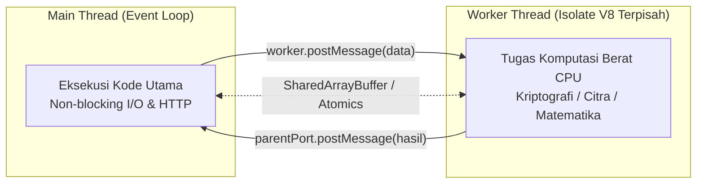

# Worker Threads

> Ringkasan
>
> - Fungsi: Menjalankan tugas komputasi berat (_CPU-intensive tasks_) pada thread latar belakang terpisah tanpa mengunci thread utama (_Event Loop_) Node.js.
> - Digunakan saat: Enkripsi kriptografi berat, kompresi berkas raksasa, pengolahan gambar atau video, kalkulasi matematika rumit, atau parsing dataset JSON berukuran besar.
> - Aturan praktis: Hindari memakai Worker Threads untuk tugas I/O biasa (seperti kueri database atau membaca berkas di disk) karena model asinkron bawaan Node.js sudah sangat efisien. Gunakan Worker Threads khusus untuk tugas-tugas berat yang memeras komputasi CPU (_CPU-bound_).

---

## Tujuan Belajar

- Membedakan beban kerja yang dibatasi kecepatan I/O (_I/O-bound_) dengan beban kerja yang menguras CPU (_CPU-bound_).
- Membedakan arsitektur multi-proses `node:cluster` dengan model multi-threading `node:worker_threads`.
- Membuat dan menjalankan thread pekerja baru menggunakan kelas `Worker`.
- Mengirim dan menerima pesan data antar-thread lewat `postMessage`, `parentPort`, dan event `'message'`.
- Mengirimkan data konfigurasi awal ke thread pekerja secara instan lewat `workerData`.
- Berbagi memori secara langsung antar-thread menggunakan `SharedArrayBuffer` dan `Atomics`.

---

## Konsep

Worker Threads bisa kita bayangkan seperti pembagian kerja di restoran cepat saji. Kasir utama bertindak sebagai Main Thread (Event Loop) yang menyambut dan melayani pelanggan di loket depan dengan gesit.

Menunggu oven microwave berbunyi adalah contoh tugas I/O: kasir tidak perlu berdiri bengong mengawasi microwave, ia cukup menunggu alarm berbunyi sambil tetap melayani pembeli berikutnya di antrean. Namun, bayangkan jika kasir tiba-tiba disuruh menggiling 5 karung gandum sendirian (tugas komputasi berat CPU). Antrean pelanggan di loket depan otomatis akan macet total selama berjam-jam!

Di sinilah Worker Threads berperan. Restoran mempekerjakan asisten dapur di ruangan belakang khusus untuk menggiling gandum (Worker Thread). Kasir utama tetap melayani tamu di loket depan tanpa gangguan sedikit pun, dan asisten dapur akan mengirimkan kabar lewat interkom (_postMessage_) begitu gandumnya selesai digiling.



---

## Referensi

| Item                    | Fungsi                                                | Catatan                                                               |
| :---------------------- | :---------------------------------------------------- | :-------------------------------------------------------------------- |
| **`new Worker()`**      | Membuat dan menjalankan thread pekerja baru           | Menerima jalur berkas skrip atau teks kode string dengan opsi `eval`  |
| **`isMainThread`**      | Mengecek apakah kode sedang berjalan di thread utama  | Bernilai `true` saat dieksekusi di proses induk utama                 |
| **`parentPort`**        | Jalur komunikasi dua arah menuju thread pembuatnya    | Bernilai `null` jika diakses langsung di thread utama                 |
| **`workerData`**        | Mengirimkan data inisialisasi awal saat thread dibuat | Tersedia seketika di thread pekerja tanpa perlu menunggu event pesan  |
| **`MessageChannel`**    | Membuat saluran komunikasi dua arah mandiri           | Menyediakan sepasang port (`port1` dan `port2`) yang bisa dipindahkan |
| **`SharedArrayBuffer`** | Menyiapkan blok memori biner bersama antar-thread     | Memungkinkan manipulasi data langsung tanpa perlu kloning memori      |
| **`Atomics`**           | Menyediakan operasi baca-tulis memori secara atomik   | Mencegah benturan balapan (_race condition_) pada memori bersama      |

### `new Worker()`

Kelas `new Worker()` digunakan untuk membuat dan menjalankan thread pekerja baru di latar belakang. Thread ini memiliki lingkungan V8 Isolate dan Event Loop mandiri yang terpisah dari thread utama.

```javascript
import { Worker } from "node:worker_threads";

const worker = new Worker(
  `
  import { parentPort } from 'node:worker_threads';
  parentPort.postMessage('Worker thread active');
`,
  { eval: true },
);

worker.on("message", (message) => {
  console.log(message);
  // Output: Worker thread active
});
```

Kasus lain: Menangkap event `'error'` saat thread pekerja mengalami kegagalan atau melempar pengecualian tak terduga.

```javascript
import { Worker } from "node:worker_threads";

const worker = new Worker(
  `
  throw new Error('Worker failure');
`,
  { eval: true },
);

worker.on("error", (error) => {
  console.log(error.message);
  // Output: Worker failure
});
```

### `isMainThread`

Properti boolean `isMainThread` bernilai `true` jika kode saat ini sedang dieksekusi di thread utama Node.js, dan bernilai `false` jika sedang berjalan di dalam thread pekerja latar belakang.

```javascript
import { isMainThread } from "node:worker_threads";

console.log(isMainThread);
// Output: true
```

Kasus lain: Menjalankan kode thread utama dan thread pekerja di dalam satu berkas yang sama dengan memanfaatkan percabangan `isMainThread`.

```javascript
import { Worker, isMainThread } from "node:worker_threads";

if (isMainThread) {
  const worker = new Worker(
    `
    import { isMainThread, parentPort } from 'node:worker_threads';
    parentPort.postMessage(isMainThread);
  `,
    { eval: true },
  );

  worker.on("message", (status) => {
    console.log("Worker isMainThread status:", status);
    // Output: Worker isMainThread status: false
  });
}
```

### `parentPort`

Objek `parentPort` adalah jalur komunikasi yang digunakan oleh thread pekerja untuk mengirimkan kabar kembali ke thread utama. Jika kita mengaksesnya di thread utama, nilainya adalah `null`.

```javascript
import { parentPort } from "node:worker_threads";

console.log(parentPort === null);
// Output: true
```

Kasus lain: Menerima data tugas dari thread utama lalu membalas hasilnya menggunakan `parentPort.postMessage()`.

```javascript
import { Worker } from "node:worker_threads";

const worker = new Worker(
  `
  import { parentPort } from 'node:worker_threads';
  parentPort.on('message', (number) => {
    parentPort.postMessage(number * 3);
  });
`,
  { eval: true },
);

worker.postMessage(10);
worker.on("message", (result) => {
  console.log(result);
  // Output: 30
  worker.terminate();
});
```

### `workerData`

Objek `workerData` dipakai untuk menitipkan data konfigurasi awal atau bahan komputasi saat thread pekerja pertama kali dibuat. Data ini otomatis disalin dan langsung bisa dibaca seketika begitu thread pekerja menyala.

```javascript
import { Worker } from "node:worker_threads";

const worker = new Worker(
  `
  import { parentPort, workerData } from 'node:worker_threads';
  parentPort.postMessage(workerData.category);
`,
  {
    eval: true,
    workerData: { category: "cryptography" },
  },
);

worker.on("message", (data) => {
  console.log(data);
  // Output: cryptography
});
```

Kasus lain: Membuktikan sifat isolasi data pada `workerData`, di mana mengubah nilai di thread pekerja tidak akan mempengaruhi variabel asli di thread utama.

```javascript
import { Worker } from "node:worker_threads";

const originalData = { score: 100 };
const worker = new Worker(
  `
  import { workerData, parentPort } from 'node:worker_threads';
  workerData.score = 999;
  parentPort.postMessage('done');
`,
  {
    eval: true,
    workerData: originalData,
  },
);

worker.on("message", () => {
  console.log(originalData.score);
  // Output: 100
});
```

### `MessageChannel`

Kelas `MessageChannel` digunakan untuk membuat jalur komunikasi dua arah independen yang terdiri dari dua pintu port (`port1` dan `port2`). Port ini bisa kita kirimkan (_transfer_) ke worker lain untuk membuka jalur komunikasi langsung antarsesama worker.

```javascript
import { MessageChannel } from "node:worker_threads";

const { port1, port2 } = new MessageChannel();

port2.on("message", (message) => {
  console.log(message);
  // Output: Direct channel message
  port1.close();
  port2.close();
});

port1.postMessage("Direct channel message");
```

Kasus lain: Memindahkan kepemilikan salah satu port ke thread worker menggunakan daftar transfer (_transferList_).

```javascript
import { Worker, MessageChannel } from "node:worker_threads";

const { port1, port2 } = new MessageChannel();
const worker = new Worker(
  `
  import { parentPort } from 'node:worker_threads';
  parentPort.on('message', (event) => {
    event.port.postMessage('Connected via custom channel');
  });
`,
  { eval: true },
);

port1.on("message", (message) => {
  console.log(message);
  // Output: Connected via custom channel
  port1.close();
  worker.terminate();
});

worker.postMessage({ port: port2 }, [port2]);
```

### `SharedArrayBuffer`

Objek `SharedArrayBuffer` digunakan untuk menyiapkan blok memori biner bersama yang bisa dibaca dan ditulis langsung oleh beberapa thread sekaligus tanpa perlu menyalin atau mengkloning data.

```javascript
const sharedBuffer = new SharedArrayBuffer(8);
console.log(sharedBuffer.byteLength);
// Output: 8
```

Kasus lain: Mengubah isi memori bersama dari dalam thread pekerja secara seketika.

```javascript
import { Worker } from "node:worker_threads";

const sharedBuffer = new SharedArrayBuffer(4);
const intArray = new Int32Array(sharedBuffer);
intArray[0] = 10;

const worker = new Worker(
  `
  import { workerData, parentPort } from 'node:worker_threads';
  const shared = new Int32Array(workerData);
  shared[0] = 50;
  parentPort.postMessage('done');
`,
  {
    eval: true,
    workerData: sharedBuffer,
  },
);

worker.on("message", () => {
  console.log(intArray[0]);
  // Output: 50
});
```

### `Atomics`

Objek `Atomics` menyediakan serangkaian operasi manipulasi memori yang dijamin aman dan terkoordinasi pada `TypedArray` yang didukung `SharedArrayBuffer`. Ini berguna untuk mencegah benturan data (_race condition_) ketika ada banyak thread yang mencoba menulis ke alamat memori yang sama pada saat bersamaan.

```javascript
const sharedBuffer = new SharedArrayBuffer(4);
const intArray = new Int32Array(sharedBuffer);

Atomics.store(intArray, 0, 50);
console.log(Atomics.load(intArray, 0));
// Output: 50

const previousValue = Atomics.add(intArray, 0, 10);
console.log(previousValue, Atomics.load(intArray, 0));
// Output: 50 60
```

Kasus lain: Menukar nilai memori hanya jika nilai yang ada saat ini cocok dengan nilai target menggunakan `Atomics.compareExchange()`.

```javascript
const buffer = new SharedArrayBuffer(4);
const typedArray = new Int32Array(buffer);
Atomics.store(typedArray, 0, 100);

const exchangeStatus = Atomics.compareExchange(typedArray, 0, 100, 200);
console.log(exchangeStatus, Atomics.load(typedArray, 0));
// Output: 100 200
```

### Perbandingan: Tugas I/O-Bound vs Tugas CPU-Bound

| Karakteristik                 | Beban I/O-Bound                                               | Beban CPU-Bound                                          |
| :---------------------------- | :------------------------------------------------------------ | :------------------------------------------------------- |
| **Sifat Pekerjaan**           | Menunggu respon jaringan, soket, atau berkas disk             | Memeras kalkulasi matematika, kompresi, atau enkripsi    |
| **Solusi Terbaik di Node.js** | Fitur non-blocking I/O bawaan Libuv di thread utama           | Menyerahkan ke thread pekerja (`node:worker_threads`)    |
| **Pemanfaatan CPU**           | Sangat rendah, sebagian besar waktu dihabiskan untuk menunggu | Sangat tinggi, bisa mendominasi 100% kerja satu inti CPU |
| **Dampak Salah Penempatan**   | Memboroskan memori jika membuat thread untuk tiap I/O         | Mengunci Event Loop dan membuat server membeku total     |

---

## Kesalahan Umum

### Memakai Worker Threads untuk Menangani Tugas I/O

Menggunakan thread pekerja hanya untuk membaca berkas dari disk atau menunggu kueri database justru membuat aplikasi lebih lambat, karena operasi asinkron bawaan Node.js di thread utama sudah sangat efisien tanpa perlu beban memori tambahan untuk inisialisasi thread baru.

```javascript
// Salah
const worker = new Worker(
  `
  import fs from 'node:fs/promises';
  const content = await fs.readFile('./data.txt', 'utf-8');
`,
  { eval: true },
);
```

```javascript
// Benar
import fs from "node:fs/promises";

// Jalankan operasi I/O asinkron langsung di thread utama
const content = await fs.readFile("./data.txt", "utf-8");
```

### Membuat Thread Baru untuk Setiap Permintaan Ringan

Membuat satu instance `Worker` baru membutuhkan alokasi memori V8 sekitar 1–3 MB dan waktu pemanasan beberapa milidetik. Membuat thread baru setiap kali ada request yang masuk ke server akan menguras memori dan memperlambat throughput secara drastis.

```javascript
// Salah
server.on("request", (req, res) => {
  const worker = new Worker(workerScript); // Boros sumber daya
});
```

```javascript
// Benar
// Gunakan thread yang sudah siap sedia memakai pola thread pool
persistentWorker.postMessage(req.data);
```

### Lupa Memindahkan Kepemilikan Data Besar pada `postMessage`

Secara bawaan, pengiriman data melalui `postMessage` akan disalin menggunakan algoritma _Structured Clone_. Jika kita mengirim buffer berukuran ratusan megabyte tanpa daftar transfer, memori komputer akan terduplikasi secara mendalam.

```javascript
// Salah
// Data buffer berukuran besar digandakan penuh di memori
worker.postMessage({ buffer: largeArrayBuffer });
```

```javascript
// Benar
// Pindahkan kepemilikan buffer secara langsung tanpa menduplikasinya di RAM
worker.postMessage({ buffer: largeArrayBuffer }, [largeArrayBuffer]);
```

---

## Studi Kasus

Skenario: Membangun fungsi pencari bilangan prima besar (`calculatePrimesInBackground`) mandiri yang didelegasikan ke thread latar belakang agar tidak mengunci _Event Loop_ thread utama, lengkap dengan pembungkus Promise serta penanganan event `'error'` dan `'exit'`.

```javascript
import { Worker } from "node:worker_threads";

function calculatePrimesInBackground(startRange, endRange) {
  return new Promise((resolve, reject) => {
    const workerScript = `
      import { workerData, parentPort } from 'node:worker_threads';

      function findPrimes(start, end) {
        const results = [];
        for (let i = Math.max(2, start); i <= end; i++) {
          let isPrime = true;
          for (let j = 2; j * j <= i; j++) {
            if (i % j === 0) {
              isPrime = false;
              break;
            }
          }
          if (isPrime) results.push(i);
        }
        return results;
      }

      const results = findPrimes(workerData.start, workerData.end);
      parentPort.postMessage(results);
    `;

    const worker = new Worker(workerScript, {
      eval: true,
      workerData: { start: startRange, end: endRange },
    });

    worker.on("message", resolve);
    worker.on("error", reject);
    worker.on("exit", (code) => {
      if (code !== 0) {
        reject(new Error("Worker stopped with exit code " + code));
      }
    });
  });
}

const primeList = await calculatePrimesInBackground(10, 30);
console.log(primeList);

// Output:
// [ 11, 13, 17, 19, 23, 29 ]
```

Arsitektur ini mengisolasi proses perulangan matematika yang berat di luar thread utama. Hasilnya, server web tetap responsif melayani tamu lain tanpa jeda lag, parameter awal terkirim rapi via `workerData`, dan hasilnya dapat dikonsumsi dengan nyaman lewat kata kunci `await`.

---

## Latihan Mandiri

### Soal 1 (Dasar)

Buat fungsi `runMultiplyTask(a, b)` yang menghitung hasil perkalian dua angka di thread pekerja latar belakang menggunakan `new Worker()` dengan opsi `{ eval: true }` dan `workerData`. Fungsi harus mengembalikan Promise yang menyelesaikan hasil perkalian tersebut.

Contoh input:

```javascript
await runMultiplyTask(7, 8);
```

Contoh output yang diharapkan:

```javascript
56;
```

Batasan: Gunakan modul bawaan `node:worker_threads` tanpa library eksternal.

### Soal 2 (Menengah)

Buat fungsi akumulasi paralel `calculateSharedSum(numbers)` yang memanfaatkan `SharedArrayBuffer` dan `Int32Array`. Fungsi menyiapkan satu `SharedArrayBuffer` sepanjang 4 byte dengan nilai awal `0` sebagai tempat akumulasi total. Fungsi kemudian membagi daftar array `numbers` menjadi dua bagian yang seimbang dan menyerahkannya ke dua thread pekerja terpisah. Setiap worker menjumlahkan sub-array miliknya dan menambahkan hasilnya ke memori bersama secara atomik menggunakan `Atomics.add()`. Thread utama menunggu kedua worker selesai lalu membaca hasil akhirnya menggunakan `Atomics.load()`.

Contoh input:

```javascript
await calculateSharedSum([10, 20, 30, 40]);
```

Contoh output yang diharapkan:

```javascript
100;
```

Batasan: Wajib menggunakan `SharedArrayBuffer` dan `Atomics.add()` untuk pembaruan memori bersama antar-thread.

### Soal 3 (Menantang)

Buat pengelola thread pool sederhana `createSimpleWorkerPool(poolSize, workerCode)`. Sistem ini mengelola sejumlah thread pekerja aktif secara terus-menerus guna memproses tugas komputasi tanpa membuat thread baru di setiap pekerjaan:

1. Siapkan sebanyak `poolSize` instance `Worker` yang mendengarkan pesan dari thread utama.
2. Sediakan metode `execute(payload)` yang mengembalikan Promise:
   - Jika ada worker yang sedang menganggur (_idle_), kirimkan payload tugas ke worker tersebut seketika.
   - Jika semua worker sedang sibuk, simpan tugas beserta fungsi `resolve` dan `reject` miliknya ke dalam antrean tunggu (_task queue_).
   - Begitu salah satu worker menyelesaikan tugas dan mengirim balasan, selesaikan Promise tugas tersebut via `resolve(result)`, lalu segera berikan tugas berikutnya dari antrean jika antrean tidak kosong.
3. Penanganan kasus khusus:
   - Jika worker mengalami error (`error`) atau mati tidak wajar (`exit` dengan kode non-0) saat memproses tugas, tolak Promise tugas tersebut dengan pesan error, hidupkan worker pengganti untuk menjaga kuota `poolSize`, dan lanjutkan penanganan antrean.
   - Sediakan metode `closePool()` yang menghentikan seluruh worker secara tertib menggunakan `worker.terminate()`.

Contoh simulasi pengujian:

```javascript
const pool = createSimpleWorkerPool(
  2,
  `
  import { parentPort } from 'node:worker_threads';
  parentPort.on('message', (task) => {
    parentPort.postMessage({ id: task.id, result: task.number * 2 });
  });
`,
);

const p1 = pool.execute({ id: 1, number: 5 });
const p2 = pool.execute({ id: 2, number: 10 });
const p3 = pool.execute({ id: 3, number: 15 });

const results = await Promise.all([p1, p2, p3]);
console.log(results);
```

Contoh output yang diharapkan:

```javascript
[
  { id: 1, result: 10 },
  { id: 2, result: 20 },
  { id: 3, result: 30 },
];
```

Batasan: Dilarang menggunakan library luar seperti `piscina`. Bangun murni menggunakan kelas `Worker` dan antrean array internal JavaScript.

---

## Navigasi

[Sebelumnya: Cluster](../15-cluster/README.md) | [Selanjutnya: Zlib](../17-zlib/README.md) | [Daftar Isi](../README.md)
