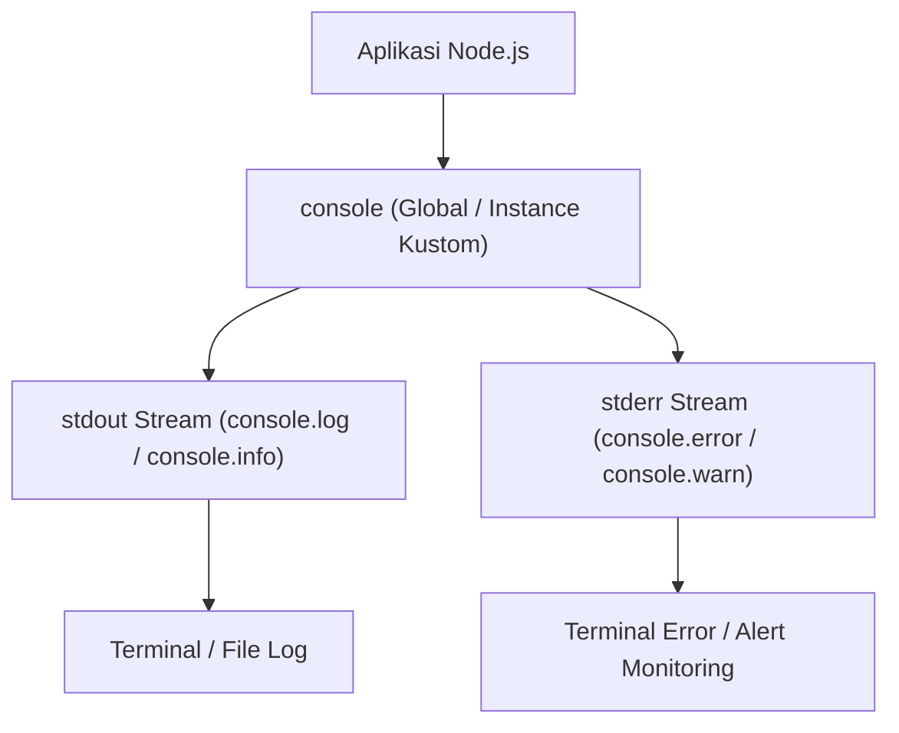

# Console

> Ringkasan
> - Tingkat: Pendukung
> - Fungsi: Menyediakan fungsi diagnostik pencatatan log dan pembuatan instance logger kustom ke stream writable.
> - Digunakan saat: Mencatat riwayat operasional, memantau error runtime, menginspeksi struktur objek data, dan mengarahkan output log ke file atau stream memori independen.
> - Aturan praktis: Gunakan `console.error()` untuk mencatat error kegagalan ke stream `stderr` dan gunakan `new Console({ stdout, stderr })` saat ingin mengalirkan log ke luar terminal bawaan.

## Cheat Sheet

| Tugas | Kode |
| :--- | :--- |
| Menulis log informasi umum ke stream stdout | `console.log("Pesan", data);` |
| Menulis pesan error ke stream stderr | `console.error("Pesan error", err);` |
| Menampilkan data array objek dalam bentuk tabel | `console.table(daftarObjek, ["kolom1"]);` |
| Menghitung frekuensi pemanggilan label | `console.count("nama-label");` |
| Mengatur ulang hitungan frekuensi label | `console.countReset("nama-label");` |
| Menginspeksi struktur objek dengan kedalaman penuh | `console.dir(objek, { depth: null });` |
| Menyiapkan instance Console kustom ke stream target | `const c = new Console({ stdout, stderr });` |

## Tujuan Belajar

- Membedakan stream output standar (`process.stdout`) dan stream error standar (`process.stderr`).
- Menggunakan `console.table()` untuk menampilkan ringkasan data tabular secara rapi di terminal.
- Menginspeksi objek bersarang tanpa pemotongan memakai `console.dir()`.
- Menghitung frekuensi kejadian tertentu memakai `console.count()` dan `console.countReset()`.
- Menyiapkan instance `Console` kustom untuk memisahkan pencatatan audit ke stream writable independen.

## Konsep

Bayangkan sistem papan pengumuman di sebuah bandara internasional. Di ruang tunggu utama, terdapat layar besar umum yang dilihat seluruh pengunjung (objek global `console`). Namun di tiap gerbang keberangkatan dan ruang teknisi bagasi, terpasang layar pemantau khusus (`new Console({ stdout, stderr })`) yang hanya mencatat aktivitas penerbangan di pintu tersebut. Pesan operasional dialirkan ke layar monitor hijau (`stdout`), sedangkan sinyal bahaya dikirim ke sirene merah (`stderr`). Modul `node:console` memberi fleksibilitas serupa untuk membagi alur pencatatan teks ke berbagai tujuan stream secara terpisah.



## Referensi

| Item | Fungsi | Catatan |
| :--- | :--- | :--- |
| `new Console(options)` | Menyiapkan instance Console independen baru | Mengarahkan log ke stream writable target |
| `console.log(...data)` | Menuliskan pesan ke stream stdout diakhiri baris baru | Memformat parameter dengan interpolasi format |
| `console.error(...data)` | Menuliskan pesan ke stream stderr diakhiri baris baru | Dipakai untuk pesan insiden dan kegagalan |
| `console.table(tabularData, properties)` | Menampilkan data array atau objek dalam format tabel | Kolom bisa difilter lewat argumen `properties` |
| `console.dir(item, options)` | Menampilkan representasi objek dengan opsi inspeksi | Mendukung pengaturan kedalaman perataan properti |
| `console.count(label)` | Menghitung dan mencetak berapa kali label dipanggil | Membantu penelusuran frekuensi eksekusi fungsi |
| `console.countReset(label)` | Mengatur ulang penghitung internal untuk label tertentu | Mereset nilai counter kembali ke nol |

### `new Console(options)`

`new Console()` membuat instance logger independen yang menulis pesan ke stream writable kustom, bukan ke terminal global bawaan.

Struktur parameter: `new Console(options)`

- `options` (object, wajib): konfigurasi stream tujuan.
  - `stdout` (WritableStream, wajib): stream tujuan penulisan pesan log dan info.
  - `stderr` (WritableStream, opsional, default: nilai `stdout`): stream tujuan penulisan error.
  - `ignoreErrors` (boolean, opsional, default: `true`): mengabaikan error penulisan saat stream tertutup.
  - `colorMode` (boolean atau string, opsional, default: `'auto'`): menyalakan atau mematikan pewarnaan teks terminal.

Nilai kembalian: instance konsol baru (`Console`).

```javascript
import { Console } from "node:console";
import { PassThrough } from "node:stream";

const out = new PassThrough();
const err = new PassThrough();
const customLogger = new Console({ stdout: out, stderr: err });

customLogger.log("Sistem dimulai");
customLogger.error("Terjadi kegagalan");

console.log(out.read().toString().trim());
// Output: Sistem dimulai
console.log(err.read().toString().trim());
// Output: Terjadi kegagalan
```

Kondisi khusus dan penanganan error: jika `stdout` bukan Writable stream yang valid, pembuatan instance melempar `TypeError [ERR_INVALID_ARG_TYPE]`.

### `console.log(...data)` dan `console.error(...data)`

`console.log()` mengalirkan data ke stream `stdout`, sedangkan `console.error()` mengalirkan data ke stream `stderr`.

Struktur parameter: menerima argumen dinamis `...data` (any, opsional) yang diubah menjadi representasi string.

Nilai kembalian: kedua metode tidak mengembalikan nilai (`undefined`).

```javascript
import { Console } from "node:console";
import { PassThrough } from "node:stream";

const outStream = new PassThrough();
const errStream = new PassThrough();
const c = new Console({ stdout: outStream, stderr: errStream });

c.log("Status: %s", "AKTIF");
c.error("Status: %s", "GAGAL");

console.log(outStream.read().toString().trim());
// Output: Status: AKTIF
console.log(errStream.read().toString().trim());
// Output: Status: GAGAL
```

Kondisi khusus dan penanganan error: kedua metode otomatis menambahkan karakter baris baru (`\n`) di akhir teks yang dicetak.

### `console.table(tabularData, properties)`

`console.table()` memformat array of objects atau objek bertingkat ke dalam bentuk tabel ASCII yang mudah dibaca di terminal.

Struktur parameter: `console.table(tabularData, properties)`

- `tabularData` (array atau object, wajib): data koleksi yang ingin divisualisasikan.
- `properties` (array string, opsional): daftar nama properti yang ingin ditampilkan sebagai kolom.

Nilai kembalian: tidak mengembalikan nilai (`undefined`).

```javascript
const items = [
  { id: 1, name: "Keyboard", price: 250000 },
  { id: 2, name: "Mouse", price: 150000 },
];

console.table(items, ["name"]);
// Output:
// ┌─────────┬────────────┐
// │ (index) │ name       │
// ├─────────┼────────────┤
// │ 0       │ 'Keyboard' │
// │ 1       │ 'Mouse'    │
// └─────────┴────────────┘
```

Kondisi khusus dan penanganan error: jika argumen pertama bukan array atau objek, fungsi mencetak data tersebut layaknya pemanggilan `console.log()` biasa.

### `console.dir(item, options)`

`console.dir()` menginspeksi objek JavaScript dan memformat hierarki propertinya sesuai aturan visualisasi.

Struktur parameter: `console.dir(item, options)`

- `item` (any, wajib): nilai atau objek yang ingin diinspeksi.
- `options` (object, opsional, default: `{}`): konfigurasi inspeksi.
  - `depth` (number atau null, opsional, default: `2`): kedalaman rekursi penelusuran properti objek.
  - `colors` (boolean, opsional, default: `false`): mengaktifkan pewarnaan ANSI di terminal.

Nilai kembalian: tidak mengembalikan nilai (`undefined`).

```javascript
const user = { name: "Budi", profile: { role: "admin" } };
console.dir(user, { colors: false, depth: 1 });
// Output:
// { name: 'Budi', profile: { role: 'admin' } }
```

Kondisi khusus dan penanganan error: jika objek bersarang melebihi batas `depth`, properti terdalam ditampilkan sebagai label ringkas `[Object]`.

### `console.count(label)` dan `console.countReset(label)`

`console.count()` mengelola hitungan berapa kali label tertentu dipanggil, sedangkan `console.countReset()` mengembalikan hitungan ke titik awal.

Struktur parameter: kedua fungsi menerima `label` (string, opsional, default: `'default'`).

Nilai kembalian: kedua metode tidak mengembalikan nilai (`undefined`).

```javascript
console.count("request");
// Output: request: 1
console.count("request");
// Output: request: 2
console.countReset("request");
console.count("request");
// Output: request: 1
```

Kondisi khusus dan penanganan error: jika `console.countReset()` dipanggil untuk label yang belum pernah dihitung, Node.js mencetak pesan peringatan ke `stderr`.

## Kesalahan Umum

### Memakai `console.log()` untuk Mencatat Error Kritis di Produksi

`console.log()` mengirim teks ke file descriptor 1 (`stdout`), sedangkan sistem agregasi log dan container orchestrator mendeteksi peringatan insiden lewat file descriptor 2 (`stderr`). Memakai `console.log()` untuk pesan error membuat sistem monitoring otomatis mengira aplikasi berjalan tanpa masalah.

```javascript
// Salah: log error dialirkan ke jalur stdout biasa
try {
  throw new Error("Koneksi database terputus");
} catch (err) {
  console.log(`[ERROR] ${err.message}`);
}
```

```javascript
// Benar: alirkan insiden kegagalan ke jalur stderr
try {
  throw new Error("Koneksi database terputus");
} catch (err) {
  console.error(`[ERROR] ${err.message}`);
}
```

### Membiarkan Objek Bersarang Dalam Terpotong Menjadi `[Object]`

Secara bawaan `console.log()` hanya menampilkan objek hingga kedalaman dua lapis. Saat menginspeksi konfigurasi bersarang atau payload API yang kompleks, properti penting sering terpotong.

```javascript
// Salah: properti terdalam terpotong saat diinspeksi
const config = { database: { auth: { credentials: { secret: "xyz" } } } };
console.log(config);
// { database: { auth: [Object] } }
```

```javascript
// Benar: gunakan console.dir dengan depth null untuk melihat hierarki utuh
const config = { database: { auth: { credentials: { secret: "xyz" } } } };
console.dir(config, { depth: null });
```

## Studi Kasus

Skenario: Pengelola audit sistem (`AuditLogger`) berbasis instance `Console` kustom yang memisahkan pencatatan riwayat operasional ke buffer audit dan peringatan insiden ke buffer error tanpa membebani terminal global aplikasi.

```javascript
import { Console } from "node:console";
import { PassThrough } from "node:stream";

class AuditLogger {
  constructor() {
    this.auditStream = new PassThrough();
    this.errorStream = new PassThrough();
    this.logger = new Console({
      stdout: this.auditStream,
      stderr: this.errorStream,
      ignoreErrors: true,
    });
  }

  logAction(userId, action, metadata = {}) {
    const entry = JSON.stringify({
      level: "AUDIT",
      userId,
      action,
      metadata,
    });
    this.logger.log(entry);
  }

  logFailure(userId, action, errorMessage) {
    const entry = JSON.stringify({
      level: "ERROR",
      userId,
      action,
      error: errorMessage,
    });
    this.logger.error(entry);
  }

  getAuditLogs() {
    const data = this.auditStream.read();
    return data ? data.toString().trim().split("\n").map(JSON.parse) : [];
  }

  getErrorLogs() {
    const data = this.errorStream.read();
    return data ? data.toString().trim().split("\n").map(JSON.parse) : [];
  }
}

const audit = new AuditLogger();
audit.logAction("user-101", "LOGIN", { ip: "127.0.0.1" });
audit.logFailure("user-102", "PAYMENT", "Saldo tidak mencukupi");

const auditEntries = audit.getAuditLogs();
const errorEntries = audit.getErrorLogs();

console.log(auditEntries.length);
// Output: 1
console.log(auditEntries[0].action);
// Output: LOGIN
console.log(errorEntries.length);
// Output: 1
console.log(errorEntries[0].error);
// Output: Saldo tidak mencukupi
```

Pola ini menjaga isolasi alur data audit sehingga riwayat penting dapat disimpan ke media penyimpanan terpisah secara asinkron.

## Latihan Mandiri

Buat fungsi `createBufferedLogger(stdoutStream, stderrStream, options = {})` untuk mengelola instance pencatatan pesan terisolasi.

- **Level 1 (Dasar):** Siapkan instance `Console` kustom yang menyalurkan `stdout` ke `stdoutStream` dan `stderr` ke `stderrStream`. Kembalikan objek pembungkus dengan metode `info(message)` (menulis `[INFO] pesan` ke `stdout`) dan `error(message)` (menulis `[ERROR] pesan` ke `stderr`).
- **Level 2 (Menengah):** Tambahkan metode `table(data, columns)` yang mendelegasikan pemformatan ke instance console kustom, serta metode `count(label)` untuk memantau frekuensi penanda.
- **Level 3 (Menantang):** Dukung opsi `options.minLevel` (default: `"INFO"`). Jika `options.minLevel === "ERROR"`, panggilan `info()` harus diabaikan dan tidak menulis apa pun ke stream `stdout`. Jika opsi `options.strictMode` bernilai `true` sementara salah satu stream tidak writable atau tidak tersedia, lempar `Error("Stream tujuan logger tidak valid")`.

Contoh input dan output normal:

```javascript
import { PassThrough } from "node:stream";

const outStream = new PassThrough();
const errStream = new PassThrough();

const logger = createBufferedLogger(outStream, errStream);
logger.info("Server siap");
logger.error("Database gagal");

console.log(outStream.read().toString().trim());
// Output: [INFO] Server siap
console.log(errStream.read().toString().trim());
// Output: [ERROR] Database gagal
```

Contoh filter level dan mode ketat:

```javascript
import { PassThrough } from "node:stream";

const outFiltered = new PassThrough();
const errFiltered = new PassThrough();
const errorOnlyLogger = createBufferedLogger(outFiltered, errFiltered, { minLevel: "ERROR" });

errorOnlyLogger.info("Pesan diabaikan");
errorOnlyLogger.error("Pesan error penting");

console.log(outFiltered.read());
// Output: null
console.log(errFiltered.read().toString().trim());
// Output: [ERROR] Pesan error penting

try {
  createBufferedLogger(null, errFiltered, { strictMode: true });
} catch (err) {
  console.log(err.message);
  // Output: Stream tujuan logger tidak valid
}
```

Tanda selesai:
- [ ] Pesan info dialirkan ke `stdout` dengan prefix label `[INFO]`.
- [ ] Pesan error dialirkan ke `stderr` dengan prefix label `[ERROR]`.
- [ ] Pemfilteran `minLevel: "ERROR"` mengabaikan pencatatan info tanpa menulis ke stream.
- [ ] Opsi `strictMode` melempar error saat stream tujuan tidak valid.
- [ ] Seluruh contoh kode teruji tanpa error syntax atau output yang meleset.

---

## Navigasi

[Sebelumnya: Readline](../16-readline/README.md) | [Selanjutnya: Child Process](../18-child-process/README.md) | [Daftar Isi](../README.md)
