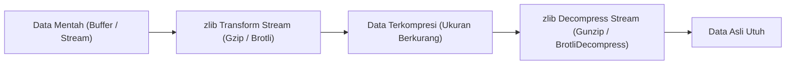

# Zlib

> Ringkasan
>
> - Fungsi: Mengompresi dan mendekompresi data biner maupun teks menggunakan algoritma standar industri seperti Gzip, Deflate, dan Brotli.
> - Digunakan saat: Mengurangi ukuran payload respons HTTP, membuat berkas arsip cadangan, menghemat kapasitas disk untuk berkas log, atau mentransfer data besar lewat stream.
> - Aturan praktis: Gunakan Transform Stream bersama `node:stream/promises` (`pipeline`) untuk memproses data berukuran besar agar terhindar dari lonjakan memori RAM, dan hindari pemanggilan fungsi sinkron di dalam server produksi.

---

## Tujuan Belajar

- Mengenal perbedaan karakteristik algoritma kompresi Gzip, Deflate, dan Brotli di Node.js.
- Mengompresi dan mendekompresi data buffer menggunakan fungsi sinkron dan asinkron.
- Memanfaatkan _Transform Stream_ kompresi bersama `node:stream/promises` untuk pengolahan aliran data yang hemat memori.
- Menangani error data rusak (_corrupted payload_) saat proses dekompresi berlangsung.
- Membangun utilitas pemilihan kompresi otomatis berdasarkan header _Accept-Encoding_.

---

## Konsep

Modul `node:zlib` bisa kita bayangkan seperti kantong plastik vakum pakaian saat kita hendak bepergian. Koper pakaian kita memiliki ruang simpan yang terbatas (seperti kapasitas hard disk atau bandwidth internet).

Sebelum memasukkan jaket tebal dan selimut (data teks berukuran besar), kita memasukkannya dulu ke dalam kantong plastik vakum, lalu menyedot udaranya sampai volumenya mengecil drastis (_kompresi_). Begitu sampai di hotel tujuan, kantong dibuka kembali sehingga pakaian mengembang utuh ke bentuk semula tanpa ada bagian yang rusak atau hilang (_dekompresi lossless_).



---

## Referensi

| Item                         | Fungsi                                                               | Catatan                                                                    |
| :--------------------------- | :------------------------------------------------------------------- | :------------------------------------------------------------------------- |
| **`gzipSync()`**             | Mengompresi data buffer menggunakan algoritma Gzip secara sinkron    | Memblokir thread utama, cocok untuk skrip sederhana atau inisialisasi awal |
| **`gunzipSync()`**           | Mendekompresi buffer berformat Gzip kembali ke bentuk semula         | Melempar error `Z_DATA_ERROR` jika struktur data biner tidak valid         |
| **`brotliCompressSync()`**   | Mengompresi data buffer menggunakan algoritma Brotli secara sinkron  | Menghasilkan rasio pengecilan ukuran yang lebih rapat untuk konten teks    |
| **`brotliDecompressSync()`** | Mendekompresi buffer berformat Brotli secara sinkron                 | Membutuhkan input struktur biner Brotli yang sah                           |
| **`deflateSync()`**          | Mengompresi data buffer menggunakan algoritma Deflate secara sinkron | Menghasilkan kompresi data mentah tanpa pembungkus header Gzip penuh       |
| **`inflateSync()`**          | Mendekompresi buffer berformat Deflate secara sinkron                | Mengembalikan muatan kompresi Deflate ke data aslinya                      |
| **`createGzip()`**           | Membuat Transform Stream untuk kompresi data Gzip                    | Sangat pas dihubungkan ke stream berkas atau soket HTTP via pipeline       |
| **`createGunzip()`**         | Membuat Transform Stream untuk mendekompresi data Gzip               | Mengurai potongan biner bertahap tanpa memuat seluruh file ke RAM          |
| **`createBrotliCompress()`** | Membuat Transform Stream untuk kompresi data Brotli                  | Mendukung pengaturan parameter kualitas kompresi tingkat lanjut            |

### `gzipSync()`

Fungsi `gzipSync()` digunakan untuk memampatkan data buffer menggunakan algoritma Gzip secara langsung dan mengunci jalannya kode sampai proses kompresi selesai. Fungsi ini biasanya dimanfaatkan pada skrip CLI atau operasi satu kali saat aplikasi pertama kali melakukan _bootstrapping_.

```javascript
import zlib from "node:zlib";

const text = "Learning data compression in Node.js. ".repeat(20);
const sourceBuffer = Buffer.from(text, "utf-8");
const gzipResult = zlib.gzipSync(sourceBuffer);

console.log(sourceBuffer.length);
// Output: 760
console.log(gzipResult.length < sourceBuffer.length);
// Output: true
```

Kasus lain: Mengompresi string teks kosong tetap menghasilkan buffer Gzip berukuran sekitar 20 byte karena menyertakan metadata header dan checksum.

```javascript
import zlib from "node:zlib";

const emptyBuffer = zlib.gzipSync(Buffer.from(""));
console.log(emptyBuffer.length);
// Output: 20
```

### `gunzipSync()`

Fungsi `gunzipSync()` digunakan untuk mengembalikan data biner yang sebelumnya dipadatkan dengan Gzip kembali ke format aslinya secara sinkron. Fungsi ini umum dipakai saat membaca berkas konfigurasi terkompresi dari penyimpanan lokal.

```javascript
import zlib from "node:zlib";

const message = "Server secret payload";
const compressed = zlib.gzipSync(Buffer.from(message));
const decompressed = zlib.gunzipSync(compressed).toString("utf-8");

console.log(decompressed);
// Output: Server secret payload
```

Kasus lain: Menangani error saat mencoba mendekompresi data biner acak yang tidak memiliki header Gzip yang sah.

```javascript
import zlib from "node:zlib";

try {
  zlib.gunzipSync(Buffer.from("invalid gzip data"));
} catch (error) {
  console.log(error.code);
  // Output: Z_DATA_ERROR
}
```

### `brotliCompressSync()`

Fungsi `brotliCompressSync()` digunakan untuk memadatkan buffer data menggunakan algoritma Brotli yang dirancang khusus untuk web modern. Fungsi ini umumnya menghasilkan ukuran berkas yang lebih kecil dibanding Gzip untuk teks berulang.

```javascript
import zlib from "node:zlib";

const webContent = "<html><body><h1>Welcome Home</h1></body></html>".repeat(10);
const brotliResult = zlib.brotliCompressSync(Buffer.from(webContent));

console.log(brotliResult.length < Buffer.byteLength(webContent));
// Output: true
```

Kasus lain: Menyesuaikan tingkat kualitas kompresi melalui opsi konfigurasi.

```javascript
import zlib from "node:zlib";

const customText = "Custom Brotli Options ".repeat(15);
const customResult = zlib.brotliCompressSync(Buffer.from(customText), {
  params: {
    [zlib.constants.BROTLI_PARAM_QUALITY]: 4,
  },
});

console.log(customResult.length > 0);
// Output: true
```

### `brotliDecompressSync()`

Fungsi `brotliDecompressSync()` digunakan untuk mendekompresi data biner berformat Brotli kembali ke bentuk buffer aslinya secara sinkron.

```javascript
import zlib from "node:zlib";

const textData = "Encrypted user profile information";
const compressed = zlib.brotliCompressSync(Buffer.from(textData));
const restored = zlib.brotliDecompressSync(compressed).toString("utf-8");

console.log(restored);
// Output: Encrypted user profile information
```

Kasus lain: Menangkap kegagalan dekompresi jika struktur data Brotli mengalami kerusakan di tengah jalan.

```javascript
import zlib from "node:zlib";

try {
  zlib.brotliDecompressSync(Buffer.from("corrupted payload"));
} catch (error) {
  console.log(typeof error.code);
  // Output: string
}
```

### `deflateSync()`

Fungsi `deflateSync()` digunakan untuk mengompresi data buffer menggunakan format Deflate standar tanpa pembungkus header Gzip tambahan. Fungsi ini sering digunakan pada paket komunikasi jaringan biner ringan atau format berkas seperti ZIP dan PNG.

```javascript
import zlib from "node:zlib";

const source = Buffer.from("Background queue message payload ".repeat(10));
const deflated = zlib.deflateSync(source);

console.log(deflated.length < source.length);
// Output: true
```

Kasus lain: Memeriksa header biner Deflate yang biasanya diawali byte penanda zlib wrapper (`0x78`).

```javascript
import zlib from "node:zlib";

const result = zlib.deflateSync(Buffer.from("Hello"));
console.log(result[0]);
// Output: 120
```

### `inflateSync()`

Fungsi `inflateSync()` digunakan untuk mengekstrak kembali data biner yang sebelumnya dikompresi menggunakan `deflateSync()`.

```javascript
import zlib from "node:zlib";

const original = "Deflate integrity verification string";
const compressed = zlib.deflateSync(Buffer.from(original));
const restored = zlib.inflateSync(compressed).toString("utf-8");

console.log(restored);
// Output: Deflate integrity verification string
```

Kasus lain: Melempar error ketika diberi buffer kosong yang tidak memiliki struktur kompresi Deflate.

```javascript
import zlib from "node:zlib";

try {
  zlib.inflateSync(Buffer.from(""));
} catch (error) {
  console.log(error.code);
  // Output: Z_BUF_ERROR
}
```

### `createGzip()`

Fungsi `createGzip()` membuat Transform Stream yang menerima potongan data dan menghasilkan aliran data terkompresi Gzip secara bertahap. Pendekatan stream ini mencegah lonjakan memori saat memproses berkas besar.

```javascript
import { createGzip } from "node:zlib";
import { Readable } from "node:stream";
import { pipeline } from "node:stream/promises";

const sourceStream = Readable.from(["Log line 1\n", "Log line 2\n"]);
const compressor = createGzip();
const chunks = [];

compressor.on("data", (chunk) => chunks.push(chunk));
await pipeline(sourceStream, compressor);

const totalBinary = Buffer.concat(chunks);
console.log(totalBinary.length > 0);
// Output: true
```

Kasus lain: Menghentikan stream dengan memancarkan sinyal error jika stream sumber mengalami kegagalan.

```javascript
import { createGzip } from "node:zlib";
import { Readable } from "node:stream";
import { pipeline } from "node:stream/promises";

const brokenStream = new Readable({
  read() {
    this.destroy(new Error("Disk read failure"));
  },
});

try {
  await pipeline(brokenStream, createGzip());
} catch (error) {
  console.log(error.message);
  // Output: Disk read failure
}
```

### `createGunzip()`

Fungsi `createGunzip()` membuat Transform Stream untuk mendekompresi aliran data biner Gzip secara bertahap, sangat cocok disambungkan ke stream jaringan atau pembacaan berkas disk berukuran raksasa.

```javascript
import { createGzip, createGunzip } from "node:zlib";
import { Readable } from "node:stream";
import { pipeline } from "node:stream/promises";

const textData = "Continuous streaming data pipeline";
const source = Readable.from([Buffer.from(textData)]);
const compressor = createGzip();
const decompressor = createGunzip();
const chunks = [];

decompressor.on("data", (chunk) => chunks.push(chunk));
await pipeline(source, compressor, decompressor);

console.log(Buffer.concat(chunks).toString("utf-8"));
// Output: Continuous streaming data pipeline
```

Kasus lain: Menangani aliran data biner parsial yang terputus di tengah proses streaming.

```javascript
import { createGunzip } from "node:zlib";
import { Readable, PassThrough } from "node:stream";
import { pipeline } from "node:stream/promises";

const partialStream = Readable.from([Buffer.from([0x1f, 0x8b, 0x08])]);
const destination = new PassThrough();

try {
  await pipeline(partialStream, createGunzip(), destination);
} catch (error) {
  console.log(error.code);
  // Output: Z_BUF_ERROR
}
```

### `createBrotliCompress()`

Fungsi `createBrotliCompress()` membuat Transform Stream untuk mengompresi data dengan format Brotli. Cara ini menjadi standar modern saat menyajikan aset web atau respons streaming HTTP melalui koneksi aman HTTPS.

```javascript
import { createBrotliCompress } from "node:zlib";
import { Readable } from "node:stream";
import { pipeline } from "node:stream/promises";

const source = Readable.from(["JSON payload from database"]);
const brotliStream = createBrotliCompress();
const chunks = [];

brotliStream.on("data", (chunk) => chunks.push(chunk));
await pipeline(source, brotliStream);

console.log(Buffer.concat(chunks).length > 0);
// Output: true
```

Kasus lain: Menggunakan konstanta mode teks untuk mengoptimalkan kamus internal Brotli.

```javascript
import { createBrotliCompress, constants } from "node:zlib";

const customStream = createBrotliCompress({
  params: {
    [constants.BROTLI_PARAM_MODE]: constants.BROTLI_MODE_TEXT,
  },
});

console.log(typeof customStream.pipe);
// Output: function
```

### Perbandingan: Gzip vs Brotli

| Karakteristik        | Gzip                                             | Brotli                                                   |
| :------------------- | :----------------------------------------------- | :------------------------------------------------------- |
| **Algoritma Dasar**  | Deflate (LZ77 + Huffman Coding)                  | LZ77 + Huffman + _Static Dictionary_ 120 KB              |
| **Kecepatan Proses** | Sangat cepat dengan penggunaan CPU hemat         | Lebih lambat di level tertinggi, efisien di level sedang |
| **Rasio Pengecilan** | Rata-rata 60% hingga 75% pada data teks          | Rata-rata 70% hingga 85% pada data teks                  |
| **Dukungan Klien**   | Didukung di hampir seluruh perangkat dan browser | Didukung di seluruh browser modern via HTTPS             |

---

## Kesalahan Umum

### Memanggil Fungsi Sinkron di Server Berbeban Tinggi

Memanggil fungsi seperti `gzipSync()` di dalam rute penanganan server HTTP akan membekukan Event Loop hingga kompresi selesai, membuat pengguna lain terpaksa menunggu giliran.

```javascript
// Salah
import zlib from "node:zlib";

function handleRequest(res, largeData) {
  const compressed = zlib.gzipSync(Buffer.from(largeData));
  res.end(compressed);
}
```

```javascript
// Benar
import { createGzip } from "node:zlib";
import { pipeline } from "node:stream/promises";
import { Readable } from "node:stream";

async function handleRequest(res, largeData) {
  res.setHeader("Content-Encoding", "gzip");
  await pipeline(Readable.from(largeData), createGzip(), res);
}
```

### Mengompresi Berkas yang Memang Sudah Terkompresi

Mencoba memampatkan berkas biner yang sudah terkompresi secara alami (seperti foto JPEG/PNG, video MP4, atau arsip ZIP) hanya akan membuang tenaga CPU secara sia-sia, bahkan terkadang ukuran akhirnya bertambah besar karena tambahan metadata header.

```javascript
// Salah
import zlib from "node:zlib";

function compressAsset(jpegBuffer) {
  return zlib.gzipSync(jpegBuffer);
}
```

```javascript
// Benar
import zlib from "node:zlib";

function compressAsset(dataBuffer, mimeType) {
  const skippedTypes = [
    "image/jpeg",
    "image/png",
    "video/mp4",
    "application/zip",
  ];
  if (skippedTypes.includes(mimeType)) {
    return dataBuffer;
  }
  return zlib.gzipSync(dataBuffer);
}
```

### Lupa Menangkap Error Saat Mendekompresi Data

Data terkompresi yang terpotong di tengah transmisi atau mengalami kerusakan biner akan memicu error internal zlib. Membiarkannya tanpa blok `try...catch` dapat menyebabkan aplikasi langsung terhenti paksa.

```javascript
// Salah
import zlib from "node:zlib";

function unpackPayload(inputBuffer) {
  return zlib.gunzipSync(inputBuffer).toString("utf-8");
}
```

```javascript
// Benar
import zlib from "node:zlib";

function unpackPayload(inputBuffer) {
  try {
    return zlib.gunzipSync(inputBuffer).toString("utf-8");
  } catch (error) {
    if (error.code === "Z_DATA_ERROR" || error.code === "Z_BUF_ERROR") {
      return null;
    }
    throw error;
  }
}
```

---

## Studi Kasus

Skenario: Membangun fungsi pengolah payload respons HTTP mandiri (_response payload compressor_) yang menegosiasikan algoritma kompresi terbaik secara otomatis berdasarkan nilai header `Accept-Encoding` dari browser klien. Jika klien mendukung Brotli (`br`), utamakan Brotli. Jika hanya mendukung `gzip`, gunakan Gzip. Jika tidak mendukung keduanya, kembalikan data apa adanya tanpa kompresi.

```javascript
import zlib from "node:zlib";

function negotiateCompression(payloadText, acceptEncodingHeader = "") {
  const sourceBuffer = Buffer.from(payloadText, "utf-8");
  const encodings = acceptEncodingHeader
    .toLowerCase()
    .split(",")
    .map((item) => item.trim());

  if (encodings.includes("br")) {
    const compressed = zlib.brotliCompressSync(sourceBuffer, {
      params: {
        [zlib.constants.BROTLI_PARAM_QUALITY]: 4,
      },
    });
    return {
      encoding: "br",
      buffer: compressed,
      originalSize: sourceBuffer.length,
      compressedSize: compressed.length,
    };
  }

  if (encodings.includes("gzip")) {
    const compressed = zlib.gzipSync(sourceBuffer);
    return {
      encoding: "gzip",
      buffer: compressed,
      originalSize: sourceBuffer.length,
      compressedSize: compressed.length,
    };
  }

  return {
    encoding: "identity",
    buffer: sourceBuffer,
    originalSize: sourceBuffer.length,
    compressedSize: sourceBuffer.length,
  };
}

const payload = JSON.stringify({ user: "Admin", role: "Superuser" }).repeat(10);

const brotliResponse = negotiateCompression(payload, "gzip, deflate, br");
console.log(brotliResponse.encoding);
// Output: br
console.log(brotliResponse.compressedSize < brotliResponse.originalSize);
// Output: true

const gzipResponse = negotiateCompression(payload, "gzip, deflate");
console.log(gzipResponse.encoding);
// Output: gzip

const plainResponse = negotiateCompression(payload, "");
console.log(plainResponse.encoding);
// Output: identity
console.log(plainResponse.compressedSize === plainResponse.originalSize);
// Output: true
```

Pola ini mengutamakan algoritma dengan rasio kompresi terbaik (Brotli) sebelum Gzip sesuai standar HTTP RFC 7231, sekaligus menyediakan opsi aman tanpa kompresi (_identity_) jika klien tidak memiliki kemampuan dekompresi.

---

## Latihan Mandiri

### Soal 1 (Dasar)

Buat fungsi `calculateSavings(dataString)` yang menghitung rasio penghematan kompresi Gzip. Fungsi harus mengembalikan objek berisi ukuran byte asli (`originalBytes`), ukuran setelah dikompresi dengan `gzipSync` (`compressedBytes`), dan persentase penghematan ukuran (`savingsPercent`) yang dibulatkan hingga dua angka di belakang koma dengan simbol `%`.

Contoh input:

```javascript
calculateSavings("Mastering Node.js Zlib in depth! ".repeat(20));
```

Contoh output yang diharapkan:

```javascript
{
  originalBytes: 660,
  compressedBytes: 60,
  savingsPercent: '90.91%'
}
```

Batasan: Gunakan modul bawaan `node:zlib` tanpa paket tambahan dari luar.

### Soal 2 (Menengah)

Buat fungsi asinkron `archiveBatchStreaming(messages, algorithm)` yang menerima array string dan parameter string algoritma (`'gzip'` atau `'brotli'`). Alirkan seluruh teks tersebut melalui Readable Stream, kompresi menggunakan Transform Stream yang sesuai (`createGzip` atau `createBrotliCompress`), dan kembalikan hasil akhirnya dalam bentuk satu objek Buffer gabungan utuh.

Contoh input:

```javascript
await archiveBatchStreaming(["log line one\n", "log line two\n"], "gzip");
```

Contoh output yang diharapkan:

```javascript
<Buffer 1f 8b 08 ...>
```

Batasan: Gunakan fungsi `pipeline` dari `node:stream/promises` bersama modul `node:stream` dan `node:zlib`.

### Soal 3 (Menantang)

Buat utilitas pengurai data terkompresi yang tahan terhadap serangan bom dekompresi (_decompression bomb protector_) bernama `safeDecompress(inputBuffer, format, maxByteLimit)`. Utilitas ini harus memeriksa format input (`'gzip'` atau `'deflate'`), menjalankan dekompresi secara bertahap menggunakan Transform Stream, dan menghitung akumulasi byte yang keluar secara bertahap.

Ketentuan penanganan kasus khusus:

- Jika selama proses dekompresi total byte output melebihi `maxByteLimit`, segera hentikan dan hancurkan (_destroy_) stream yang terlibat lalu kembalikan objek `{ status: 'failure', reason: 'MAX_SIZE_EXCEEDED' }`.
- Jika data input rusak atau format biner tidak sesuai dengan parameter `format`, tangkap error-nya dan kembalikan objek `{ status: 'failure', reason: 'INVALID_FORMAT' }`.
- Jika proses berhasil dan ukurannya aman dalam batas wajar, kembalikan objek `{ status: 'success', text: '<content>', totalBytes: <count> }`.

Contoh input 1 (kasus sukses):

```javascript
import zlib from "node:zlib";
const payload = zlib.gzipSync(Buffer.from("A".repeat(500)));
await safeDecompress(payload, "gzip", 1000);
```

Contoh output 1:

```javascript
{
  status: 'success',
  text: 'AAAAAAAAAAAAAAAA...',
  totalBytes: 500
}
```

Contoh input 2 (kasus melampaui batas byte):

```javascript
import zlib from "node:zlib";
const bombPayload = zlib.gzipSync(Buffer.from("A".repeat(5000)));
await safeDecompress(bombPayload, "gzip", 100);
```

Contoh output 2:

```javascript
{
  status: 'failure',
  reason: 'MAX_SIZE_EXCEEDED'
}
```

Contoh input 3 (kasus data rusak):

```javascript
await safeDecompress(Buffer.from("corrupted random data"), "gzip", 1000);
```

Contoh output 3:

```javascript
{
  status: 'failure',
  reason: 'INVALID_FORMAT'
}
```

Batasan: Wajib menggunakan Transform Stream untuk mencegah pembengkakan memori mendadak di heap V8. Dilarang menggunakan paket eksternal dari NPM.

---

## Navigasi

[Sebelumnya: Worker Threads](../16-worker-threads/README.md) | [Selanjutnya: Readline](../18-readline/README.md) | [Daftar Isi](../README.md)
