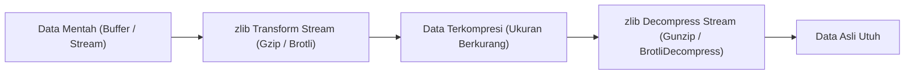

# Zlib

> Ringkasan
> - Fungsi: Mengompresi dan mendekompresi data biner atau teks menggunakan algoritma standar seperti Gzip, Deflate, dan Brotli.
> - Digunakan saat: Mengurangi ukuran payload respons HTTP, mengarsipkan berkas cadangan, menghemat ruang penyimpanan log, atau mentransfer data besar melalui stream.
> - Aturan praktis: Gunakan Transform Stream bersama `stream/promises.pipeline` untuk memproses data berukuran besar agar terhindar dari lonjakan penggunaan memori heap, dan hindari pemanggilan metode sinkron di dalam server produksi.

---

## Tujuan Belajar

- Mengidentifikasi perbedaan algoritma kompresi Gzip, Deflate, dan Brotli pada Node.js.
- Mengompresi dan mendekompresi buffer data menggunakan fungsi sinkron dan asinkron.
- Menerapkan _Transform Stream_ kompresi dengan `node:stream/promises` untuk penanganan aliran data secara efisien.
- Menangani galat data rusak (_corrupted payload_) saat proses dekompresi.
- Membangun utilitas pemilihan kompresi otomatis berdasarkan header _Accept-Encoding_.

---

## Konsep

> Modul `node:zlib` dianalogikan seperti kantong plastik vakum pakaian saat bepergian. Koper memiliki kapasitas muat terbatas (bandwidth jaringan atau ruang disk). Sebelum memasukkan pakaian tebal (data teks berukuran besar), pakaian dimasukkan ke dalam kantong vakum lalu udaranya disedot hingga volumenya mengecil drastis (_kompresi_). Ketika pakaian sampai di tujuan, kantong dibuka kembali sehingga pakaian mengembang ke bentuk semula tanpa mengalami kerusakan (_dekompresi lossless_).



---

## Referensi

| Item | Fungsi | Catatan |
| :--- | :--- | :--- |
| **`gzipSync()`** | Mengompresi buffer data menggunakan algoritma Gzip secara sinkron | Memblokir thread utama, cocok untuk skrip sederhana atau inisialisasi awal |
| **`gunzipSync()`** | Mendekompresi buffer data berformat Gzip secara sinkron | Melempar galat `Z_DATA_ERROR` jika format biner data tidak valid |
| **`brotliCompressSync()`** | Mengompresi buffer data menggunakan algoritma Brotli secara sinkron | Memberikan rasio reduksi ukuran lebih rapat untuk konten teks |
| **`brotliDecompressSync()`** | Mendekompresi buffer data berformat Brotli secara sinkron | Membutuhkan input stream struktur biner Brotli yang valid |
| **`deflateSync()`** | Mengompresi buffer data menggunakan algoritma Deflate secara sinkron | Menghasilkan kompresi data mentah tanpa header pembungkus Gzip penuh |
| **`inflateSync()`** | Mendekompresi buffer data berformat Deflate secara sinkron | Mengembalikan payload hasil kompresi Deflate ke data aslinya |
| **`createGzip()`** | Membuat instance Transform Stream untuk kompresi data Gzip | Ideal disambungkan ke stream berkas atau soket HTTP via pipeline |
| **`createGunzip()`** | Membuat instance Transform Stream untuk dekompresi data Gzip | Mengurai chunk biner secara bertahap tanpa memuat seluruh file ke RAM |
| **`createBrotliCompress()`** | Membuat instance Transform Stream untuk kompresi data Brotli | Mendukung penyesuaian parameter kualitas kompresi tingkat lanjut |

### `gzipSync()`

Fungsi `gzipSync()` digunakan untuk memadatkan buffer data menggunakan algoritma Gzip secara langsung dan memblokir eksekusi hingga proses selesai. Fungsi ini biasanya dimanfaatkan pada skrip CLI atau operasi satu kali saat aplikasi pertama kali melakukan _bootstrapping_.

```javascript
import zlib from 'node:zlib';

const text = 'Learning data compression in Node.js. '.repeat(20);
const sourceBuffer = Buffer.from(text, 'utf-8');
const gzipResult = zlib.gzipSync(sourceBuffer);

console.log(sourceBuffer.length);
// Output: 760
console.log(gzipResult.length < sourceBuffer.length);
// Output: true
```

Kasus lain: Mengompresi string kosong tetap menghasilkan buffer Gzip berukuran sekitar 20 byte karena menyertakan metadata header dan checksum.

```javascript
import zlib from 'node:zlib';

const emptyBuffer = zlib.gzipSync(Buffer.from(''));
console.log(emptyBuffer.length);
// Output: 20
```

### `gunzipSync()`

Fungsi `gunzipSync()` digunakan untuk mengembalikan data biner yang sebelumnya dikompresi dengan Gzip ke format aslinya secara sinkron. Fungsi ini umum dipakai saat membaca arsip konfigurasi terkompresi dari disk.

```javascript
import zlib from 'node:zlib';

const message = 'Server secret payload';
const compressed = zlib.gzipSync(Buffer.from(message));
const decompressed = zlib.gunzipSync(compressed).toString('utf-8');

console.log(decompressed);
// Output: Server secret payload
```

Kasus lain: Menangani galat ketika mencoba mendekompresi buffer biner acak yang tidak memiliki header Gzip sah.

```javascript
import zlib from 'node:zlib';

try {
  zlib.gunzipSync(Buffer.from('invalid gzip data'));
} catch (error) {
  console.log(error.code);
  // Output: Z_DATA_ERROR
}
```

### `brotliCompressSync()`

Fungsi `brotliCompressSync()` digunakan untuk mengompresi buffer data menggunakan algoritma Brotli yang dioptimalkan untuk konten web modern. Fungsi ini menghasilkan ukuran berkas lebih kecil dibanding Gzip untuk teks berulang.

```javascript
import zlib from 'node:zlib';

const webContent = '<html><body><h1>Welcome Home</h1></body></html>'.repeat(10);
const brotliResult = zlib.brotliCompressSync(Buffer.from(webContent));

console.log(brotliResult.length < Buffer.byteLength(webContent));
// Output: true
```

Kasus lain: Mengatur opsi kualitas kompresi melalui parameter konfigurasi.

```javascript
import zlib from 'node:zlib';

const customText = 'Custom Brotli Options '.repeat(15);
const customResult = zlib.brotliCompressSync(Buffer.from(customText), {
  params: {
    [zlib.constants.BROTLI_PARAM_QUALITY]: 4,
  },
});

console.log(customResult.length > 0);
// Output: true
```

### `brotliDecompressSync()`

Fungsi `brotliDecompressSync()` digunakan untuk mendekompresi payload biner yang dikompresi menggunakan algoritma Brotli kembali ke buffer aslinya. Fungsi ini dipakai saat memproses tanggapan API eksternal yang dienkode dengan Brotli.

```javascript
import zlib from 'node:zlib';

const textData = 'Encrypted user profile information';
const compressed = zlib.brotliCompressSync(Buffer.from(textData));
const restored = zlib.brotliDecompressSync(compressed).toString('utf-8');

console.log(restored);
// Output: Encrypted user profile information
```

Kasus lain: Menangkap kegagalan dekompresi jika format stream Brotli mengalami kerusakan data.

```javascript
import zlib from 'node:zlib';

try {
  zlib.brotliDecompressSync(Buffer.from('corrupted payload'));
} catch (error) {
  console.log(typeof error.code);
  // Output: string
}
```

### `deflateSync()`

Fungsi `deflateSync()` digunakan untuk mengompresi buffer data menggunakan spesifikasi RFC 1951 Deflate standar tanpa header Gzip tambahan. Fungsi ini sering dipakai pada protokol komunikasi jaringan biner ringan atau format berkas seperti ZIP dan PNG.

```javascript
import zlib from 'node:zlib';

const source = Buffer.from('Background queue message payload '.repeat(10));
const deflated = zlib.deflateSync(source);

console.log(deflated.length < source.length);
// Output: true
```

Kasus lain: Memeriksa header biner Deflate yang biasanya diawali byte penanda zlib wrapper (`0x78`).

```javascript
import zlib from 'node:zlib';

const result = zlib.deflateSync(Buffer.from('Hello'));
console.log(result[0]);
// Output: 120
```

### `inflateSync()`

Fungsi `inflateSync()` digunakan untuk mengekstrak kembali data biner yang dikompresi menggunakan `deflateSync()`. Fungsi ini melengkapi pemrosesan paket biner protokol kustom.

```javascript
import zlib from 'node:zlib';

const original = 'Deflate integrity verification string';
const compressed = zlib.deflateSync(Buffer.from(original));
const restored = zlib.inflateSync(compressed).toString('utf-8');

console.log(restored);
// Output: Deflate integrity verification string
```

Kasus lain: Melempar galat ketika diberi buffer kosong yang tidak memiliki struktur kompresi Deflate.

```javascript
import zlib from 'node:zlib';

try {
  zlib.inflateSync(Buffer.from(''));
} catch (error) {
  console.log(error.code);
  // Output: Z_BUF_ERROR
}
```

### `createGzip()`

Fungsi `createGzip()` membuat instance Transform Stream yang menerima potongan data dan mengeluarkan potongan data terkompresi Gzip secara asinkron. Pendekatan stream ini mencegah lonjakan memori saat memproses berkas multi-megabyte.

```javascript
import { createGzip } from 'node:zlib';
import { Readable } from 'node:stream';
import { pipeline } from 'node:stream/promises';

const sourceStream = Readable.from(['Log line 1\n', 'Log line 2\n']);
const compressor = createGzip();
const chunks = [];

compressor.on('data', (chunk) => chunks.push(chunk));
await pipeline(sourceStream, compressor);

const totalBinary = Buffer.concat(chunks);
console.log(totalBinary.length > 0);
// Output: true
```

Kasus lain: Menghentikan stream dengan memancarkan sinyal error jika stream sumber mengalami kegagalan.

```javascript
import { createGzip } from 'node:zlib';
import { Readable } from 'node:stream';
import { pipeline } from 'node:stream/promises';

const brokenStream = new Readable({
  read() {
    this.destroy(new Error('Disk read failure'));
  },
});

try {
  await pipeline(brokenStream, createGzip());
} catch (error) {
  console.log(error.message);
  // Output: Disk read failure
}
```

### `createGunzip()`

Fungsi `createGunzip()` membuat instance Transform Stream untuk mendekompresi aliran data biner Gzip secara bertahap. Fungsi ini digunakan bersama stream pembacaan jaringan atau pembacaan berkas disk berukuran besar.

```javascript
import { createGzip, createGunzip } from 'node:zlib';
import { Readable } from 'node:stream';
import { pipeline } from 'node:stream/promises';

const textData = 'Continuous streaming data pipeline';
const source = Readable.from([Buffer.from(textData)]);
const compressor = createGzip();
const decompressor = createGunzip();
const chunks = [];

decompressor.on('data', (chunk) => chunks.push(chunk));
await pipeline(source, compressor, decompressor);

console.log(Buffer.concat(chunks).toString('utf-8'));
// Output: Continuous streaming data pipeline
```

Kasus lain: Menangani aliran chunk biner parsial yang terputus di tengah proses streaming.

```javascript
import { createGunzip } from 'node:zlib';
import { Readable, PassThrough } from 'node:stream';
import { pipeline } from 'node:stream/promises';

const partialStream = Readable.from([Buffer.from([0x1f, 0x8b, 0x08])]);
const destination = new PassThrough();

try {
  await pipeline(partialStream, createGunzip(), destination);
} catch (error) {
  console.log(error.code);
  // Output: Z_BUF_ERROR
}
```

### `createBrotliCompress()`

Fungsi `createBrotliCompress()` membuat instance Transform Stream untuk kompresi data berformat Brotli. Pendekatan ini menjadi standar modern saat menyajikan aset web statis atau respons streaming HTTP melalui koneksi HTTPS.

```javascript
import { createBrotliCompress } from 'node:zlib';
import { Readable } from 'node:stream';
import { pipeline } from 'node:stream/promises';

const source = Readable.from(['JSON payload from database']);
const brotliStream = createBrotliCompress();
const chunks = [];

brotliStream.on('data', (chunk) => chunks.push(chunk));
await pipeline(source, brotliStream);

console.log(Buffer.concat(chunks).length > 0);
// Output: true
```

Kasus lain: Menggunakan konstanta mode teks untuk mengoptimalkan kamus internal Brotli.

```javascript
import { createBrotliCompress, constants } from 'node:zlib';

const customStream = createBrotliCompress({
  params: {
    [constants.BROTLI_PARAM_MODE]: constants.BROTLI_MODE_TEXT,
  },
});

console.log(typeof customStream.pipe);
// Output: function
```

### Perbandingan: Gzip vs Brotli

| Karakteristik | Gzip | Brotli |
| :--- | :--- | :--- |
| **Algoritma Dasar** | Deflate (LZ77 + Huffman Coding) | LZ77 + Huffman + _Static Dictionary_ 120 KB |
| **Kecepatan Kompresi** | Sangat cepat dengan konsumsi CPU rendah | Lebih lambat pada level tertinggi, efisien pada level menengah |
| **Rasio Pengurangan Ukuran** | Rata-rata 60% hingga 75% pada data teks | Rata-rata 70% hingga 85% pada data teks |
| **Dukungan Klien** | Didukung di hampir semua klien HTTP dan sistem operasi | Didukung di seluruh browser modern melalui HTTPS |

---

## Kesalahan Umum

### Memanggil Fungsi Sinkron di Server Berbeban Tinggi

Penggunaan `gzipSync()` di dalam penanganan permintaan server HTTP menghentikan eksekusi Event Loop hingga kompresi selesai, menyebabkan permintaan klien lain tertahan.

```javascript
// Salah
import zlib from 'node:zlib';

function handleRequest(res, largeData) {
  const compressed = zlib.gzipSync(Buffer.from(largeData));
  res.end(compressed);
}
```

```javascript
// Benar
import { createGzip } from 'node:zlib';
import { pipeline } from 'node:stream/promises';
import { Readable } from 'node:stream';

async function handleRequest(res, largeData) {
  res.setHeader('Content-Encoding', 'gzip');
  await pipeline(Readable.from(largeData), createGzip(), res);
}
```

### Mengompresi Berkas yang Sudah Terkompresi

Mencoba mengompresi format biner yang sudah memiliki kompresi internal (seperti gambar JPEG/PNG atau video MP4) membuang siklus CPU dan dapat menghasilkan ukuran akhir yang justru lebih besar karena penambahan metadata header.

```javascript
// Salah
import zlib from 'node:zlib';

function compressAsset(jpegBuffer) {
  return zlib.gzipSync(jpegBuffer);
}
```

```javascript
// Benar
import zlib from 'node:zlib';

function compressAsset(dataBuffer, mimeType) {
  const skippedTypes = ['image/jpeg', 'image/png', 'video/mp4', 'application/zip'];
  if (skippedTypes.includes(mimeType)) {
    return dataBuffer;
  }
  return zlib.gzipSync(dataBuffer);
}
```

### Mengabaikan Penanganan Galat pada Dekompresi

Data terkompresi yang terpotong di tengah transmisi atau dimanipulasi pihak luar akan memicu galat internal zlib. Membiarkannya tanpa blok penangkap kesalahan dapat menghentikan proses Node.js.

```javascript
// Salah
import zlib from 'node:zlib';

function unpackPayload(inputBuffer) {
  return zlib.gunzipSync(inputBuffer).toString('utf-8');
}
```

```javascript
// Benar
import zlib from 'node:zlib';

function unpackPayload(inputBuffer) {
  try {
    return zlib.gunzipSync(inputBuffer).toString('utf-8');
  } catch (error) {
    if (error.code === 'Z_DATA_ERROR' || error.code === 'Z_BUF_ERROR') {
      return null;
    }
    throw error;
  }
}
```

---

## Studi Kasus

Skenario: Membangun fungsi pengolah muatan HTTP respons mandiri (_response payload compressor_) yang secara otomatis menegosiasikan algoritma kompresi terbaik berdasarkan nilai header `Accept-Encoding` dari klien. Jika klien mendukung Brotli (`br`), sistem mengutamakan Brotli. Jika hanya mendukung `gzip`, sistem menggunakan Gzip. Jika tidak mendukung keduanya, data dikembalikan tanpa kompresi.

```javascript
import zlib from 'node:zlib';

function negotiateCompression(payloadText, acceptEncodingHeader = '') {
  const sourceBuffer = Buffer.from(payloadText, 'utf-8');
  const encodings = acceptEncodingHeader
    .toLowerCase()
    .split(',')
    .map((item) => item.trim());

  if (encodings.includes('br')) {
    const compressed = zlib.brotliCompressSync(sourceBuffer, {
      params: {
        [zlib.constants.BROTLI_PARAM_QUALITY]: 4,
      },
    });
    return {
      encoding: 'br',
      buffer: compressed,
      originalSize: sourceBuffer.length,
      compressedSize: compressed.length,
    };
  }

  if (encodings.includes('gzip')) {
    const compressed = zlib.gzipSync(sourceBuffer);
    return {
      encoding: 'gzip',
      buffer: compressed,
      originalSize: sourceBuffer.length,
      compressedSize: compressed.length,
    };
  }

  return {
    encoding: 'identity',
    buffer: sourceBuffer,
    originalSize: sourceBuffer.length,
    compressedSize: sourceBuffer.length,
  };
}

const payload = JSON.stringify({ user: 'Admin', role: 'Superuser' }).repeat(10);

const brotliResponse = negotiateCompression(payload, 'gzip, deflate, br');
console.log(brotliResponse.encoding);
// Output: br
console.log(brotliResponse.compressedSize < brotliResponse.originalSize);
// Output: true

const gzipResponse = negotiateCompression(payload, 'gzip, deflate');
console.log(gzipResponse.encoding);
// Output: gzip

const plainResponse = negotiateCompression(payload, '');
console.log(plainResponse.encoding);
// Output: identity
console.log(plainResponse.compressedSize === plainResponse.originalSize);
// Output: true
```

Desain ini dipilih karena memprioritaskan algoritma kompresi rasio tertinggi (Brotli) sebelum Gzip sesuai standar HTTP RFC 7231, sekaligus menyediakan jalur cadangan tanpa kompresi (_identity_) jika klien tidak memiliki kemampuan dekompresi.

---

## Latihan Mandiri

### Soal 1 (Dasar)

Buat fungsi `calculateSavings(dataString)` yang menghitung rasio kompresi algoritma Gzip. Fungsi harus mengembalikan objek berisi ukuran byte asli (`originalBytes`), ukuran setelah dikompresi dengan `gzipSync` (`compressedBytes`), dan persentase penghematan ukuran (`savingsPercent`) yang dibulatkan hingga dua angka di belakang koma dengan simbol `%`.

Contoh masukan:
```javascript
calculateSavings('Mastering Node.js Zlib in depth! '.repeat(20));
```

Contoh keluaran yang diharapkan:
```javascript
{
  originalBytes: 660,
  compressedBytes: 60,
  savingsPercent: '90.91%'
}
```

Batasan: Gunakan modul bawaan `node:zlib` tanpa dependensi eksternal.

### Soal 2 (Menengah)

Buat fungsi asinkron `archiveBatchStreaming(messages, algorithm)` yang menerima larik string dan parameter string algoritma (`'gzip'` atau `'brotli'`). Gabungkan seluruh string tersebut melalui Readable Stream, kompresi menggunakan Transform Stream yang sesuai (`createGzip` atau `createBrotliCompress`), dan kembalikan hasil akhirnya dalam bentuk sebuah Buffer gabungan utuh.

Contoh masukan:
```javascript
await archiveBatchStreaming(['log line one\n', 'log line two\n'], 'gzip');
```

Contoh keluaran yang diharapkan:
```javascript
<Buffer 1f 8b 08 ...>
```

Batasan: Gunakan `stream/promises.pipeline` dan modul `node:stream` serta `node:zlib`.

### Soal 3 (Menantang)

Buat utilitas pengurai data terkompresi yang aman dari serangan bom dekompresi (_decompression bomb protector_) bernama `safeDecompress(inputBuffer, format, maxByteLimit)`. Utilitas ini harus memeriksa format masukan (`'gzip'` atau `'deflate'`), melakukan dekompresi secara bertahap menggunakan Transform Stream, dan menghitung akumulasi byte yang keluar.

Ketentuan penanganan kasus tepi:
- Jika selama proses dekompresi total byte keluaran melebihi `maxByteLimit`, segera hancurkan (_destroy_) stream yang terlibat dan kembalikan objek `{ status: 'failure', reason: 'MAX_SIZE_EXCEEDED' }`.
- Jika data masukan korup atau format biner tidak sesuai dengan parameter `format`, tangkap galat dan kembalikan objek `{ status: 'failure', reason: 'INVALID_FORMAT' }`.
- Jika proses berhasil dan ukuran berada dalam batas, kembalikan objek `{ status: 'success', text: '<content>', totalBytes: <count> }`.

Contoh masukan 1:
```javascript
import zlib from 'node:zlib';
const payload = zlib.gzipSync(Buffer.from('A'.repeat(500)));
await safeDecompress(payload, 'gzip', 1000);
```

Contoh keluaran 1:
```javascript
{
  status: 'success',
  text: 'AAAAAAAAAAAAAAAA...',
  totalBytes: 500
}
```

Contoh masukan 2:
```javascript
import zlib from 'node:zlib';
const bombPayload = zlib.gzipSync(Buffer.from('A'.repeat(5000)));
await safeDecompress(bombPayload, 'gzip', 100);
```

Contoh keluaran 2:
```javascript
{
  status: 'failure',
  reason: 'MAX_SIZE_EXCEEDED'
}
```

Contoh masukan 3:
```javascript
await safeDecompress(Buffer.from('corrupted random data'), 'gzip', 1000);
```

Contoh keluaran 3:
```javascript
{
  status: 'failure',
  reason: 'INVALID_FORMAT'
}
```

Batasan: Wajib menggunakan mekanisme streaming Transform Stream untuk mencegah pemborosan memori seketika di V8 heap. Dilarang menggunakan paket pihak ketiga dari NPM.

---

## Navigasi

[Sebelumnya: Worker Threads](../16-worker-threads/README.md) | [Selanjutnya: Readline](../18-readline/README.md) | [Daftar Isi](../README.md)
