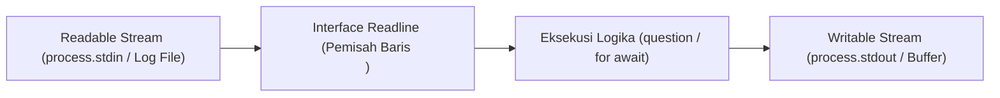

# Readline

> Ringkasan
>
> - Fungsi: Membaca aliran masukan baris demi baris dari Readable Stream seperti terminal interaktif atau berkas teks.
> - Digunakan saat: Mengajukan pertanyaan interaktif di terminal, membuat antarmuka Command Line Interface (CLI), atau memproses berkas log raksasa secara berurutan.
> - Aturan praktis: Selalu gunakan blok `try...finally` untuk memastikan `rl.close()` dipanggil setelah interaksi selesai agar proses Node.js tidak menggantung akibat stream yang tetap terbuka di Event Loop.

---

## Tujuan Belajar

- Mengonfigurasi antarmuka readline menggunakan API modern `node:readline/promises`.
- Mengajukan pertanyaan interaktif secara sekuensial menggunakan metode `question()`.
- Membaca aliran teks baris demi baris menggunakan pola `for await...of`.
- Mengelola status antarmuka terminal interaktif melalui `setPrompt()`, `pause()`, dan `resume()`.
- Menghindari kebocoran proses aktif dengan penutupan antarmuka secara disiplin.

---

## Konsep

> Modul `node:readline` dianalogikan seperti resepsionis loket layanan masyarakat. Resepsionis mengajukan satu pertanyaan formulir kepada pemohon yang berdiri di depan loket (_Readable Stream_ `stdin`). Pemohon menuliskan jawaban lalu menekan bel atau menyerahkan lembar isian dengan tanda enter (_event_ baris baru). Resepsionis membaca jawaban tersebut, mencatatnya ke buku register, lalu mengajukan pertanyaan berikutnya. Ketika seluruh formulir selesai diisi, resepsionis menutup jendela loket (_`rl.close()`_) sehingga pemohon dapat meninggalkan ruangan dan lampu operasional kantor dapat dipadamkan secara bersih.



---

## Referensi

| Item | Fungsi | Catatan |
| :--- | :--- | :--- |
| **`createInterface()`** | Membuat antarmuka penghubung antara Readable Stream dan Writable Stream | Menerima konfigurasi stream masukan, luaran, dan opsi penanganan baris baru |
| **`question()`** | Menampilkan pertanyaan teks dan menunggu masukan jawaban berbasis Promise | Membutuhkan import dari sub-jalur `node:readline/promises` |
| **`close()`** | Menutup antarmuka pembacaan dan melepaskan listener pada stream masukan | Wajib dipanggil untuk mengizinkan Event Loop keluar secara normal |
| **`for await...of (Readline)`** | Mengiterasi pembacaan baris demi baris dari stream secara asinkron | Sangat hemat memori karena tidak memuat seluruh berkas ke RAM |
| **`setPrompt()`** | Mengonfigurasi teks atau simbol prompt untuk sesi terminal interaktif | Nilai default prompt adalah `> ` jika tidak diubah |
| **`prompt()`** | Menulis teks prompt yang telah ditentukan ke stream keluaran | Menyiapkan kursor masukan bagi pengguna terminal |
| **`pause()`** | Menunda pembacaan aliran data dari stream masukan untuk sementara waktu | Mencegah penumpukan event baris baru saat sistem memproses tugas berat |
| **`resume()`** | Melanjutkan kembali aliran pembacaan stream masukan yang ditunda | Mengaktifkan kembali penerimaan baris data baru |
| **`cursorTo()`** | Memindahkan posisi kursor terminal ke koordinat kolom dan baris tertentu | Memerlukan stream TTY aktif atau stream luaran berkemampuan kontrol escape |

### `createInterface()`

Fungsi `createInterface()` digunakan untuk menginisialisasi objek penghubung yang membaca data baris demi baris dari stream masukan (`input`) dan menulis ke stream luaran (`output`). Fungsi ini merupakan titik awal seluruh interaksi readline.

```javascript
import { createInterface } from "node:readline/promises";
import { PassThrough } from "node:stream";

const streamMasuk = new PassThrough();
const streamKeluar = new PassThrough();

const rl = createInterface({
  input: streamMasuk,
  output: streamKeluar,
});

console.log(typeof rl.question);
// Output: function

rl.close();
```

Kasus lain: Mengaktifkan opsi `crlfDelay: Infinity` saat membaca berkas agar kombinasi karakter `\r\n` (CRLF) pada Windows diperlakukan sebagai satu baris baru tunggal.

```javascript
import { createInterface } from "node:readline";
import { Readable } from "node:stream";

const sumberCRLF = Readable.from(["baris 1\r\nbaris 2\r\n"]);
const rl = createInterface({
  input: sumberCRLF,
  crlfDelay: Infinity,
});

const baris = [];
for await (const teks of rl) {
  baris.push(teks);
}

console.log(baris.length);
// Output: 2
```

### `question()`

Metode `question()` menulis teks pertanyaan ke stream luaran dan mengembalikan sebuah Promise yang terselesaikan ketika pengguna mengirimkan baris jawaban (menekan Enter). Metode ini menyederhanakan alur tanya-jawab tanpa bersarangnya fungsi callback.

```javascript
import { createInterface } from "node:readline/promises";
import { PassThrough } from "node:stream";

const streamMasuk = new PassThrough();
const streamKeluar = new PassThrough();
const rl = createInterface({ input: streamMasuk, output: streamKeluar });

process.nextTick(() => streamMasuk.write("Budi Santoso\n"));

const jawaban = await rl.question("Masukkan nama lengkap: ");
console.log(jawaban);
// Output: Budi Santoso

rl.close();
```

Kasus lain: Menangani masukan kosong ketika pengguna langsung menekan tombol Enter tanpa mengetik teks apa pun.

```javascript
import { createInterface } from "node:readline/promises";
import { PassThrough } from "node:stream";

const streamMasuk = new PassThrough();
const streamKeluar = new PassThrough();
const rl = createInterface({ input: streamMasuk, output: streamKeluar });

process.nextTick(() => streamMasuk.write("\n"));

const respon = await rl.question("Tekan enter untuk lanjut: ");
console.log(respon.length === 0);
// Output: true

rl.close();
```

### `close()`

Metode `close()` menutup instans antarmuka readline, melepaskan kontrol listener dari stream masukan, dan memancarkan event `close`. Metode ini krusial untuk mencegah kebocoran proses yang menggantung.

```javascript
import { createInterface } from "node:readline/promises";
import { PassThrough } from "node:stream";

const streamMasuk = new PassThrough();
const streamKeluar = new PassThrough();
const rl = createInterface({ input: streamMasuk, output: streamKeluar });

let statusTertutup = false;
rl.on("close", () => {
  statusTertutup = true;
});

rl.close();
console.log(statusTertutup);
// Output: true
```

Kasus lain: Memanggil metode operasi seperti `question()` setelah antarmuka ditutup akan melempar galat `ERR_USE_AFTER_CLOSE`.

```javascript
import { createInterface } from "node:readline/promises";
import { PassThrough } from "node:stream";

const rl = createInterface({ input: new PassThrough(), output: new PassThrough() });
rl.close();

try {
  await rl.question("Pertanyaan terlambat: ");
} catch (error) {
  console.log(error.code);
  // Output: ERR_USE_AFTER_CLOSE
}
```

### `for await...of (Readline)`

Pola iterasi `for await...of` memungkinkan pembacaan berkas atau stream baris demi baris secara asinkron tanpa menimbun seluruh isi berkas di dalam memori heap. Pola ini sangat ideal untuk pengolahan berkas log berukuran gigabyte.

```javascript
import { createInterface } from "node:readline";
import { Readable } from "node:stream";

const streamSumber = Readable.from([
  "192.168.1.1 GET /index.html 200\n",
  "192.168.1.2 POST /login 401\n",
]);

const rl = createInterface({ input: streamSumber });
const logDaftar = [];

for await (const baris of rl) {
  logDaftar.push(baris.split(" ")[1]);
}

console.log(logDaftar);
// Output: [ 'GET', 'POST' ]
```

Kasus lain: Stream masukan kosong akan langsung menyelesaikan iterasi tanpa mengeksekusi tubuh loop satu kali pun.

```javascript
import { createInterface } from "node:readline";
import { Readable } from "node:stream";

const streamKosong = Readable.from([]);
const rl = createInterface({ input: streamKosong });

let jumlahEksekusi = 0;
for await (const _baris of rl) {
  jumlahEksekusi++;
}

console.log(jumlahEksekusi);
// Output: 0
```

### `setPrompt()`

Metode `setPrompt()` menentukan string penanda atau simbol prompt yang akan ditampilkan ke stream keluaran saat program menunggu masukan berikutnya dari pengguna.

```javascript
import { createInterface } from "node:readline";
import { PassThrough } from "node:stream";

const streamKeluar = new PassThrough();
const rl = createInterface({ input: new PassThrough(), output: streamKeluar });

rl.setPrompt("kueri-sql> ");
rl.prompt();

streamKeluar.on("data", (chunk) => {
  console.log(chunk.toString("utf-8"));
  // Output: kueri-sql> 
});

rl.close();
```

Kasus lain: Mengubah prompt secara dinamis berdasarkan status autentikasi atau konteks percakapan pengguna.

```javascript
import { createInterface } from "node:readline";
import { PassThrough } from "node:stream";

const rl = createInterface({ input: new PassThrough(), output: new PassThrough() });
const modeAdmin = true;

rl.setPrompt(modeAdmin ? "admin# " : "tamu$ ");
console.log(typeof rl.getPrompt);
// Output: function

rl.close();
```

### `prompt()`

Metode `prompt()` mencetak teks prompt yang sudah ditetapkan oleh `setPrompt()` ke stream luaran serta menempatkan kursor pada baris baru agar pengguna siap mengetikkan perintah.

```javascript
import { createInterface } from "node:readline";
import { PassThrough } from "node:stream";

const streamKeluar = new PassThrough();
let tercetak = "";

streamKeluar.on("data", (chunk) => {
  tercetak += chunk.toString("utf-8");
});

const rl = createInterface({ input: new PassThrough(), output: streamKeluar });
rl.setPrompt("input: ");
rl.prompt();

console.log(tercetak);
// Output: input: 

rl.close();
```

Kasus lain: Menghindari pemindahan kursor yang merusak tampilan terminal saat menggunakan parameter `preserveCursor`.

```javascript
import { createInterface } from "node:readline";
import { PassThrough } from "node:stream";

const rl = createInterface({ input: new PassThrough(), output: new PassThrough() });
rl.prompt(true);
console.log(typeof rl.prompt);
// Output: function
rl.close();
```

### `pause()`

Metode `pause()` menangguhkan sementara pembacaan data dari stream masukan. Metode ini berguna ketika aplikasi menerima baris perintah yang memerlukan pemrosesan I/O asinkron yang lama sebelum siap menerima baris berikutnya.

```javascript
import { createInterface } from "node:readline";
import { PassThrough } from "node:stream";

const streamMasuk = new PassThrough();
const rl = createInterface({ input: streamMasuk, output: new PassThrough() });

rl.pause();
console.log(typeof rl.pause);
// Output: function

rl.close();
```

Kasus lain: Memeriksa apakah penghentian sementara menyebabkan event stream tertunda sampai pemanggilan resume dilakukan.

```javascript
import { createInterface } from "node:readline";
import { PassThrough } from "node:stream";

const streamMasuk = new PassThrough();
const rl = createInterface({ input: streamMasuk });

let terpanggil = false;
rl.on("line", () => {
  terpanggil = true;
});

rl.pause();
streamMasuk.write("teks baru\n");
console.log(terpanggil);
// Output: false

rl.close();
```

### `resume()`

Metode `resume()` melanjutkan kembali pembacaan stream masukan yang sebelumnya ditangguhkan oleh `pause()`, sehingga antarmuka siap menerima baris data berikutnya.

```javascript
import { createInterface } from "node:readline";
import { PassThrough } from "node:stream";

const streamMasuk = new PassThrough();
const rl = createInterface({ input: streamMasuk });

rl.pause();
rl.resume();

console.log(typeof rl.resume);
// Output: function

rl.close();
```

Kasus lain: Memastikan baris data yang tertunda saat kondisi jeda diproses segera setelah stream diaktifkan kembali.

```javascript
import { createInterface } from "node:readline";
import { PassThrough } from "node:stream";

const streamMasuk = new PassThrough();
const rl = createInterface({ input: streamMasuk });
let hitung = 0;

rl.on("line", () => {
  hitung++;
});

rl.pause();
streamMasuk.write("baris tertunda\n");
rl.resume();

process.nextTick(() => {
  console.log(hitung > 0);
  // Output: true
  rl.close();
});
```

### `cursorTo()`

Fungsi `cursorTo()` dari modul `node:readline` digunakan untuk memindahkan posisi kursor terminal ke koordinat kolom `x` dan baris `y` tertentu pada stream luaran TTY. Fungsi ini umum dipakai untuk merender animasi bilah kemajuan (_progress bar_) pada antarmuka CLI.

```javascript
import readline from "node:readline";
import { PassThrough } from "node:stream";

const streamKeluar = new PassThrough();
let kodeEscape = "";

streamKeluar.on("data", (chunk) => {
  kodeEscape += chunk.toString("utf-8");
});

readline.cursorTo(streamKeluar, 0, 0);
console.log(kodeEscape.length > 0);
// Output: true
```

Kasus lain: Melewatkan koordinat tanpa nilai parameter baris `y` hanya memindahkan posisi horizontal kolom pada baris saat ini.

```javascript
import readline from "node:readline";
import { PassThrough } from "node:stream";

const streamKeluar = new PassThrough();
const berhasil = readline.cursorTo(streamKeluar, 5);

console.log(berhasil);
// Output: true
```

### Perbandingan: Gaya Callback vs Gaya Promises

| Karakteristik | Callback (`node:readline`) | Promises (`node:readline/promises`) |
| :--- | :--- | :--- |
| **Gaya Sintaks** | `rl.question(pesan, (jawaban) => {})` | `const jawaban = await rl.question(pesan)` |
| **Alur Pertanyaan Beruntun** | Rawan menghasilkan kode bersarang berlebihan | Linear, terstruktur, dan bersih menggunakan `await` |
| **Top-Level Await** | Memerlukan pembungkus fungsi atau Promise manual | Didukung secara native di modul ESM modern |
| **Penanganan Galat** | Melewatkan galat melalui parameter fungsi callback | Menggunakan blok standar `try...catch...finally` |

---

## Kesalahan Umum

### Lupa Memanggil `rl.close()`

Mengabaikan pemanggilan `rl.close()` setelah sesi interaksi selesai membuat proses Node.js menggantung tanpa henti karena listener stream `process.stdin` terus menahan siklus Event Loop.

```javascript
// Salah
import { createInterface } from "node:readline/promises";

async function tanyaPengguna() {
  const rl = createInterface({ input: process.stdin, output: process.stdout });
  const jawaban = await rl.question("Lanjutkan? (y/n): ");
  console.log("Memproses...", jawaban);
  // Proses tidak akan pernah selesai keluar ke terminal!
}
```

```javascript
// Benar
import { createInterface } from "node:readline/promises";

async function tanyaPengguna() {
  const rl = createInterface({ input: process.stdin, output: process.stdout });
  try {
    const jawaban = await rl.question("Lanjutkan? (y/n): ");
    console.log("Memproses...", jawaban);
  } finally {
    rl.close(); // Menjamin proses dapat keluar dengan bersih
  }
}
```

### Membuka Beberapa Instance Readline pada Stream yang Sama

Membuat beberapa instans `createInterface` secara bersamaan yang mendengarkan `process.stdin` memicu konflik pembacaan buffer masukan, di mana karakter input terpecah atau terduplikasi antar-instans.

```javascript
// Salah
import { createInterface } from "node:readline/promises";

const rl1 = createInterface({ input: process.stdin, output: process.stdout });
const rl2 = createInterface({ input: process.stdin, output: process.stdout });
const nama = await rl1.question("Nama: ");
const usia = await rl2.question("Usia: ");
```

```javascript
// Benar
import { createInterface } from "node:readline/promises";

const rl = createInterface({ input: process.stdin, output: process.stdout });
try {
  const nama = await rl.question("Nama: ");
  const usia = await rl.question("Usia: ");
} finally {
  rl.close();
}
```

### Mengabaikan Penanganan Karakter Spasi Berlebih

Masukan pengguna terminal sering kali menyertakan spasi di awal atau akhir kata yang tidak disengaja, menyebabkan kegagalan validasi logika jika tidak dinormalisasi dengan `.trim()`.

```javascript
// Salah
const pilihan = await rl.question("Ketik 'ya' untuk konfirmasi: ");
if (pilihan === "ya") {
  jalankanAksi();
}
```

```javascript
// Benar
const pilihan = await rl.question("Ketik 'ya' untuk konfirmasi: ");
if (pilihan.trim().toLowerCase() === "ya") {
  jalankanAksi();
}
```

---

## Studi Kasus

Skenario: Membangun fungsi panduan inisialisasi konfigurasi proyek (_CLI configuration wizard_) yang mengajukan serangkaian pertanyaan interaktif terstruktur, melakukan validasi nilai masukan secara ketat, serta memastikan seluruh sumber daya readline tertutup rapi meskipun terjadi pembatalan atau kegagalan validasi.

```javascript
import { createInterface } from "node:readline/promises";
import { PassThrough } from "node:stream";

async function jalankanWizardProyek(streamMasuk, streamKeluar) {
  const rl = createInterface({
    input: streamMasuk,
    output: streamKeluar,
  });

  const konfigurasi = {};

  try {
    const namaProyek = await rl.question("Nama paket proyek: ");
    const namaBersih = namaProyek.trim();
    if (!namaBersih || !/^[a-z0-9-_]+$/.test(namaBersih)) {
      throw new Error("Nama proyek hanya boleh memuat huruf kecil, angka, atau tanda hubung.");
    }
    konfigurasi.nama = namaBersih;

    const versi = await rl.question("Versi awal (default 1.0.0): ");
    konfigurasi.versi = versi.trim() || "1.0.0";

    const gitInit = await rl.question("Inisialisasi repositori Git? (y/n): ");
    konfigurasi.git = gitInit.trim().toLowerCase() === "y";

    return {
      sukses: true,
      data: konfigurasi,
    };
  } catch (error) {
    return {
      sukses: false,
      pesanGalat: error.message,
    };
  } finally {
    rl.close();
  }
}

// Simulasi masukan stream secara terprogram
const inputMock = new PassThrough();
const outputMock = new PassThrough();

process.nextTick(() => {
  inputMock.write("portal-layanan\n");
  inputMock.write("2.1.0\n");
  inputMock.write("y\n");
});

const hasilWizard = await jalankanWizardProyek(inputMock, outputMock);
console.log(hasilWizard.sukses);
// Output: true
console.log(hasilWizard.data.nama);
// Output: portal-layanan
console.log(hasilWizard.data.versi);
// Output: 2.1.0
console.log(hasilWizard.data.git);
// Output: true
```

Desain ini dipilih karena memisahkan masukan dan luaran melalui stream yang fleksibel, memanfaatkan `try...finally` untuk menjamin pelepasan listener `stdin`, serta memverifikasi data sebelum disimpan ke struktur konfigurasi akhir.

---

## Latihan Mandiri

### Soal 1 (Dasar)

Buat fungsi asinkron `hitungAkumulasiAngka(streamTeks)` yang menerima Readable Stream berisi baris-baris string angka. Gunakan `createInterface` dan pola iterasi `for await...of` untuk membaca baris demi baris, mengabaikan baris kosong, menjumlahkan seluruh angka, dan mengembalikan objek dengan properti `total` dan `jumlahBaris`.

Contoh masukan:

```javascript
import { Readable } from "node:stream";
const stream = Readable.from(["15\n", "25\n", "\n", "60\n"]);
await hitungAkumulasiAngka(stream);
```

Contoh keluaran yang diharapkan:

```javascript
{
  total: 100,
  jumlahBaris: 3
}
```

Batasan: Gunakan modul bawaan `node:readline` dan `node:stream` tanpa dependensi eksternal.

### Soal 2 (Menengah)

Buat fungsi `tanyaDenganBatasPercobaan(rl, teksPertanyaan, fungsiValidasi, batasMaksimal)` yang mengajukan pertanyaan kepada pengguna menggunakan `rl.question()`. Jika masukan tidak lulus validasi `fungsiValidasi(jawaban)`, ajukan kembali pertanyaan tersebut hingga maksimal `batasMaksimal` kali percobaan. Jika berhasil, kembalikan string jawaban yang bersih (`trim`). Jika batas percobaan habis dan belum valid, lempar galat dengan pesan `'BATAS_PERCOBAAN_HABIS'`.

Contoh masukan:

```javascript
const validator = (teks) => teks.length >= 5;
// Pengguna memasukkan: 'abc', lalu 'abcdef'
await tanyaDenganBatasPercobaan(rl, "Masukkan kode lisensi (min 5 digit): ", validator, 3);
```

Contoh keluaran yang diharapkan:

```javascript
'abcdef'
```

Batasan: Gunakan antarmuka `node:readline/promises` dan pastikan tidak ada kebocoran promise yang belum terselesaikan.

### Soal 3 (Menantang)

Buat utilitas pengurai berkas log aliran kontinu (_streaming access log aggregator_) bernama `agregasiLogAkses(streamLog)`. Fungsi ini menerima Readable Stream yang menyajikan data log web per baris dengan format string terpisah spasi: `[TIMESTAMP] [IP] [METODE_HTTP] [KODE_STATUS] [LATENSI_MS]`.

Ketentuan pemrosesan:

- Gunakan `createInterface` untuk memproses aliran data baris demi baris tanpa menampung seluruh teks ke dalam variabel array.
- Hitung total entri log yang valid (`totalPermintaan`).
- Petakan distribusi kode status ke dalam kategori: `sukses` (status 200–299), `klienError` (status 400–499), dan `serverError` (status 500–599).
- Hitung rata-rata latensi dalam milidetik dari entri yang valid.
- Abaikan dan hitung baris korup (jumlah kolom kurang dari 5 atau nilai status bukan integer numerik) ke dalam properti `barisCacat`.
- Seluruh pembacaan harus aman dan tahan terhadap aliran data masukan raksasa.

Contoh masukan:

```javascript
import { Readable } from "node:stream";

const dataLog = Readable.from([
  "2026-10-12T10:00:00Z 10.0.0.1 GET 200 45\n",
  "2026-10-12T10:00:01Z 10.0.0.2 POST 201 120\n",
  "baris log korup tanpa spasi yang cukup\n",
  "2026-10-12T10:00:02Z 10.0.0.3 GET 404 15\n",
  "2026-10-12T10:00:03Z 10.0.0.4 POST 500 350\n"
]);

await agregasiLogAkses(dataLog);
```

Contoh keluaran yang diharapkan:

```javascript
{
  totalPermintaan: 4,
  barisCacat: 1,
  rataRataLatensiMs: 132.5,
  distribusiStatus: {
    sukses: 2,
    klienError: 1,
    serverError: 1
  }
}
```

Batasan: Wajib menggunakan `node:readline` untuk memproses data stream secara inkremental tanpa memuat seluruh berkas ke memori RAM secara bersamaan. Dilarang menggunakan pustaka pihak ketiga.

---

## Navigasi

[Sebelumnya: Zlib](../17-zlib/README.md) | [Selanjutnya: Report](../19-report/README.md) | [Daftar Isi](../README.md)
