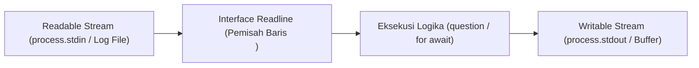

# Readline

> Ringkasan
>
> - Fungsi: Membaca aliran data teks baris demi baris dari Readable Stream, seperti terminal interaktif atau berkas log.
> - Digunakan saat: Mengajukan pertanyaan interaktif di terminal, membuat antarmuka Command Line Interface (CLI), atau memproses berkas log raksasa secara berurutan.
> - Aturan praktis: Selalu gunakan blok `try...finally` untuk memastikan `rl.close()` dipanggil setelah interaksi selesai agar proses Node.js tidak menggantung akibat stream yang tetap terbuka di Event Loop.

---

## Tujuan Belajar

- Mengonfigurasi antarmuka readline menggunakan API modern `node:readline/promises`.
- Mengajukan pertanyaan interaktif secara berurutan menggunakan metode `question()`.
- Membaca aliran teks baris demi baris menggunakan perulangan `for await...of`.
- Mengelola status antarmuka terminal interaktif melalui `setPrompt()`, `pause()`, dan `resume()`.
- Mencegah proses aplikasi menggantung dengan menutup antarmuka secara tertib dan disiplin.

---

## Konsep

Modul `node:readline` bisa kita bayangkan seperti resepsionis di loket pelayanan. Resepsionis mengajukan satu pertanyaan formulir kepada pengunjung yang berdiri di depan loket (_Readable Stream_ `stdin`). Pengunjung menuliskan jawaban lalu menekan bel atau menyerahkan lembar isian dengan menekan tombol Enter (_event_ baris baru).

Resepsionis membaca jawaban tersebut, mencatatnya ke buku pendaftaran, lalu mengajukan pertanyaan berikutnya. Ketika seluruh pertanyaan formulir selesai dijawab, resepsionis menutup jendela loket (_`rl.close()`_). Dengan demikian, pengunjung bisa meninggalkan ruangan dan lampu kantor pelayanan bisa dimatikan dengan rapi tanpa ada aktivitas yang menggantung.



---

## Referensi

| Item                            | Fungsi                                                                 | Catatan                                                                     |
| :------------------------------ | :--------------------------------------------------------------------- | :-------------------------------------------------------------------------- |
| **`createInterface()`**         | Membuat jembatan penghubung antara Readable Stream dan Writable Stream | Menerima konfigurasi stream input, output, dan opsi pemisah baris baru      |
| **`question()`**                | Menampilkan pertanyaan teks dan menunggu jawaban berbasis Promise      | Memerlukan impor dari sub-jalur `node:readline/promises`                    |
| **`close()`**                   | Menutup antarmuka pembacaan dan melepaskan listener pada stream input  | Wajib dipanggil agar proses Event Loop bisa keluar secara normal            |
| **`for await...of (Readline)`** | Membaca baris demi baris dari stream secara asinkron                   | Sangat hemat memori karena tidak memuat seluruh isi berkas ke RAM           |
| **`setPrompt()`**               | Mengatur teks atau simbol prompt untuk sesi terminal interaktif        | Nilai bawaan prompt adalah `> ` jika tidak diubah                           |
| **`prompt()`**                  | Menulis teks prompt yang telah ditentukan ke stream output             | Menyiapkan kursor input bagi pengguna di terminal                           |
| **`pause()`**                   | Menghentikan sementara pembacaan data dari stream input                | Menahan penumpukan baris baru saat sistem memproses tugas berat             |
| **`resume()`**                  | Melanjutkan kembali aliran pembacaan stream input yang ditunda         | Mengaktifkan kembali penerimaan baris data baru                             |
| **`cursorTo()`**                | Menggeser posisi kursor terminal ke koordinat kolom dan baris tertentu | Membutuhkan stream TTY aktif atau stream output berkemampuan kontrol escape |

### `createInterface()`

Fungsi `createInterface()` digunakan untuk membuat objek penghubung yang membaca data baris demi baris dari stream input (`input`) dan menulis ke stream output (`output`). Fungsi ini adalah pintu masuk utama untuk menggunakan readline.

```javascript
import { createInterface } from "node:readline/promises";
import { PassThrough } from "node:stream";

const inputStream = new PassThrough();
const outputStream = new PassThrough();

const rl = createInterface({
  input: inputStream,
  output: outputStream,
});

console.log(typeof rl.question);
// Output: function

rl.close();
```

Kasus lain: Mengaktifkan opsi `crlfDelay: Infinity` saat membaca berkas agar format baris ganda `\r\n` (CRLF) pada Windows diperlakukan sebagai satu baris baru biasa.

```javascript
import { createInterface } from "node:readline";
import { Readable } from "node:stream";

const crlfSource = Readable.from(["line 1\r\nline 2\r\n"]);
const rl = createInterface({
  input: crlfSource,
  crlfDelay: Infinity,
});

const lines = [];
for await (const text of rl) {
  lines.push(text);
}

console.log(lines.length);
// Output: 2
```

### `question()`

Metode `question()` menulis teks pertanyaan ke layar terminal dan mengembalikan sebuah Promise yang akan selesai ketika pengguna mengetikkan jawaban dan menekan tombol Enter. Metode ini membuat alur tanya-jawab menjadi sangat mudah dibaca tanpa perlu callback bersarang.

```javascript
import { createInterface } from "node:readline/promises";
import { PassThrough } from "node:stream";

const inputStream = new PassThrough();
const outputStream = new PassThrough();
const rl = createInterface({ input: inputStream, output: outputStream });

process.nextTick(() => inputStream.write("John Doe\n"));

const answer = await rl.question("Enter full name: ");
console.log(answer);
// Output: John Doe

rl.close();
```

Kasus lain: Menangani input kosong ketika pengguna langsung menekan tombol Enter tanpa mengetik teks apa pun.

```javascript
import { createInterface } from "node:readline/promises";
import { PassThrough } from "node:stream";

const inputStream = new PassThrough();
const outputStream = new PassThrough();
const rl = createInterface({ input: inputStream, output: outputStream });

process.nextTick(() => inputStream.write("\n"));

const response = await rl.question("Press enter to continue: ");
console.log(response.length === 0);
// Output: true

rl.close();
```

### `close()`

Metode `close()` menutup instance antarmuka readline, melepaskan listener pada stream input, dan memancarkan event `close`. Memanggil metode ini sangat penting agar aplikasi tidak menggantung di terminal.

```javascript
import { createInterface } from "node:readline/promises";
import { PassThrough } from "node:stream";

const inputStream = new PassThrough();
const outputStream = new PassThrough();
const rl = createInterface({ input: inputStream, output: outputStream });

let isClosed = false;
rl.on("close", () => {
  isClosed = true;
});

rl.close();
console.log(isClosed);
// Output: true
```

Kasus lain: Mencoba memanggil metode seperti `question()` setelah antarmuka ditutup akan menghasilkan error `ERR_USE_AFTER_CLOSE`.

```javascript
import { createInterface } from "node:readline/promises";
import { PassThrough } from "node:stream";

const rl = createInterface({
  input: new PassThrough(),
  output: new PassThrough(),
});
rl.close();

try {
  await rl.question("Late question: ");
} catch (error) {
  console.log(error.code);
  // Output: ERR_USE_AFTER_CLOSE
}
```

### `for await...of (Readline)`

Pola perulangan `for await...of` memungkinkan kita membaca isi stream teks baris demi baris secara asinkron tanpa menumpuk seluruh teks di memori RAM. Cara ini sangat ideal untuk memproses berkas log raksasa berukuran puluhan gigabyte.

```javascript
import { createInterface } from "node:readline";
import { Readable } from "node:stream";

const sourceStream = Readable.from([
  "192.168.1.1 GET /index.html 200\n",
  "192.168.1.2 POST /login 401\n",
]);

const rl = createInterface({ input: sourceStream });
const methods = [];

for await (const line of rl) {
  methods.push(line.split(" ")[1]);
}

console.log(methods);
// Output: [ 'GET', 'POST' ]
```

Kasus lain: Stream input yang kosong akan langsung menyelesaikan perulangan tanpa mengeksekusi isi loop satu kali pun.

```javascript
import { createInterface } from "node:readline";
import { Readable } from "node:stream";

const emptyStream = Readable.from([]);
const rl = createInterface({ input: emptyStream });

let executionCount = 0;
for await (const _line of rl) {
  executionCount++;
}

console.log(executionCount);
// Output: 0
```

### `setPrompt()`

Metode `setPrompt()` digunakan untuk menentukan tanda atau simbol prompt yang akan ditampilkan di terminal saat aplikasi sedang menunggu input berikutnya dari pengguna.

```javascript
import { createInterface } from "node:readline";
import { PassThrough } from "node:stream";

const outputStream = new PassThrough();
const rl = createInterface({ input: new PassThrough(), output: outputStream });

rl.setPrompt("sql-query> ");

outputStream.on("data", (chunk) => {
  console.log(chunk.toString("utf-8").trim());
  // Output: sql-query>
});

rl.prompt();
rl.close();
```

Kasus lain: Mengubah teks prompt secara dinamis berdasarkan status hak akses pengguna.

```javascript
import { createInterface } from "node:readline";
import { PassThrough } from "node:stream";

const rl = createInterface({
  input: new PassThrough(),
  output: new PassThrough(),
});
const isAdmin = true;

rl.setPrompt(isAdmin ? "admin# " : "guest$ ");
console.log(typeof rl.getPrompt);
// Output: function

rl.close();
```

### `prompt()`

Metode `prompt()` mencetak teks prompt yang telah diatur oleh `setPrompt()` ke layar terminal, lalu memposisikan kursor di baris baru agar pengguna siap mengetikkan perintah.

```javascript
import { createInterface } from "node:readline";
import { PassThrough } from "node:stream";

const outputStream = new PassThrough();
let printedOutput = "";

outputStream.on("data", (chunk) => {
  printedOutput += chunk.toString("utf-8");
});

const rl = createInterface({ input: new PassThrough(), output: outputStream });
rl.setPrompt("input: ");
rl.prompt();

console.log(printedOutput.trim());
// Output: input:

rl.close();
```

Kasus lain: Menghindari pemindahan kursor yang merusak tampilan terminal dengan mengaktifkan parameter `preserveCursor`.

```javascript
import { createInterface } from "node:readline";
import { PassThrough } from "node:stream";

const rl = createInterface({
  input: new PassThrough(),
  output: new PassThrough(),
});
rl.prompt(true);
console.log(typeof rl.prompt);
// Output: function
rl.close();
```

### `pause()`

Metode `pause()` menunda sementara pembacaan data dari stream input. Sangat bermanfaat jika aplikasi menerima perintah yang butuh waktu lama untuk diselesaikan sebelum siap menerima baris teks berikutnya.

```javascript
import { createInterface } from "node:readline";
import { PassThrough } from "node:stream";

const inputStream = new PassThrough();
const rl = createInterface({ input: inputStream, output: new PassThrough() });

rl.pause();
console.log(typeof rl.pause);
// Output: function

rl.close();
```

Kasus lain: Memastikan bahwa penundaan sementara akan menahan pemancaran event hingga pemanggilan `resume()` dilakukan.

```javascript
import { createInterface } from "node:readline";
import { PassThrough } from "node:stream";

const inputStream = new PassThrough();
const rl = createInterface({ input: inputStream });

let isEmitted = false;
rl.on("line", () => {
  isEmitted = true;
});

rl.pause();
inputStream.write("pending text\n");
console.log(isEmitted);
// Output: false

rl.close();
```

### `resume()`

Metode `resume()` melanjutkan kembali pembacaan stream input yang sebelumnya ditunda oleh `pause()`, sehingga antarmuka kembali siap menerima baris input baru.

```javascript
import { createInterface } from "node:readline";
import { PassThrough } from "node:stream";

const inputStream = new PassThrough();
const rl = createInterface({ input: inputStream });

rl.pause();
rl.resume();

console.log(typeof rl.resume);
// Output: function

rl.close();
```

Kasus lain: Memastikan baris data yang sempat tertahan selama masa jeda langsung diproses seketika setelah stream diaktifkan kembali.

```javascript
import { createInterface } from "node:readline";
import { PassThrough } from "node:stream";

const inputStream = new PassThrough();
const rl = createInterface({ input: inputStream });
let lineCount = 0;

rl.on("line", () => {
  lineCount++;
});

rl.pause();
inputStream.write("queued line\n");
rl.resume();

process.nextTick(() => {
  console.log(lineCount > 0);
  // Output: true
  rl.close();
});
```

### `cursorTo()`

Fungsi `cursorTo()` dari modul `node:readline` dipakai untuk menggeser posisi kursor terminal ke koordinat kolom `x` dan baris `y` tertentu pada stream output TTY. Fungsi ini sering digunakan untuk membuat animasi indikator kemajuan (_progress bar_) di aplikasi terminal.

```javascript
import readline from "node:readline";
import { PassThrough } from "node:stream";

const outputStream = new PassThrough();
let escapeCode = "";

outputStream.on("data", (chunk) => {
  escapeCode += chunk.toString("utf-8");
});

readline.cursorTo(outputStream, 0, 0);
console.log(escapeCode.length > 0);
// Output: true
```

Kasus lain: Melewatkan koordinat tanpa menyertakan nomor baris `y` hanya akan menggeser posisi horizontal kolom pada baris saat ini.

```javascript
import readline from "node:readline";
import { PassThrough } from "node:stream";

const outputStream = new PassThrough();
const success = readline.cursorTo(outputStream, 5);

console.log(success);
// Output: true
```

### Perbandingan: Gaya Callback vs Gaya Promises

| Karakteristik                | Callback (`node:readline`)                   | Promises (`node:readline/promises`)                      |
| :--------------------------- | :------------------------------------------- | :------------------------------------------------------- |
| **Gaya Penulisan**           | `rl.question(prompt, (answer) => {})`        | `const answer = await rl.question(prompt)`               |
| **Pertanyaan Bertingkat**    | Berisiko membuat piramida callback bersarang | Linier, terstruktur rapi, dan mudah dibaca lewat `await` |
| **Dukungan Top-Level Await** | Butuh pembungkus Promise manual              | Didukung secara native di modul ESM modern               |
| **Penanganan Error**         | Melewati parameter error pada callback       | Menggunakan blok standar `try...catch...finally`         |

---

## Kesalahan Umum

### Lupa Memanggil `rl.close()`

Mengabaikan pemanggilan `rl.close()` setelah sesi tanya-jawab selesai akan membuat program Node.js menggantung tanpa henti, karena listener stream `process.stdin` terus menahan siklus Event Loop agar tetap menyala.

```javascript
// Salah
import { createInterface } from "node:readline/promises";

async function promptUser() {
  const rl = createInterface({ input: process.stdin, output: process.stdout });
  const answer = await rl.question("Continue? (y/n): ");
  console.log("Processing...", answer);
  // Program Node.js tidak akan pernah keluar kembali ke shell terminal!
}
```

```javascript
// Benar
import { createInterface } from "node:readline/promises";

async function promptUser() {
  const rl = createInterface({ input: process.stdin, output: process.stdout });
  try {
    const answer = await rl.question("Continue? (y/n): ");
    console.log("Processing...", answer);
  } finally {
    rl.close(); // Memastikan proses terminal bisa keluar dengan tuntas
  }
}
```

### Membuka Beberapa Instance Readline pada Stream yang Sama

Membuat beberapa instance `createInterface` secara bersamaan yang sama-sama mendengarkan `process.stdin` akan memicu konflik perebutan buffer input, di mana karakter ketikan pengguna bisa terpecah atau terduplikasi antar-instance.

```javascript
// Salah
import { createInterface } from "node:readline/promises";

const rl1 = createInterface({ input: process.stdin, output: process.stdout });
const rl2 = createInterface({ input: process.stdin, output: process.stdout });
const name = await rl1.question("Name: ");
const age = await rl2.question("Age: ");
```

```javascript
// Benar
import { createInterface } from "node:readline/promises";

const rl = createInterface({ input: process.stdin, output: process.stdout });
try {
  const name = await rl.question("Name: ");
  const age = await rl.question("Age: ");
} finally {
  rl.close();
}
```

### Mengabaikan Spasi Tambahan pada Input Pengguna

Pengguna sering kali tanpa sengaja mengetikkan spasi di awal atau akhir kata. Jika kita tidak membersihkannya dengan `.trim()`, pengecekan logika bisa keliru atau gagal validasi.

```javascript
// Salah
const choice = await rl.question("Type 'yes' to confirm: ");
if (choice === "yes") {
  // Gagal jika pengguna mengetik "yes "
  executeAction();
}
```

```javascript
// Benar
const choice = await rl.question("Type 'yes' to confirm: ");
if (choice.trim().toLowerCase() === "yes") {
  executeAction();
}
```

---

## Studi Kasus

Skenario: Membangun fungsi panduan inisialisasi konfigurasi proyek (_CLI configuration wizard_) yang mengajukan serangkaian pertanyaan terstruktur, memvalidasi format input secara ketat, serta memastikan sumber daya readline ditutup dengan bersih meskipun proses dibatalkan atau mengalami error.

```javascript
import { createInterface } from "node:readline/promises";
import { PassThrough } from "node:stream";

async function runProjectWizard(inputStream, outputStream) {
  const rl = createInterface({
    input: inputStream,
    output: outputStream,
  });

  const config = {};

  try {
    const projectName = await rl.question("Project package name: ");
    const cleanName = projectName.trim();
    if (!cleanName || !/^[a-z0-9-_]+$/.test(cleanName)) {
      throw new Error(
        "Project name must only contain lowercase alphanumeric characters and hyphens.",
      );
    }
    config.name = cleanName;

    const initialVersion = await rl.question(
      "Initial version (default 1.0.0): ",
    );
    config.version = initialVersion.trim() || "1.0.0";

    const gitInit = await rl.question("Initialize Git repository? (y/n): ");
    config.git = gitInit.trim().toLowerCase() === "y";

    return {
      success: true,
      data: config,
    };
  } catch (error) {
    return {
      success: false,
      errorMessage: error.message,
    };
  } finally {
    rl.close();
  }
}

// Simulasi pengujian input stream secara terprogram
const inputMock = new PassThrough();
const outputMock = new PassThrough();

const mockAnswers = ["service-portal\n", "2.1.0\n", "y\n"];
outputMock.on("data", () => {
  if (mockAnswers.length > 0) {
    inputMock.write(mockAnswers.shift());
  }
});

const wizardResult = await runProjectWizard(inputMock, outputMock);
console.log(wizardResult.success);
// Output: true
console.log(wizardResult.data.name);
// Output: service-portal
console.log(wizardResult.data.version);
// Output: 2.1.0
console.log(wizardResult.data.git);
// Output: true
```

Desain ini fleksibel karena memisahkan stream input dan output, memanfaatkan blok `try...finally` untuk menjamin pelepasan listener `stdin`, serta memverifikasi data sebelum disimpan ke konfigurasi akhir.

---

## Latihan Mandiri

### Soal 1 (Dasar)

Buat fungsi asinkron `calculateStreamSum(textStream)` yang menerima Readable Stream berisi baris-baris teks angka. Gunakan `createInterface` dan perulangan `for await...of` untuk membaca baris demi baris, melewati baris kosong, menjumlahkan seluruh angka, dan mengembalikan objek dengan nilai `total` serta `lineCount`.

Contoh input:

```javascript
import { Readable } from "node:stream";
const stream = Readable.from(["15\n", "25\n", "\n", "60\n"]);
await calculateStreamSum(stream);
```

Contoh output yang diharapkan:

```javascript
{
  total: 100,
  lineCount: 3
}
```

Batasan: Gunakan modul bawaan `node:readline` dan `node:stream` tanpa dependensi eksternal.

### Soal 2 (Menengah)

Buat fungsi `askWithRetryLimit(rl, questionText, validatorFn, maxRetries)` yang mengajukan pertanyaan kepada pengguna menggunakan `rl.question()`. Jika input tidak memenuhi validasi `validatorFn(answer)`, ajukan kembali pertanyaan tersebut hingga maksimal `maxRetries` kali percobaan. Jika valid, kembalikan teks jawaban yang sudah dibersihkan (`trim`). Jika batas percobaan habis dan tetap belum valid, lempar error dengan pesan `'MAX_RETRIES_EXCEEDED'`.

Contoh input:

```javascript
const validator = (text) => text.length >= 5;
// Pengguna memasukkan: 'abc', lalu 'abcdef'
await askWithRetryLimit(rl, "Enter license key (min 5 chars): ", validator, 3);
```

Contoh output yang diharapkan:

```javascript
"abcdef";
```

Batasan: Gunakan `node:readline/promises` dan pastikan tidak ada kebocoran promise yang belum terselesaikan.

### Soal 3 (Menantang)

Buat utilitas pengolah berkas log aliran kontinu (_streaming access log aggregator_) bernama `aggregateAccessLogs(logStream)`. Fungsi ini menerima Readable Stream yang mengalirkan data log web baris demi baris dengan format teks terpisah spasi: `[TIMESTAMP] [IP] [METHOD] [STATUS] [LATENCY_MS]`.

Ketentuan fungsional:

- Gunakan `createInterface` untuk memproses aliran data baris demi baris tanpa menampung seluruh teks ke dalam variabel array besar.
- Hitung total baris log yang valid (`totalRequests`).
- Kelompokkan kode status ke dalam tiga kategori: `success` (status 200–299), `clientError` (status 400–499), dan `serverError` (status 500–599).
- Hitung nilai rata-rata latensi dalam satuan milidetik dari entri yang valid (`averageLatencyMs`).
- Lewati baris data yang rusak (jumlah kata kurang dari 5 atau nilai status/latensi bukan angka valid) dan catat jumlahnya ke dalam properti `invalidLines`.
- Seluruh proses pembacaan harus aman dan tahan terhadap aliran data input raksasa.

Contoh input:

```javascript
import { Readable } from "node:stream";

const logData = Readable.from([
  "2026-10-12T10:00:00Z 10.0.0.1 GET 200 45\n",
  "2026-10-12T10:00:01Z 10.0.0.2 POST 201 120\n",
  "invalid corrupted line without enough tokens\n",
  "2026-10-12T10:00:02Z 10.0.0.3 GET 404 15\n",
  "2026-10-12T10:00:03Z 10.0.0.4 POST 500 350\n",
]);

await aggregateAccessLogs(logData);
```

Contoh output yang diharapkan:

```javascript
{
  totalRequests: 4,
  invalidLines: 1,
  averageLatencyMs: 132.5,
  statusDistribution: {
    success: 2,
    clientError: 1,
    serverError: 1
  }
}
```

Batasan: Wajib menggunakan `node:readline` untuk memproses data stream secara bertahap tanpa memuat seluruh berkas ke memori RAM sekaligus. Dilarang menggunakan paket pihak ketiga.

---

## Navigasi

[Sebelumnya: Zlib](../17-zlib/README.md) | [Selanjutnya: Report](../19-report/README.md) | [Daftar Isi](../README.md)
