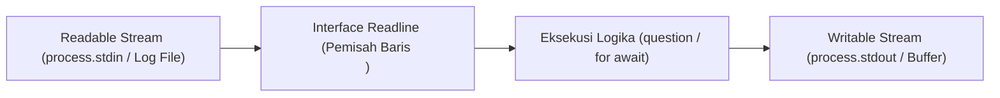

# Readline

> Ringkasan
> - Fungsi: Membaca aliran masukan baris demi baris dari Readable Stream seperti terminal interaktif atau berkas teks.
> - Digunakan saat: Mengajukan pertanyaan interaktif di terminal, membuat antarmuka Command Line Interface (CLI), atau memproses berkas log raksasa secara berurutan.
> - Aturan praktis: Selalu gunakan blok `try...finally` untuk memastikan `rl.close()` dipanggil setelah interaksi selesai agar proses Node.js tidak menggantung akibat stream yang tetap terbuka di Event Loop.

---

## Tujuan Belajar

- Mengonfigurasi antarmuka readline menggunakan API modern `node:readline/promises`.
- Mengajukan pertanyaan interaktif secara sekuensial menggunakan metode `question()`.
- Membaca aliran teks baris demi baris menggunakan pola `for await...of`.
- Mengelola status antarmuka terminal interaktif melalui `setPrompt()`, `pause()`, dan `resume()`.
- Menghindari kebocoran proses aktif dengan penutupan antarmuka secara disiplin.

---

## Konsep

> Modul `node:readline` dianalogikan seperti resepsionis loket layanan masyarakat. Resepsionis mengajukan satu pertanyaan formulir kepada pemohon yang berdiri di depan loket (_Readable Stream_ `stdin`). Pemohon menuliskan jawaban lalu menekan bel atau menyerahkan lembar isian dengan tanda enter (_event_ baris baru). Resepsionis membaca jawaban tersebut, mencatatnya ke buku register, lalu mengajukan pertanyaan berikutnya. Ketika seluruh formulir selesai diisi, resepsionis menutup jendela loket (_`rl.close()`_) sehingga pemohon dapat meninggalkan ruangan dan lampu operasional kantor dapat dipadamkan secara bersih.



---

## Referensi

| Item | Fungsi | Catatan |
| :--- | :--- | :--- |
| **`createInterface()`** | Membuat antarmuka penghubung antara Readable Stream dan Writable Stream | Menerima konfigurasi stream masukan, luaran, dan opsi penanganan baris baru |
| **`question()`** | Menampilkan pertanyaan teks dan menunggu masukan jawaban berbasis Promise | Membutuhkan import dari sub-jalur `node:readline/promises` |
| **`close()`** | Menutup antarmuka pembacaan dan melepaskan listener pada stream masukan | Wajib dipanggil untuk mengizinkan Event Loop keluar secara normal |
| **`for await...of (Readline)`** | Mengiterasi pembacaan baris demi baris dari stream secara asinkron | Sangat hemat memori karena tidak memuat seluruh berkas ke RAM |
| **`setPrompt()`** | Mengonfigurasi teks atau simbol prompt untuk sesi terminal interaktif | Nilai default prompt adalah `> ` jika tidak diubah |
| **`prompt()`** | Menulis teks prompt yang telah ditentukan ke stream keluaran | Menyiapkan kursor masukan bagi pengguna terminal |
| **`pause()`** | Menunda pembacaan aliran data dari stream masukan untuk sementara waktu | Mencegah penumpukan event baris baru saat sistem memproses tugas berat |
| **`resume()`** | Melanjutkan kembali aliran pembacaan stream masukan yang ditunda | Mengaktifkan kembali penerimaan baris data baru |
| **`cursorTo()`** | Memindahkan posisi kursor terminal ke koordinat kolom dan baris tertentu | Memerlukan stream TTY aktif atau stream luaran berkemampuan kontrol escape |

### `createInterface()`

Fungsi `createInterface()` digunakan untuk menginisialisasi objek penghubung yang membaca data baris demi baris dari stream masukan (`input`) dan menulis ke stream luaran (`output`). Fungsi ini merupakan titik awal seluruh interaksi readline.

```javascript
import { createInterface } from 'node:readline/promises';
import { PassThrough } from 'node:stream';

const inputStream = new PassThrough();
const outputStream = new PassThrough();

const rl = createInterface({
  input: inputStream,
  output: outputStream,
});

console.log(typeof rl.question);
// Output: function

rl.close();
```

Kasus lain: Mengaktifkan opsi `crlfDelay: Infinity` saat membaca berkas agar kombinasi karakter `\r\n` (CRLF) pada Windows diperlakukan sebagai satu baris baru tunggal.

```javascript
import { createInterface } from 'node:readline';
import { Readable } from 'node:stream';

const crlfSource = Readable.from(['line 1\r\nline 2\r\n']);
const rl = createInterface({
  input: crlfSource,
  crlfDelay: Infinity,
});

const lines = [];
for await (const text of rl) {
  lines.push(text);
}

console.log(lines.length);
// Output: 2
```

### `question()`

Metode `question()` menulis teks pertanyaan ke stream luaran dan mengembalikan sebuah Promise yang terselesaikan ketika pengguna mengirimkan baris jawaban (menekan Enter). Metode ini menyederhanakan alur tanya-jawab tanpa bersarangnya fungsi callback.

```javascript
import { createInterface } from 'node:readline/promises';
import { PassThrough } from 'node:stream';

const inputStream = new PassThrough();
const outputStream = new PassThrough();
const rl = createInterface({ input: inputStream, output: outputStream });

process.nextTick(() => inputStream.write('John Doe\n'));

const answer = await rl.question('Enter full name: ');
console.log(answer);
// Output: John Doe

rl.close();
```

Kasus lain: Menangani masukan kosong ketika pengguna langsung menekan tombol Enter tanpa mengetik teks apa pun.

```javascript
import { createInterface } from 'node:readline/promises';
import { PassThrough } from 'node:stream';

const inputStream = new PassThrough();
const outputStream = new PassThrough();
const rl = createInterface({ input: inputStream, output: outputStream });

process.nextTick(() => inputStream.write('\n'));

const response = await rl.question('Press enter to continue: ');
console.log(response.length === 0);
// Output: true

rl.close();
```

### `close()`

Metode `close()` menutup instans antarmuka readline, melepaskan kontrol listener dari stream masukan, dan memancarkan event `close`. Metode ini krusial untuk mencegah kebocoran proses yang menggantung.

```javascript
import { createInterface } from 'node:readline/promises';
import { PassThrough } from 'node:stream';

const inputStream = new PassThrough();
const outputStream = new PassThrough();
const rl = createInterface({ input: inputStream, output: outputStream });

let isClosed = false;
rl.on('close', () => {
  isClosed = true;
});

rl.close();
console.log(isClosed);
// Output: true
```

Kasus lain: Memanggil metode operasi seperti `question()` setelah antarmuka ditutup akan melempar galat `ERR_USE_AFTER_CLOSE`.

```javascript
import { createInterface } from 'node:readline/promises';
import { PassThrough } from 'node:stream';

const rl = createInterface({ input: new PassThrough(), output: new PassThrough() });
rl.close();

try {
  await rl.question('Late question: ');
} catch (error) {
  console.log(error.code);
  // Output: ERR_USE_AFTER_CLOSE
}
```

### `for await...of (Readline)`

Pola iterasi `for await...of` memungkinkan pembacaan berkas atau stream baris demi baris secara asinkron tanpa menimbun seluruh isi berkas di dalam memori heap. Pola ini sangat ideal untuk pengolahan berkas log berukuran gigabyte.

```javascript
import { createInterface } from 'node:readline';
import { Readable } from 'node:stream';

const sourceStream = Readable.from([
  '192.168.1.1 GET /index.html 200\n',
  '192.168.1.2 POST /login 401\n',
]);

const rl = createInterface({ input: sourceStream });
const methods = [];

for await (const line of rl) {
  methods.push(line.split(' ')[1]);
}

console.log(methods);
// Output: [ 'GET', 'POST' ]
```

Kasus lain: Stream masukan kosong akan langsung menyelesaikan iterasi tanpa mengeksekusi tubuh loop satu kali pun.

```javascript
import { createInterface } from 'node:readline';
import { Readable } from 'node:stream';

const emptyStream = Readable.from([]);
const rl = createInterface({ input: emptyStream });

let executionCount = 0;
for await (const _line of rl) {
  executionCount++;
}

console.log(executionCount);
// Output: 0
```

### `setPrompt()`

Metode `setPrompt()` menentukan string penanda atau simbol prompt yang akan ditampilkan ke stream keluaran saat program menunggu masukan berikutnya dari pengguna.

```javascript
import { createInterface } from 'node:readline';
import { PassThrough } from 'node:stream';

const outputStream = new PassThrough();
const rl = createInterface({ input: new PassThrough(), output: outputStream });

rl.setPrompt('sql-query> ');

outputStream.on('data', (chunk) => {
  console.log(chunk.toString('utf-8').trim());
  // Output: sql-query>
});

rl.prompt();
rl.close();
```

Kasus lain: Mengubah prompt secara dinamis berdasarkan status autentikasi atau konteks percakapan pengguna.

```javascript
import { createInterface } from 'node:readline';
import { PassThrough } from 'node:stream';

const rl = createInterface({ input: new PassThrough(), output: new PassThrough() });
const isAdmin = true;

rl.setPrompt(isAdmin ? 'admin# ' : 'guest$ ');
console.log(typeof rl.getPrompt);
// Output: function

rl.close();
```

### `prompt()`

Metode `prompt()` mencetak teks prompt yang sudah ditetapkan oleh `setPrompt()` ke stream luaran serta menempatkan kursor pada baris baru agar pengguna siap mengetikkan perintah.

```javascript
import { createInterface } from 'node:readline';
import { PassThrough } from 'node:stream';

const outputStream = new PassThrough();
let printedOutput = '';

outputStream.on('data', (chunk) => {
  printedOutput += chunk.toString('utf-8');
});

const rl = createInterface({ input: new PassThrough(), output: outputStream });
rl.setPrompt('input: ');
rl.prompt();

console.log(printedOutput.trim());
// Output: input:

rl.close();
```

Kasus lain: Menghindari pemindahan kursor yang merusak tampilan terminal saat menggunakan parameter `preserveCursor`.

```javascript
import { createInterface } from 'node:readline';
import { PassThrough } from 'node:stream';

const rl = createInterface({ input: new PassThrough(), output: new PassThrough() });
rl.prompt(true);
console.log(typeof rl.prompt);
// Output: function
rl.close();
```

### `pause()`

Metode `pause()` menangguhkan sementara pembacaan data dari stream masukan. Metode ini berguna ketika aplikasi menerima baris perintah yang memerlukan pemrosesan I/O asinkron yang lama sebelum siap menerima baris berikutnya.

```javascript
import { createInterface } from 'node:readline';
import { PassThrough } from 'node:stream';

const inputStream = new PassThrough();
const rl = createInterface({ input: inputStream, output: new PassThrough() });

rl.pause();
console.log(typeof rl.pause);
// Output: function

rl.close();
```

Kasus lain: Memeriksa apakah penghentian sementara menyebabkan event stream tertunda sampai pemanggilan resume dilakukan.

```javascript
import { createInterface } from 'node:readline';
import { PassThrough } from 'node:stream';

const inputStream = new PassThrough();
const rl = createInterface({ input: inputStream });

let isEmitted = false;
rl.on('line', () => {
  isEmitted = true;
});

rl.pause();
inputStream.write('pending text\n');
console.log(isEmitted);
// Output: false

rl.close();
```

### `resume()`

Metode `resume()` melanjutkan kembali pembacaan stream masukan yang sebelumnya ditangguhkan oleh `pause()`, sehingga antarmuka siap menerima baris data berikutnya.

```javascript
import { createInterface } from 'node:readline';
import { PassThrough } from 'node:stream';

const inputStream = new PassThrough();
const rl = createInterface({ input: inputStream });

rl.pause();
rl.resume();

console.log(typeof rl.resume);
// Output: function

rl.close();
```

Kasus lain: Memastikan baris data yang tertunda saat kondisi jeda diproses segera setelah stream diaktifkan kembali.

```javascript
import { createInterface } from 'node:readline';
import { PassThrough } from 'node:stream';

const inputStream = new PassThrough();
const rl = createInterface({ input: inputStream });
let lineCount = 0;

rl.on('line', () => {
  lineCount++;
});

rl.pause();
inputStream.write('queued line\n');
rl.resume();

process.nextTick(() => {
  console.log(lineCount > 0);
  // Output: true
  rl.close();
});
```

### `cursorTo()`

Fungsi `cursorTo()` dari modul `node:readline` digunakan untuk memindahkan posisi kursor terminal ke koordinat kolom `x` dan baris `y` tertentu pada stream luaran TTY. Fungsi ini umum dipakai untuk merender animasi bilah kemajuan (_progress bar_) pada antarmuka CLI.

```javascript
import readline from 'node:readline';
import { PassThrough } from 'node:stream';

const outputStream = new PassThrough();
let escapeCode = '';

outputStream.on('data', (chunk) => {
  escapeCode += chunk.toString('utf-8');
});

readline.cursorTo(outputStream, 0, 0);
console.log(escapeCode.length > 0);
// Output: true
```

Kasus lain: Melewatkan koordinat tanpa nilai parameter baris `y` hanya memindahkan posisi horizontal kolom pada baris saat ini.

```javascript
import readline from 'node:readline';
import { PassThrough } from 'node:stream';

const outputStream = new PassThrough();
const success = readline.cursorTo(outputStream, 5);

console.log(success);
// Output: true
```

### Perbandingan: Gaya Callback vs Gaya Promises

| Karakteristik | Callback (`node:readline`) | Promises (`node:readline/promises`) |
| :--- | :--- | :--- |
| **Gaya Sintaks** | `rl.question(prompt, (answer) => {})` | `const answer = await rl.question(prompt)` |
| **Alur Pertanyaan Beruntun** | Rawan menghasilkan kode bersarang berlebihan | Linear, terstruktur, dan bersih menggunakan `await` |
| **Top-Level Await** | Memerlukan pembungkus fungsi atau Promise manual | Didukung secara native di modul ESM modern |
| **Penanganan Galat** | Melewatkan galat melalui parameter fungsi callback | Menggunakan blok standar `try...catch...finally` |

---

## Kesalahan Umum

### Lupa Memanggil `rl.close()`

Mengabaikan pemanggilan `rl.close()` setelah sesi interaksi selesai membuat proses Node.js menggantung tanpa henti karena listener stream `process.stdin` terus menahan siklus Event Loop.

```javascript
// Salah
import { createInterface } from 'node:readline/promises';

async function promptUser() {
  const rl = createInterface({ input: process.stdin, output: process.stdout });
  const answer = await rl.question('Continue? (y/n): ');
  console.log('Processing...', answer);
  // Proses tidak akan pernah selesai keluar ke terminal!
}
```

```javascript
// Benar
import { createInterface } from 'node:readline/promises';

async function promptUser() {
  const rl = createInterface({ input: process.stdin, output: process.stdout });
  try {
    const answer = await rl.question('Continue? (y/n): ');
    console.log('Processing...', answer);
  } finally {
    rl.close(); // Menjamin proses dapat keluar dengan bersih
  }
}
```

### Membuka Beberapa Instance Readline pada Stream yang Sama

Membuat beberapa instans `createInterface` secara bersamaan yang mendengarkan `process.stdin` memicu konflik pembacaan buffer masukan, di mana karakter input terpecah atau terduplikasi antar-instans.

```javascript
// Salah
import { createInterface } from 'node:readline/promises';

const rl1 = createInterface({ input: process.stdin, output: process.stdout });
const rl2 = createInterface({ input: process.stdin, output: process.stdout });
const name = await rl1.question('Name: ');
const age = await rl2.question('Age: ');
```

```javascript
// Benar
import { createInterface } from 'node:readline/promises';

const rl = createInterface({ input: process.stdin, output: process.stdout });
try {
  const name = await rl.question('Name: ');
  const age = await rl.question('Age: ');
} finally {
  rl.close();
}
```

### Mengabaikan Penanganan Karakter Spasi Berlebih

Masukan pengguna terminal sering kali menyertakan spasi di awal atau akhir kata yang tidak disengaja, menyebabkan kegagalan validasi logika jika tidak dinormalisasi dengan `.trim()`.

```javascript
// Salah
const choice = await rl.question("Type 'yes' to confirm: ");
if (choice === 'yes') {
  executeAction();
}
```

```javascript
// Benar
const choice = await rl.question("Type 'yes' to confirm: ");
if (choice.trim().toLowerCase() === 'yes') {
  executeAction();
}
```

---

## Studi Kasus

Skenario: Membangun fungsi panduan inisialisasi konfigurasi proyek (_CLI configuration wizard_) yang mengajukan serangkaian pertanyaan interaktif terstruktur, melakukan validasi nilai masukan secara ketat, serta memastikan seluruh sumber daya readline tertutup rapi meskipun terjadi pembatalan atau kegagalan validasi.

```javascript
import { createInterface } from 'node:readline/promises';
import { PassThrough } from 'node:stream';

async function runProjectWizard(inputStream, outputStream) {
  const rl = createInterface({
    input: inputStream,
    output: outputStream,
  });

  const config = {};

  try {
    const projectName = await rl.question('Project package name: ');
    const cleanName = projectName.trim();
    if (!cleanName || !/^[a-z0-9-_]+$/.test(cleanName)) {
      throw new Error('Project name must only contain lowercase alphanumeric characters and hyphens.');
    }
    config.name = cleanName;

    const initialVersion = await rl.question('Initial version (default 1.0.0): ');
    config.version = initialVersion.trim() || '1.0.0';

    const gitInit = await rl.question('Initialize Git repository? (y/n): ');
    config.git = gitInit.trim().toLowerCase() === 'y';

    return {
      success: true,
      data: config,
    };
  } catch (error) {
    return {
      success: false,
      errorMessage: error.message,
    };
  } finally {
    rl.close();
  }
}

// Simulasi masukan stream secara terprogram
const inputMock = new PassThrough();
const outputMock = new PassThrough();

const mockAnswers = ['service-portal\n', '2.1.0\n', 'y\n'];
outputMock.on('data', () => {
  if (mockAnswers.length > 0) {
    inputMock.write(mockAnswers.shift());
  }
});

const wizardResult = await runProjectWizard(inputMock, outputMock);
console.log(wizardResult.success);
// Output: true
console.log(wizardResult.data.name);
// Output: service-portal
console.log(wizardResult.data.version);
// Output: 2.1.0
console.log(wizardResult.data.git);
// Output: true
```

Desain ini dipilih karena memisahkan masukan dan luaran melalui stream yang fleksibel, memanfaatkan `try...finally` untuk menjamin pelepasan listener `stdin`, serta memverifikasi data sebelum disimpan ke struktur konfigurasi akhir.

---

## Latihan Mandiri

### Soal 1 (Dasar)

Buat fungsi asinkron `calculateStreamSum(textStream)` yang menerima Readable Stream berisi baris-baris string angka. Gunakan `createInterface` dan pola iterasi `for await...of` untuk membaca baris demi baris, mengabaikan baris kosong, menjumlahkan seluruh angka, dan mengembalikan objek dengan properti `total` dan `lineCount`.

Contoh masukan:
```javascript
import { Readable } from 'node:stream';
const stream = Readable.from(['15\n', '25\n', '\n', '60\n']);
await calculateStreamSum(stream);
```

Contoh keluaran yang diharapkan:
```javascript
{
  total: 100,
  lineCount: 3
}
```

Batasan: Gunakan modul bawaan `node:readline` dan `node:stream` tanpa dependensi eksternal.

### Soal 2 (Menengah)

Buat fungsi `askWithRetryLimit(rl, questionText, validatorFn, maxRetries)` yang mengajukan pertanyaan kepada pengguna menggunakan `rl.question()`. Jika masukan tidak lulus validasi `validatorFn(answer)`, ajukan kembali pertanyaan tersebut hingga maksimal `maxRetries` kali percobaan. Jika berhasil, kembalikan string jawaban yang bersih (`trim`). Jika batas percobaan habis dan belum valid, lempar galat dengan pesan `'MAX_RETRIES_EXCEEDED'`.

Contoh masukan:
```javascript
const validator = (text) => text.length >= 5;
// Pengguna memasukkan: 'abc', lalu 'abcdef'
await askWithRetryLimit(rl, 'Enter license key (min 5 chars): ', validator, 3);
```

Contoh keluaran yang diharapkan:
```javascript
'abcdef'
```

Batasan: Gunakan antarmuka `node:readline/promises` dan pastikan tidak ada kebocoran promise yang belum terselesaikan.

### Soal 3 (Menantang)

Buat utilitas pengurai berkas log aliran kontinu (_streaming access log aggregator_) bernama `aggregateAccessLogs(logStream)`. Fungsi ini menerima Readable Stream yang menyajikan data log web per baris dengan format string terpisah spasi: `[TIMESTAMP] [IP] [METHOD] [STATUS] [LATENCY_MS]`.

Ketentuan pemrosesan:
- Gunakan `createInterface` untuk memproses aliran data baris demi baris tanpa menampung seluruh teks ke dalam variabel array.
- Hitung total entri log yang valid (`totalRequests`).
- Petakan distribusi kode status ke dalam kategori: `success` (status 200–299), `clientError` (status 400–499), dan `serverError` (status 500–599).
- Hitung rata-rata latensi dalam milidetik dari entri yang valid (`averageLatencyMs`).
- Abaikan dan hitung baris korup (jumlah kolom kurang dari 5 atau nilai status/latensi bukan angka valid) ke dalam properti `invalidLines`.
- Seluruh pembacaan harus aman dan tahan terhadap aliran data masukan raksasa.

Contoh masukan:
```javascript
import { Readable } from 'node:stream';

const logData = Readable.from([
  '2026-10-12T10:00:00Z 10.0.0.1 GET 200 45\n',
  '2026-10-12T10:00:01Z 10.0.0.2 POST 201 120\n',
  'invalid corrupted line without enough tokens\n',
  '2026-10-12T10:00:02Z 10.0.0.3 GET 404 15\n',
  '2026-10-12T10:00:03Z 10.0.0.4 POST 500 350\n'
]);

await aggregateAccessLogs(logData);
```

Contoh keluaran yang diharapkan:
```javascript
{
  totalRequests: 4,
  invalidLines: 1,
  averageLatencyMs: 132.5,
  statusDistribution: {
    success: 2,
    clientError: 1,
    serverError: 1
  }
}
```

Batasan: Wajib menggunakan `node:readline` untuk memproses data stream secara inkremental tanpa memuat seluruh berkas ke memori RAM secara bersamaan. Dilarang menggunakan pustaka pihak ketiga.

---

## Navigasi

[Sebelumnya: Zlib](../17-zlib/README.md) | [Selanjutnya: Report](../19-report/README.md) | [Daftar Isi](../README.md)
