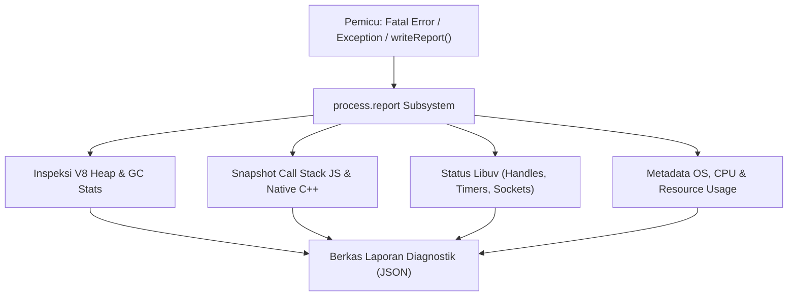

# Report

> Ringkasan
>
> - Fungsi: Menghasilkan dokumen laporan diagnostik mendalam berformat JSON yang merangkum kondisi internal proses Node.js, mesin V8, antrean Libuv, dan lingkungan sistem operasi.
> - Digunakan saat: Menyelidiki penyebab aplikasi mati mendadak (_post-mortem debugging_), menganalisis kebocoran memori (_memory leak_), atau mengumpulkan data performa saat terjadi masalah fatal di server produksi.
> - Aturan praktis: Selalu aktifkan `process.report.excludeEnv = true` agar variabel lingkungan yang menyimpan kunci rahasia dan kata sandi database tidak bocor ke dalam berkas laporan JSON.

---

## Tujuan Belajar

- Mengonfigurasi pembuatan laporan diagnostik otomatis lewat properti `process.report`.
- Menghasilkan berkas laporan diagnostik ke media penyimpanan menggunakan `writeReport()`.
- Mengambil struktur data laporan diagnostik langsung di memori dengan `getReport()`.
- Melindungi data kredensial rahasia dengan menyembunyikan variabel lingkungan via `excludeEnv`.
- Memahami isi komponen utama laporan: alokasi heap V8, jejak _call stack_, dan metrik Libuv.

---

## Konsep

Fitur `process.report` bisa kita bayangkan seperti kotak hitam (_flight data recorder_) pada pesawat terbang. Selama penerbangan berjalan lancar, kotak hitam bersiap merekam berbagai parameter operasional penting di latar belakang.

Jika tiba-tiba terjadi masalah fatal atau mesin pesawat mati mendadak (_fatal error_ atau _crash_), instrumen ini secara otomatis mengabadikan rekaman presisi mengenai status kemudi, temperatur mesin, tekanan kabin, dan percakapan kokpit. Tim penyelidik kemudian dapat membuka rekaman terstruktur tersebut untuk menemukan akar penyebab masalah tanpa perlu menebak-nebak kondisi saat insiden berlangsung.



---

## Referensi

| Item                            | Fungsi                                                                          | Catatan                                                                            |
| :------------------------------ | :------------------------------------------------------------------------------ | :--------------------------------------------------------------------------------- |
| **`writeReport()`**             | Membuat dan menyimpan berkas laporan diagnostik JSON ke disk                    | Menerima parameter nama jalur berkas dan objek error kustom                        |
| **`getReport()`**               | Mengembalikan seluruh data laporan diagnostik langsung sebagai objek JavaScript | Berjalan murni di memori tanpa menulis berkas fisik ke disk                        |
| **`reportOnFatalError`**        | Menulis laporan otomatis saat terjadi error fatal internal pada mesin V8        | Sangat penting untuk menangkap bukti saat memori heap habis (_heap out of memory_) |
| **`reportOnUncaughtException`** | Memicu laporan otomatis saat ada error JavaScript yang tidak tertangkap         | Mengabadikan jejak call stack fungsi sebelum aplikasi terhenti                     |
| **`reportOnSignal`**            | Membuat laporan saat proses menerima sinyal sistem operasi tertentu             | Berguna untuk memeriksa status server yang sedang berjalan via sinyal POSIX        |
| **`excludeEnv`**                | Menghapus daftar `process.env` dari dokumen laporan yang dibuat                 | Mencegah bocornya kunci API dan kata sandi rahasia di laporan                      |
| **`directory`**                 | Menentukan folder tempat menyimpan berkas laporan diagnostik                    | Nilai bawaannya adalah direktori kerja saat ini (`process.cwd()`)                  |
| **`filename`**                  | Mengatur pola nama berkas laporan diagnostik                                    | Mendukung penamaan khusus agar tidak menimpa berkas laporan lama                   |
| **`compact`**                   | Menuliskan JSON laporan dalam satu baris rapat tanpa indentasi                  | Menghemat ruang penyimpanan disk pada server produksi                              |

### `writeReport()`

Metode `writeReport()` mengambil potret menyeluruh dari kondisi runtime Node.js dan menyimpannya sebagai berkas JSON ke penyimpanan lokal. Metode ini mengembalikan nama berkas lengkap yang berhasil dibuat.

```javascript
import process from "node:process";
import os from "node:os";
import path from "node:path";
import fs from "node:fs/promises";

const targetPath = path.join(os.tmpdir(), "test-report.json");
const reportFilename = process.report.writeReport(targetPath);

console.log(typeof reportFilename);
// Output: string

const fileStats = await fs.stat(targetPath);
console.log(fileStats.size > 0);
// Output: true

await fs.unlink(targetPath);
```

Kasus lain: Menyelipkan objek error kustom ke dalam `writeReport()` untuk menyematkan pesan error spesifik ke dalam data tumpukan laporan.

```javascript
import process from "node:process";
import os from "node:os";
import path from "node:path";
import fs from "node:fs/promises";

const customError = new Error("Payment gateway connection lost");
const targetPath = path.join(os.tmpdir(), "error-report.json");

process.report.writeReport(targetPath, customError);
const content = JSON.parse(await fs.readFile(targetPath, "utf-8"));

console.log(content.javascriptStack.message);
// Output: Error: Payment gateway connection lost

await fs.unlink(targetPath);
```

### `getReport()`

Metode `getReport()` mengembalikan seluruh data laporan diagnostik langsung sebagai objek JavaScript di memori tanpa membuat berkas ke disk. Cara ini sangat pas untuk mengirimkan metrik pemeriksaan ke dasbor monitoring eksternal.

```javascript
import process from "node:process";

const report = process.report.getReport();

console.log(typeof report);
// Output: object
console.log(typeof report.header.nodejsVersion);
// Output: string
console.log(typeof report.javascriptHeap.usedMemory);
// Output: number
```

Kasus lain: Memberikan objek error untuk memeriksa call stack fungsi secara instan di memori.

```javascript
import process from "node:process";

const customError = new TypeError("Incompatible data type");
const diagnostic = process.report.getReport(customError);

console.log(diagnostic.javascriptStack.message);
// Output: TypeError: Incompatible data type
```

### `reportOnFatalError`

Properti boolean `reportOnFatalError` mengatur agar Node.js otomatis membuat berkas laporan saat mesin V8 mengalami error fatal yang tidak tertangani, misalnya saat kehabisan alokasi memori heap.

```javascript
import process from "node:process";

process.report.reportOnFatalError = true;

console.log(process.report.reportOnFatalError);
// Output: true
```

Kasus lain: Menonaktifkan fitur pembuatan laporan otomatis saat terjadi error fatal.

```javascript
import process from "node:process";

process.report.reportOnFatalError = false;

console.log(process.report.reportOnFatalError);
// Output: false
```

### `reportOnUncaughtException`

Properti boolean `reportOnUncaughtException` memicu pembuatan laporan diagnostik secara otomatis setiap kali ada error JavaScript yang tidak ditangkap oleh blok `try...catch`.

```javascript
import process from "node:process";

process.report.reportOnUncaughtException = true;

console.log(process.report.reportOnUncaughtException);
// Output: true
```

Kasus lain: Mematikan pemicu otomatis ini jika penanganan pengecualian tak terduga sudah dikelola sendiri secara manual.

```javascript
import process from "node:process";

process.report.reportOnUncaughtException = false;

console.log(process.report.reportOnUncaughtException);
// Output: false
```

### `reportOnSignal`

Properti boolean `reportOnSignal` memungkinkan pembuatan laporan diagnostik saat aplikasi menerima sinyal sistem operasi tertentu (secara bawaan sinyal `SIGUSR2` pada sistem operasi berbasis POSIX/Linux).

```javascript
import process from "node:process";

process.report.reportOnSignal = true;

console.log(process.report.reportOnSignal);
// Output: true
```

Kasus lain: Memeriksa nama sinyal sistem yang dijadikan pemicu pembuatan laporan diagnostik.

```javascript
import process from "node:process";

console.log(process.report.signal);
// Output: SIGUSR2
```

### `excludeEnv`

Properti boolean `excludeEnv` mengatur apakah daftar variabel lingkungan (`process.env`) ikut dicatat ke dalam dokumen laporan. Mengubahnya menjadi `true` adalah langkah penting untuk mencegah kebocoran data rahasia.

```javascript
import process from "node:process";

process.report.excludeEnv = true;
const report = process.report.getReport();

console.log("environmentVariables" in report);
// Output: false
```

Kasus lain: Jika disetel `false`, seluruh variabel lingkungan akan dicatat lengkap di bawah kunci `environmentVariables`.

```javascript
import process from "node:process";

process.report.excludeEnv = false;
const report = process.report.getReport();

console.log("environmentVariables" in report);
// Output: true
```

### `directory`

Properti `directory` menentukan lokasi folder penyimpanan berkas laporan saat `writeReport()` dipanggil tanpa menyebutkan nama jalur berkas secara eksplisit.

```javascript
import process from "node:process";
import os from "node:os";

process.report.directory = os.tmpdir();

console.log(process.report.directory === os.tmpdir());
// Output: true
```

Kasus lain: Membaca nilai bawaan direktori laporan sebelum diubah yang berupa string kosong (mengikuti folder kerja aplikasi saat ini).

```javascript
import process from "node:process";

process.report.directory = "";
console.log(process.report.directory);
// Output:
```

### `filename`

Properti `filename` digunakan untuk menetapkan pola nama berkas laporan yang akan dipakai saat sistem membuat laporan otomatis.

```javascript
import process from "node:process";

process.report.filename = "diagnostic-audit.json";

console.log(process.report.filename);
// Output: diagnostic-audit.json
```

Kasus lain: Mengosongkan kembali nama berkas agar Node.js menggunakan pola nama default bawaan yang menyertakan informasi tanggal dan nomor PID.

```javascript
import process from "node:process";

process.report.filename = "";
console.log(process.report.filename);
// Output:
```

### `compact`

Properti boolean `compact` mengontrol format kerapatan JSON pada laporan. Jika disetel `true`, berkas laporan ditulis dalam satu baris panjang tanpa spasi indentasi agar lebih hemat ukuran disk.

```javascript
import process from "node:process";

process.report.compact = true;

console.log(process.report.compact);
// Output: true
```

Kasus lain: Menyetel ke `false` agar berkas laporan tersusun rapi dengan indentasi multi-baris sehingga nyaman dibaca langsung oleh manusia.

```javascript
import process from "node:process";

process.report.compact = false;

console.log(process.report.compact);
// Output: false
```

### Perbandingan: `writeReport()` vs `getReport()`

| Karakteristik        | `writeReport()`                                       | `getReport()`                                     |
| :------------------- | :---------------------------------------------------- | :------------------------------------------------ |
| **Bentuk Hasil**     | Berkas fisik JSON yang disimpan ke disk               | Objek JavaScript langsung di memori RAM           |
| **Operasi I/O**      | Melakukan operasi tulis berkas ke penyimpanan         | Murni membaca struktur internal runtime di memori |
| **Tujuan Pemakaian** | Analisis pasca-insiden (_post-mortem crash analysis_) | Pemantauan berkala dan integrasi dasbor telemetri |
| **Penggunaan Disk**  | Mengurangi kapasitas ruang simpan disk                | Tidak menggunakan ruang simpan disk sama sekali   |

---

## Kesalahan Umum

### Membiarkan Variabel Lingkungan Terekspos di Laporan Produksi

Secara bawaan properti `excludeEnv` bernilai `false`. Jika berkas laporan JSON diagnostik tidak sengaja terunggah ke tempat umum, informasi rahasia seperti kunci JWT dan kata sandi database akan ikut terbuka.

```javascript
// Salah
import process from "node:process";

process.report.reportOnFatalError = true;
// Seluruh isi process.env akan dicatat di dalam berkas laporan!
```

```javascript
// Benar
import process from "node:process";

process.report.excludeEnv = true;
process.report.reportOnFatalError = true;
// Data variabel lingkungan dibersihkan secara aman dari laporan
```

### Memanggil `writeReport()` di Dalam Perulangan Request Server

Menghasilkan dokumen diagnostik lengkap membutuhkan waktu komputasi untuk memeriksa tumpukan memori V8 dan menulis berkas ke penyimpanan. Memanggilnya di dalam rute HTTP reguler akan memperlambat kinerja server dan menahan Event Loop.

```javascript
// Salah
function handleRequest(req, res) {
  process.report.writeReport(); // Menghambat penanganan request pengguna lain!
  res.end("OK");
}
```

```javascript
// Benar
function handleRequest(req, res) {
  // Hanya panggil penulisan laporan jika terdeteksi anomali kritis yang nyata
  if (isCriticalAnomaly) {
    process.report.writeReport();
  }
  res.end("OK");
}
```

### Lupa Menentukan Folder Penyimpanan Khusus

Jika properti `directory` tidak ditentukan, berkas laporan otomatis akan tersimpan berceceran di direktori kerja aktif proyek, berisiko ikut terunggah ke repositori Git jika polanya belum dimasukkan ke `.gitignore`.

```javascript
// Salah
import process from "node:process";

process.report.reportOnUncaughtException = true;
// Berkas laporan akan dibuat langsung di folder utama aplikasi
```

```javascript
// Benar
import process from "node:process";
import os from "node:os";
import path from "node:path";

process.report.directory = path.join(os.tmpdir(), "node-reports");
process.report.reportOnUncaughtException = true;
```

---

## Studi Kasus

Skenario: Membangun modul pengawas kesehatan memori otomatis (_automated heap health monitor_) yang memantau rasio pemakaian memori V8 Heap secara berkala. Jika penggunaan heap melebihi ambang batas aman 85%, sistem secara aman mengambil snapshot diagnostik via `getReport()`, menyembunyikan variabel lingkungan rahasia, dan menyusun laporan insiden ringkas sebelum terjadi kegagalan fatal akibat kehabisan memori.

```javascript
import process from "node:process";

function inspectMemoryHealth(ratioThreshold = 0.85) {
  // Pastikan variabel lingkungan selalu terlindungi
  process.report.excludeEnv = true;

  const diagnostic = process.report.getReport();
  const heap = diagnostic.javascriptHeap;
  const usageRatio = heap.usedMemory / heap.totalMemory;

  const evaluationResult = {
    timestamp: diagnostic.header.dumpEventTime,
    pid: diagnostic.header.processId,
    nodeVersion: diagnostic.header.nodejsVersion,
    usedMemoryMb: Number((heap.usedMemory / (1024 * 1024)).toFixed(2)),
    totalMemoryMb: Number((heap.totalMemory / (1024 * 1024)).toFixed(2)),
    usageRatio: Number(usageRatio.toFixed(4)),
    isCritical: usageRatio >= ratioThreshold,
    libuvSummary: {
      loopQueueCount: diagnostic.libuv ? diagnostic.libuv.length : 0,
    },
  };

  return evaluationResult;
}

const serverStatus = inspectMemoryHealth(0.9);

console.log(typeof serverStatus.pid);
// Output: number
console.log(serverStatus.usedMemoryMb > 0);
// Output: true
console.log(typeof serverStatus.isCritical);
// Output: boolean
```

Pendekatan ini mengandalkan `getReport()` yang beroperasi langsung di memori tanpa membebani media penyimpanan dengan operasi I/O, serta selalu memastikan kerahasiaan data sensitif dengan menyetel `excludeEnv = true`.

---

## Latihan Mandiri

### Soal 1 (Dasar)

Buat fungsi `getDiagnosticSummary()` yang memanggil `process.report.getReport()` dan mengembalikan objek ringkas berisi properti: `nodeVersion` (string), `arch` (string), `libuvLoopCount` (angka jumlah entri pada libuv atau 0 jika kosong), serta `usedHeapBytes` (angka dari `javascriptHeap.usedMemory`).

Contoh input:

```javascript
getDiagnosticSummary();
```

Contoh output yang diharapkan:

```javascript
{
  nodeVersion: 'v24.15.0',
  arch: 'x64',
  libuvLoopCount: 0,
  usedHeapBytes: 4808224
}
```

Batasan: Gunakan objek bawaan `process.report` tanpa dependensi eksternal.

### Soal 2 (Menengah)

Buat fungsi `configureSecureReport(dirPath, customFilename)` yang menyetel konfigurasi `process.report` ke tingkat keamanan tinggi. Fungsi harus mengatur folder penyimpanan ke `dirPath`, menetapkan nama berkas ke `customFilename`, mengaktifkan `excludeEnv = true`, menyetel `compact = true`, serta mengaktifkan pemicu otomatis `reportOnFatalError = true`. Kembalikan objek status konfigurasi yang memvalidasi bahwa seluruh nilai properti tersebut telah terpasang dengan tepat.

Contoh input:

```javascript
configureSecureReport("/tmp/audit-reports", "critical-report.json");
```

Contoh output yang diharapkan:

```javascript
{
  configuredDirectory: '/tmp/audit-reports',
  configuredFilename: 'critical-report.json',
  isEnvExcluded: true,
  isCompact: true,
  isFatalReportEnabled: true
}
```

Batasan: Gunakan modul bawaan `node:process` tanpa dependensi pihak ketiga.

### Soal 3 (Menantang)

Buat fungsi penganalisis anomali diagnostik terprogram bernama `analyzeCriticalIncident(errorObject, uptimeThresholdSeconds)`. Fungsi ini menerima objek error dan ambang batas minimal durasi berjalan aplikasi.

Ketentuan pemrosesan:

- Pastikan pengaturan `process.report.excludeEnv = true` aktif sebelum mengambil data.
- Ambil objek laporan diagnostik di memori menggunakan `process.report.getReport(errorObject)`.
- Periksa apakah durasi uptime aplikasi saat insiden terjadi berada di bawah `uptimeThresholdSeconds` (menandakan insiden _crash_ saat startup) atau sesudahnya.
- Ambil 2 baris teratas dari `javascriptStack.stack` yang memicu error ke dalam array `stackSnippet`.
- Hitung persentase pemakaian heap terhadap batas maksimal heap (`javascriptHeap.memoryLimit`) dalam format dua angka di belakang koma dengan simbol `%`.
- Jika rasio heap di atas 80% ATAU insiden terjadi di bawah batas uptime (`startupCrash: true`), beri tanda tingkat keparahan sebagai `'HIGH'`. Jika tidak, beri tanda sebagai `'MEDIUM'`.
- Kembalikan objek kesimpulan insiden tanpa menulis berkas fisik ke disk.

Contoh input:

```javascript
const sampleError = new Error("Message queue connection refused");
analyzeCriticalIncident(sampleError, 60);
```

Contoh output yang diharapkan:

```javascript
{
  severity: 'HIGH',
  errorMessage: 'Message queue connection refused',
  startupCrash: true,
  heapUsagePercent: '0.20%',
  stackSnippet: [
    'at file:///app/monitor.js:10:20',
    'at file:///app/server.js:45:12'
  ],
  systemMetadata: {
    platform: 'linux',
    pid: 12345
  }
}
```

Batasan: Dilarang melakukan penulisan berkas ke disk (`writeReport` tidak boleh digunakan). Lakukan analisis murni di memori via `getReport()`.

---

## Navigasi

[Sebelumnya: Readline](../18-readline/README.md) | [Selanjutnya: Util](../20-util/README.md) | [Daftar Isi](../README.md)
