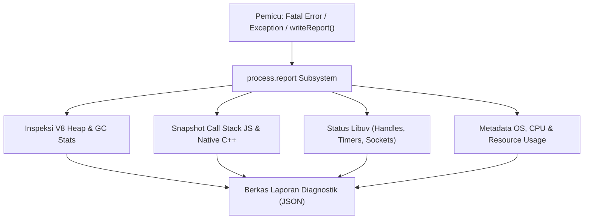

# Report

> Ringkasan
> - Fungsi: Menghasilkan dokumen laporan diagnostik mendalam dalam format JSON yang merangkum status internal proses Node.js, mesin V8, thread pool Libuv, dan lingkungan sistem operasi.
> - Digunakan saat: Menyelidiki insiden aplikasi tumbang mendadak (_post-mortem debugging_), menganalisis kebocoran memori (_memory leak_), atau mengumpulkan telemetri performa fatal di server produksi.
> - Aturan praktis: Selalu aktifkan `process.report.excludeEnv = true` agar variabel lingkungan yang memuat token rahasia dan kata sandi database tidak bocor ke dalam berkas diagnostik JSON.

---

## Tujuan Belajar

- Mengonfigurasi pemicu laporan otomatis melalui properti `process.report`.
- Menghasilkan laporan diagnostik berbasis berkas disk menggunakan `writeReport()`.
- Mengekstrak struktur data laporan diagnostik langsung di memori dengan `getReport()`.
- Melindungi data kredensial sensitif dengan menonaktifkan dump variabel lingkungan via `excludeEnv`.
- Mengurai komponen laporan utama: heap V8, tumpukan panggilan (_call stack_), dan metrik Libuv.

---

## Konsep

> Fitur `process.report` dianalogikan seperti kotak hitam (_flight data recorder_) pada pesawat terbang. Selama penerbangan berjalan normal, kotak hitam bersiaga merekam parameter telemetri penting. Jika terjadi turbulensi ekstrem atau kegagalan mesin mendadak (_fatal error_ atau _crash_), instrumen ini secara otomatis mengabadikan rekaman presisi mengenai status kemudi, temperatur mesin, tekanan kabin, dan percakapan kokpit. Tim penyelidik keselamatan perangkat lunak kemudian dapat membuka rekaman terstruktur tersebut untuk menemukan akar penyebab kegagalan tanpa perlu menebak-nebak kondisi saat insiden berlangsung.



---

## Referensi

| Item | Fungsi | Catatan |
| :--- | :--- | :--- |
| **`writeReport()`** | Menghasilkan dan menulis berkas laporan diagnostik berformat JSON ke disk | Menerima argumen opsional nama jalur berkas dan objek galat kustom |
| **`getReport()`** | Mengembalikan seluruh struktur data laporan diagnostik langsung sebagai objek JavaScript | Berjalan murni di memori tanpa memicu operasi penulisan berkas ke disk |
| **`reportOnFatalError`** | Mengaktifkan pembuatan laporan otomatis ketika terjadi galat fatal internal V8 | Sangat krusial untuk menangkap bukti insiden _JavaScript heap out of memory_ |
| **`reportOnUncaughtException`** | Memicu pembuatan laporan otomatis saat terjadi pengecualian galat yang tidak tertangkap | Menangkap jejak tumpukan fungsi tepat sebelum proses keluar secara abnormal |
| **`reportOnSignal`** | Memicu pembuatan laporan diagnostik saat proses menerima sinyal sistem operasi | Berguna untuk inspeksi proses server yang sedang berjalan via sinyal POSIX |
| **`excludeEnv`** | Menghilangkan kunci dan nilai `process.env` dari dokumen laporan yang dihasilkan | Mencegah kebocoran rahasia sistem seperti API key dan kata sandi basis data |
| **`directory`** | Menentukan jalur folder penyimpanan berkas laporan diagnostik | Nilai bawaan adalah direktori kerja proses saat ini (`process.cwd()`) |
| **`filename`** | Mengatur penamaan berkas laporan diagnostik | Mendukung pembuatan pola penamaan khusus agar tidak menimpa laporan lama |
| **`compact`** | Menulis isi dokumen JSON laporan dalam satu baris ringkas tanpa spasi indentasi | Menghemat alokasi ruang penyimpanan disk pada server produksi |

### `writeReport()`

Metode `writeReport()` mengekstrak kondisi menyeluruh dari runtime Node.js dan menyimpannya sebagai berkas berformat JSON ke sistem berkas lokal. Metode ini mengembalikan nama berkas lengkap yang berhasil ditulis.

```javascript
import process from 'node:process';
import os from 'node:os';
import path from 'node:path';
import fs from 'node:fs/promises';

const targetPath = path.join(os.tmpdir(), 'test-report.json');
const reportFilename = process.report.writeReport(targetPath);

console.log(typeof reportFilename);
// Output: string

const fileStats = await fs.stat(targetPath);
console.log(fileStats.size > 0);
// Output: true

await fs.unlink(targetPath);
```

Kasus lain: Melewatkan objek galat kustom ke dalam `writeReport()` untuk menyematkan konteks galat spesifik ke dalam data tumpukan laporan.

```javascript
import process from 'node:process';
import os from 'node:os';
import path from 'node:path';
import fs from 'node:fs/promises';

const customError = new Error('Payment gateway connection lost');
const targetPath = path.join(os.tmpdir(), 'error-report.json');

process.report.writeReport(targetPath, customError);
const content = JSON.parse(await fs.readFile(targetPath, 'utf-8'));

console.log(content.javascriptStack.message);
// Output: Error: Payment gateway connection lost

await fs.unlink(targetPath);
```

### `getReport()`

Metode `getReport()` mengembalikan representasi objek JavaScript dari seluruh status diagnostik secara langsung di memori tanpa menyentuh disk. Metode ini ideal untuk meneruskan metrik diagnosa ke layanan monitoring eksternal.

```javascript
import process from 'node:process';

const report = process.report.getReport();

console.log(typeof report);
// Output: object
console.log(typeof report.header.nodejsVersion);
// Output: string
console.log(typeof report.javascriptHeap.usedMemory);
// Output: number
```

Kasus lain: Melewatkan objek galat untuk membedah call stack fungsi secara instan tanpa menulis berkas.

```javascript
import process from 'node:process';

const customError = new TypeError('Incompatible data type');
const diagnostic = process.report.getReport(customError);

console.log(diagnostic.javascriptStack.message);
// Output: TypeError: Incompatible data type
```

### `reportOnFatalError`

Properti boolean `reportOnFatalError` mengonfigurasi runtime agar secara otomatis menulis dokumen diagnostik ke disk saat mesin V8 mengalami galat fatal yang tidak dapat dipulihkan, seperti kehabisan alokasi memori heap.

```javascript
import process from 'node:process';

process.report.reportOnFatalError = true;

console.log(process.report.reportOnFatalError);
// Output: true
```

Kasus lain: Menonaktifkan pemicu fatal error untuk menghemat ruang disk jika sistem sudah memiliki mekanisme pelaporan terpisah.

```javascript
import process from 'node:process';

process.report.reportOnFatalError = false;

console.log(process.report.reportOnFatalError);
// Output: false
```

### `reportOnUncaughtException`

Properti boolean `reportOnUncaughtException` memicu pembuatan laporan diagnostik secara otomatis setiap kali ada galat JavaScript yang tidak ditangkap oleh blok `try...catch` sebelum proses dihentikan.

```javascript
import process from 'node:process';

process.report.reportOnUncaughtException = true;

console.log(process.report.reportOnUncaughtException);
// Output: true
```

Kasus lain: Menghindari pembuatan berkas laporan berulang ketika pengembang sudah menangani event `uncaughtException` secara manual.

```javascript
import process from 'node:process';

process.report.reportOnUncaughtException = false;

console.log(process.report.reportOnUncaughtException);
// Output: false
```

### `reportOnSignal`

Properti boolean `reportOnSignal` memungkinkan pembuatan laporan diagnostik saat proses yang sedang berjalan menerima sinyal sistem operasi tertentu (secara bawaan sinyal `SIGUSR2` pada sistem operasi POSIX).

```javascript
import process from 'node:process';

process.report.reportOnSignal = true;

console.log(process.report.reportOnSignal);
// Output: true
```

Kasus lain: Memeriksa nama sinyal sistem yang dikonfigurasikan sebagai pemicu laporan diagnostik.

```javascript
import process from 'node:process';

console.log(process.report.signal);
// Output: SIGUSR2
```

### `excludeEnv`

Properti boolean `excludeEnv` mengatur apakah variabel lingkungan (`process.env`) diikutsertakan di dalam berkas laporan diagnostik. Menyetel properti ini ke `true` mencegah kebocoran kredensial rahasia.

```javascript
import process from 'node:process';

process.report.excludeEnv = true;
const report = process.report.getReport();

console.log('environmentVariables' in report);
// Output: false
```

Kasus lain: Ketika bernilai `false`, seluruh variabel lingkungan akan dicatat lengkap di bawah kunci `environmentVariables`.

```javascript
import process from 'node:process';

process.report.excludeEnv = false;
const report = process.report.getReport();

console.log('environmentVariables' in report);
// Output: true
```

### `directory`

Properti `directory` menentukan jalur folder penyimpanan berkas diagnostik saat `writeReport()` dipanggil tanpa argumen jalur atau saat laporan dipicu secara otomatis oleh sistem.

```javascript
import process from 'node:process';
import os from 'node:os';

process.report.directory = os.tmpdir();

console.log(process.report.directory === os.tmpdir());
// Output: true
```

Kasus lain: Membaca nilai bawaan direktori laporan sebelum diubah yang berupa string kosong (mengikuti direktori kerja saat ini).

```javascript
import process from 'node:process';

process.report.directory = '';
console.log(process.report.directory);
// Output:
```

### `filename`

Properti `filename` menetapkan pola nama berkas laporan yang akan digunakan saat proses menghasilkan laporan otomatis.

```javascript
import process from 'node:process';

process.report.filename = 'diagnostic-audit.json';

console.log(process.report.filename);
// Output: diagnostic-audit.json
```

Kasus lain: Menyetel kembali nama berkas ke string kosong agar Node.js menggunakan penamaan pola default bawaan yang memuat timestamp dan PID.

```javascript
import process from 'node:process';

process.report.filename = '';
console.log(process.report.filename);
// Output:
```

### `compact`

Properti boolean `compact` mengontrol pemformatan JSON laporan diagnostik. Jika bernilai `true`, laporan ditulis sebagai teks JSON satu baris rapat tanpa indentasi.

```javascript
import process from 'node:process';

process.report.compact = true;

console.log(process.report.compact);
// Output: true
```

Kasus lain: Menyetel ke `false` agar berkas yang dihasilkan terformat rapi dengan indentasi multi-baris sehingga mudah dibaca secara visual oleh pengembang.

```javascript
import process from 'node:process';

process.report.compact = false;

console.log(process.report.compact);
// Output: false
```

### Perbandingan: `writeReport()` vs `getReport()`

| Karakteristik | `writeReport()` | `getReport()` |
| :--- | :--- | :--- |
| **Media Luaran** | Berkas fisik JSON yang disimpan ke disk | Objek JavaScript mentah di memori heap |
| **Operasi I/O** | Melakukan penulisan I/O berkas ke sistem penyimpanan | Murni operasi pembacaan struktur internal runtime di memori |
| **Tujuan Pemakaian** | Analisis pasca-kegagalan sistem (_post-mortem crash analysis_) | Pemeriksaan kesehatan berkala dan integrasi telemetri mikro |
| **Kebutuhan Ruang Disk** | Mengurangi kapasitas ruang disk pada server | Tidak menggunakan ruang penyimpanan disk |

---

## Kesalahan Umum

### Membiarkan Variabel Lingkungan Terekspos di Laporan Produksi

Secara bawaan `excludeEnv` bernilai `false`. Jika berkas JSON diagnostik terunggah ke penyimpanan publik atau log aggregator tanpa sanitasi, rahasia seperti kunci JWT dan kata sandi database akan terbongkar.

```javascript
// Salah
import process from 'node:process';

process.report.reportOnFatalError = true;
// Seluruh isi process.env akan dicatat di dalam berkas laporan!
```

```javascript
// Benar
import process from 'node:process';

process.report.excludeEnv = true;
process.report.reportOnFatalError = true;
// Data variabel lingkungan dibersihkan secara aman dari laporan
```

### Memanggil `writeReport()` di Dalam Perulangan Permintaan Aktif

Menghasilkan dump diagnostik lengkap membutuhkan waktu komputasi untuk memeriksa tumpukan memori V8 dan melakukan penulisan berkas ke disk. Memanggilnya di dalam penanganan permintaan HTTP biasa akan memicu latensi tinggi dan memblokir Event Loop.

```javascript
// Salah
function handleRequest(req, res) {
  process.report.writeReport(); // Menghambat pemrosesan permintaan lain!
  res.end('OK');
}
```

```javascript
// Benar
function handleRequest(req, res) {
  // Hanya picu penulisan laporan jika terdeteksi kondisi kritis yang nyata
  if (isCriticalAnomaly) {
    process.report.writeReport();
  }
  res.end('OK');
}
```

### Tidak Menentukan Direktori Penyimpanan Khusus

Jika properti `directory` tidak dikonfigurasi, berkas laporan diagnostik otomatis akan tercecer di direktori kerja aktif proyek, berisiko masuk ke repositori version control (_git commit_) jika pola berkas tidak masuk `.gitignore`.

```javascript
// Salah
import process from 'node:process';

process.report.reportOnUncaughtException = true;
// Laporan akan dibuat langsung di folder root aplikasi
```

```javascript
// Benar
import process from 'node:process';
import os from 'node:os';
import path from 'node:path';

process.report.directory = path.join(os.tmpdir(), 'node-reports');
process.report.reportOnUncaughtException = true;
```

---

## Studi Kasus

Skenario: Membangun modul pengawas kesehatan memori otomatis (_automated heap health monitor_) yang memantau rasio pemakaian memori V8 Heap secara terprogram. Jika penggunaan heap melebihi ambang batas aman 85%, sistem secara aman mengambil snapshot diagnostik internal via `getReport()`, mengecualikan variabel lingkungan rahasia, dan menyusun laporan insiden ringkas sebelum terjadi kegagalan fatal kehabisan memori.

```javascript
import process from 'node:process';

function inspectMemoryHealth(ratioThreshold = 0.85) {
  // Pastikan variabel lingkungan selalu terlindungi
  process.report.excludeEnv = true;

  const diagnostic = process.report.getReport();
  const heap = diagnostic.javascriptHeap;
  const usageRatio = heap.usedMemory / heap.totalMemory;

  const evaluationResult = {
    timestamp: diagnostic.header.dumpEventTime,
    pid: diagnostic.header.processId,
    nodeVersion: diagnostic.header.nodejsVersion,
    usedMemoryMb: Number((heap.usedMemory / (1024 * 1024)).toFixed(2)),
    totalMemoryMb: Number((heap.totalMemory / (1024 * 1024)).toFixed(2)),
    usageRatio: Number(usageRatio.toFixed(4)),
    isCritical: usageRatio >= ratioThreshold,
    libuvSummary: {
      loopQueueCount: diagnostic.libuv ? diagnostic.libuv.length : 0,
    },
  };

  return evaluationResult;
}

const serverStatus = inspectMemoryHealth(0.9);

console.log(typeof serverStatus.pid);
// Output: number
console.log(serverStatus.usedMemoryMb > 0);
// Output: true
console.log(typeof serverStatus.isCritical);
// Output: boolean
```

Desain ini dipilih karena memanfaatkan metode `getReport()` yang beroperasi langsung di memori tanpa membebani disk dengan operasi I/O, serta menegakkan perlindungan data sensitif dengan selalu menyetel `excludeEnv = true`.

---

## Latihan Mandiri

### Soal 1 (Dasar)

Buat fungsi `getDiagnosticSummary()` yang memanggil `process.report.getReport()` dan mengembalikan objek ringkas berisi properti: `nodeVersion` (string), `arch` (string), `libuvLoopCount` (number jumlah entri array handles pada libuv atau 0 jika tidak tersedia), serta `usedHeapBytes` (number dari `javascriptHeap.usedMemory`).

Contoh masukan:
```javascript
getDiagnosticSummary();
```

Contoh keluaran yang diharapkan:
```javascript
{
  nodeVersion: 'v24.15.0',
  arch: 'x64',
  libuvLoopCount: 0,
  usedHeapBytes: 4808224
}
```

Batasan: Gunakan objek bawaan `process.report` tanpa dependensi eksternal.

### Soal 2 (Menengah)

Buat fungsi `configureSecureReport(dirPath, customFilename)` yang mengatur konfigurasi `process.report` ke status proteksi tinggi. Fungsi harus mengatur direktori penyimpanan ke `dirPath`, menetapkan pola nama berkas ke `customFilename`, mengaktifkan `excludeEnv = true`, mengaktifkan `compact = true`, serta mengaktifkan pemicu otomatis `reportOnFatalError = true`. Kembalikan objek status konfigurasi yang memvalidasi bahwa seluruh nilai properti tersebut telah terpasang dengan benar.

Contoh masukan:
```javascript
configureSecureReport('/tmp/audit-reports', 'critical-report.json');
```

Contoh keluaran yang diharapkan:
```javascript
{
  configuredDirectory: '/tmp/audit-reports',
  configuredFilename: 'critical-report.json',
  isEnvExcluded: true,
  isCompact: true,
  isFatalReportEnabled: true
}
```

Batasan: Gunakan modul bawaan `node:process` tanpa dependensi pihak ketiga.

### Soal 3 (Menantang)

Buat fungsi penyaring dan penganalisis anomali diagnostik terprogram bernama `analyzeCriticalIncident(errorObject, uptimeThresholdSeconds)`. Fungsi ini menerima objek galat dan ambang batas minimal durasi berjalan proses.

Ketentuan pemrosesan:
- Pastikan `process.report.excludeEnv = true` aktif sebelum mengambil data.
- Ambil objek laporan diagnostik di memori menggunakan `process.report.getReport(errorObject)`.
- Validasi apakah durasi uptime proses saat insiden terjadi berada di bawah `uptimeThresholdSeconds` (menandakan insiden _crash_ saat startup) atau sesudahnya.
- Ekstrak 2 baris teratas dari `javascriptStack.stack` fungsi yang memicu galat ke dalam array `stackSnippet`.
- Hitung persentase penggunaan heap terhadap batas maksimal heap (`javascriptHeap.memoryLimit`) dengan format dua desimal dan simbol `%`.
- Jika rasio heap di atas 80% ATAU insiden terjadi di bawah batas uptime (`startupCrash: true`), tandai tingkat keparahan sebagai `'HIGH'`. Jika tidak, tandai sebagai `'MEDIUM'`.
- Kembalikan objek kesimpulan insiden tanpa menulis berkas fisik ke disk.

Contoh masukan:
```javascript
const sampleError = new Error('Message queue connection refused');
analyzeCriticalIncident(sampleError, 60);
```

Contoh keluaran yang diharapkan:
```javascript
{
  severity: 'HIGH',
  errorMessage: 'Message queue connection refused',
  startupCrash: true,
  heapUsagePercent: '0.20%',
  stackSnippet: [
    'at file:///app/monitor.js:10:20',
    'at file:///app/server.js:45:12'
  ],
  systemMetadata: {
    platform: 'linux',
    pid: 12345
  }
}
```

Batasan: Tidak boleh melakukan penulisan berkas ke disk (`writeReport` tidak boleh digunakan). Murni analisis memori terprogram via `getReport()`.

---

## Navigasi

[Sebelumnya: Readline](../18-readline/README.md) | [Selanjutnya: Util](../20-util/README.md) | [Daftar Isi](../README.md)
