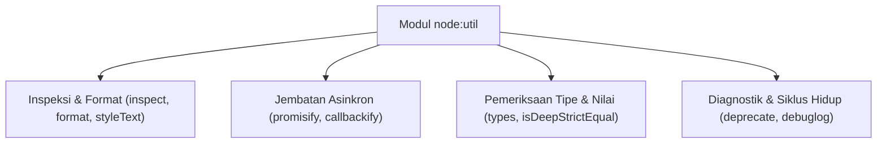

# Util

> Ringkasan
>
> - Fungsi: Menyediakan kumpulan alat bantu internal untuk memformat string teks, memeriksa objek bersarang, mengonversi fungsi asinkron, dan mengecek tipe data internal.
> - Digunakan saat: Memodernisasi fungsi callback lama ke Promise, mencetak struktur objek dengan referensi melingkar tanpa takut aplikasi crash, serta menguji kesamaan dua objek kompleks.
> - Aturan praktis: Selalu manfaatkan `util.promisify` saat menyambungkan fungsi callback `(err, value)` lama ke dalam gaya penulisan modern berbasis `async/await`.

---

## Tujuan Belajar

- Memformat teks terstruktur menggunakan `util.format()` dengan berbagai simbol penentu format (_specifier_).
- Menginspeksi objek bersarang dan referensi melingkar secara aman menggunakan `util.inspect()`.
- Mengonversi fungsi berbasis callback menjadi Promise menggunakan `util.promisify()` dan sebaliknya via `util.callbackify()`.
- Memeriksa tipe data internal mesin V8 secara presisi lewat `util.types`.
- Menguji kesamaan mendalam antara dua objek menggunakan `util.isDeepStrictEqual()`.

---

## Konsep

Modul `node:util` bisa kita bayangkan seperti pisau lipat serbaguna (_Swiss Army Knife_) milik seorang teknisi mekanik. Tentu saja kita tidak menggunakan pisau lipat ini untuk membangun seluruh gedung pabrik dari nol.

Namun, ketika kita butuh kaca pembesar untuk membaca nomor seri komponen yang rumit dan kecil (_`util.inspect`_), kepala adaptor untuk menyambungkan baut lama ke obeng listrik modern (_`util.promisify`_), atau stempel penanda bahwa suatu onderdil sudah mulai usang (_`util.deprecate`_), perkakas bawaan ini siap sedia membantu kita tanpa perlu mengunduh modul tambahan dari luar.



---

## Referensi

| Item                      | Fungsi                                                                         | Catatan                                                                                  |
| :------------------------ | :----------------------------------------------------------------------------- | :--------------------------------------------------------------------------------------- |
| **`format()`**            | Menyusun teks menggunakan format placeholder gaya printf                       | Mendukung `%s` (string), `%d` (angka), `%j` (JSON), dan `%o` (objek)                     |
| **`inspect()`**           | Menghasilkan representasi teks detail dari sebuah objek JavaScript             | Kebal dari error referensi melingkar (_circular reference_) dan mendukung opsi kedalaman |
| **`promisify()`**         | Mengubah fungsi callback _error-first_ menjadi fungsi berbasis Promise         | Mengasumsikan argumen terakhir fungsi adalah callback `(err, result)`                    |
| **`callbackify()`**       | Mengubah fungsi `async` atau Promise menjadi fungsi bergaya callback           | Membantu menjaga kompatibilitas dengan sistem kode lama                                  |
| **`deprecate()`**         | Membungkus fungsi dengan peringatan resmi bahwa fungsi sudah usang             | Mencetak peringatan ke terminal hanya saat fungsi pertama kali dipanggil                 |
| **`types`**               | Kumpulan validator tipe internal V8 yang jauh lebih presisi dibanding `typeof` | Mendukung pengecekan `isDate`, `isPromise`, `isMap`, `isNativeError`, dan lainnya        |
| **`isDeepStrictEqual()`** | Memastikan apakah dua variabel atau objek bernilai sama persis secara mendalam | Membandingkan prototipe, seluruh properti dalam, dan nilai primitif                      |
| **`debuglog()`**          | Membuat fungsi pencatat log kondisional berbasis variabel `NODE_DEBUG`         | Tidak membebani kinerja aplikasi saat flag debug tidak diaktifkan                        |
| **`styleText()`**         | Memberikan format warna dan gaya visual teks pada layar terminal               | Fitur bawaan modern Node.js untuk menghias CLI tanpa dependensi luar                     |

### `format()`

Fungsi `format()` menyusun string teks dengan menggantikan penanda placeholder menggunakan nilai argumen yang kita berikan. Fungsi ini merupakan mesin utama di balik pemformatan pesan pada `console.log`.

```javascript
import util from "node:util";

const message = util.format(
  "User %s (ID: %d) has balance: $%d",
  "Santoso",
  102,
  500,
);

console.log(message);
// Output: User Santoso (ID: 102) has balance: $500
```

Kasus lain: Menggunakan placeholder `%j` untuk langsung mengubah objek menjadi teks JSON di tengah kalimat.

```javascript
import util from "node:util";

const jsonText = util.format("Event status: %j", { active: true, code: 200 });

console.log(jsonText);
// Output: Event status: {"active":true,"code":200}
```

### `inspect()`

Fungsi `inspect()` menghasilkan teks diagnostik dari suatu objek dengan membuka susunan internalnya hingga tingkat kedalaman tertentu. Fungsi ini sangat aman digunakan karena tidak akan crash saat menjumpai referensi melingkar (_circular reference_).

```javascript
import util from "node:util";

const rootObject = { name: "Root" };
rootObject.circularRef = rootObject;

const inspected = util.inspect(rootObject, { depth: 2 });
console.log(inspected.includes("[Circular"));
// Output: true
```

Kasus lain: Mengatur opsi `{ depth: null }` untuk membuka seluruh lapisan objek bersarang tanpa ada batasan pemotongan level.

```javascript
import util from "node:util";

const deeplyNested = { a: { b: { c: { d: "target" } } } };
const result = util.inspect(deeplyNested, { depth: null });

console.log(result.includes("target"));
// Output: true
```

### `promisify()`

Fungsi `promisify()` mengambil fungsi yang mengikuti format callback tradisional Node.js `(err, value)` lalu mengubahnya menjadi fungsi berbasis Promise yang bisa kita panggil rapi dengan kata kunci `await`.

```javascript
import util from "node:util";

function fetchUserProfile(id, callback) {
  if (id <= 0) {
    callback(new Error("Invalid user ID"));
    return;
  }
  callback(null, { id, name: "John" });
}

const fetchUserProfileAsync = util.promisify(fetchUserProfile);
const profile = await fetchUserProfileAsync(10);

console.log(profile.name);
// Output: John
```

Kasus lain: Menangkap penolakan Promise saat fungsi callback mengirimkan objek error pada parameter pertamanya.

```javascript
import util from "node:util";

function failOperation(callback) {
  callback(new Error("Connection failed"));
}

const failOperationAsync = util.promisify(failOperation);

try {
  await failOperationAsync();
} catch (error) {
  console.log(error.message);
  // Output: Connection failed
}
```

### `callbackify()`

Fungsi `callbackify()` adalah kebalikan dari `promisify`. Fungsi ini membungkus fungsi `async` agar dapat menerima callback `(err, result)` sebagai parameter penutup, memudahkan integrasi dengan kode lama.

```javascript
import util from "node:util";

async function calculateDiscountAsync(price) {
  return price * 0.9;
}

const calculateDiscountCallback = util.callbackify(calculateDiscountAsync);

calculateDiscountCallback(100000, (err, result) => {
  console.log(result);
  // Output: 90000
});
```

Kasus lain: Meneruskan error yang dilempar oleh fungsi async ke parameter pertama fungsi callback.

```javascript
import util from "node:util";

async function throwAsyncError() {
  throw new Error("Computation failure");
}

const callbackFn = util.callbackify(throwAsyncError);

callbackFn((err, _result) => {
  console.log(err.message);
  // Output: Computation failure
});
```

### `deprecate()`

Fungsi `deprecate()` membungkus fungsi yang sudah tidak disarankan lagi penggunaannya dan secara otomatis mencetak pesan peringatan ke layar terminal saat fungsi tersebut pertama kali dipanggil.

```javascript
import util from "node:util";

const legacyAdd = util.deprecate(
  (a, b) => a + b,
  "legacyAdd() is deprecated. Use modern calculator.",
  "DEP_ADD_001",
);

const sum = legacyAdd(5, 10);
console.log(sum);
// Output: 15
```

Kasus lain: Pemanggilan kedua dan seterusnya tidak akan mencetak peringatan berulang ke konsol agar log terminal tetap bersih.

```javascript
import util from "node:util";

const legacyProcess = util.deprecate(
  (x) => x * 2,
  "legacyProcess is deprecated",
);
console.log(legacyProcess(4));
// Output: 8
console.log(legacyProcess(5));
// Output: 10
```

### `types`

Sub-objek `util.types` menyediakan berbagai fungsi pengecekan tipe data internal mesin V8 secara akurat, mengatasi keterbatasan operator bawaan `typeof` yang sering kali menganggap banyak tipe berbeda sebagai `'object'`.

```javascript
import util from "node:util";

console.log(util.types.isDate(new Date()));
// Output: true
console.log(util.types.isPromise(Promise.resolve()));
// Output: true
console.log(util.types.isMap(new Map()));
// Output: true
```

Kasus lain: Membedakan objek error bawaan JavaScript dari objek literal biasa.

```javascript
import util from "node:util";

console.log(util.types.isNativeError(new TypeError("Invalid type")));
// Output: true
console.log(util.types.isNativeError({ message: "Not a native error" }));
// Output: false
```

### `isDeepStrictEqual()`

Fungsi `isDeepStrictEqual()` membandingkan dua nilai secara mendalam dan ketat. Fungsi ini memverifikasi kesamaan struktur objek, elemen array, kesamaan tipe primitif, hingga rantai prototipe.

```javascript
import util from "node:util";

const objA = { tags: ["nodejs", "backend"], config: { active: true } };
const objB = { tags: ["nodejs", "backend"], config: { active: true } };

console.log(util.isDeepStrictEqual(objA, objB));
// Output: true
```

Kasus lain: Menemukan perbedaan jika urutan elemen array berbeda atau jika tipe data primitifnya tidak sama persis (misal angka vs teks angka).

```javascript
import util from "node:util";

const arrayA = [1, 2, "3"];
const arrayB = [1, 2, 3];

console.log(util.isDeepStrictEqual(arrayA, arrayB));
// Output: false
```

### `debuglog()`

Fungsi `debuglog()` menghasilkan fungsi pencatat log yang hanya akan mencetak pesan ke terminal jika variabel lingkungan `NODE_DEBUG` menyertakan nama kategori yang cocok.

```javascript
import util from "node:util";

const debugServer = util.debuglog("http-server");

console.log(typeof debugServer);
// Output: function
```

Kasus lain: Memeriksa nilai properti `enabled` untuk mengetahui apakah pencatatan log pada kategori tersebut sedang aktif.

```javascript
import util from "node:util";

const debugDb = util.debuglog("database");
console.log(typeof debugDb.enabled);
// Output: boolean
```

### `styleText()`

Fungsi `styleText()` digunakan untuk mewarnai teks, menebalkan font, atau menambahkan garis bawah pada teks terminal secara native tanpa memerlukan library tambahan dari luar.

```javascript
import util from "node:util";

const boldText = util.styleText("bold", "System Notification");

console.log(typeof boldText);
// Output: string
console.log(boldText.includes("System Notification"));
// Output: true
```

Kasus lain: Mengombinasikan beberapa gaya tampilan sekaligus menggunakan array.

```javascript
import util from "node:util";

const styledText = util.styleText(["red", "underline"], "Fatal Error");
console.log(typeof styledText);
// Output: string
```

### Perbandingan: `promisify()` vs `callbackify()`

| Karakteristik          | `promisify()`                                     | `callbackify()`                                        |
| :--------------------- | :------------------------------------------------ | :----------------------------------------------------- |
| **Bentuk Input**       | Fungsi callback konvensional `(..., cb)`          | Fungsi berbasis Promise atau fungsi `async`            |
| **Bentuk Output**      | Mengembalikan Promise yang bisa di-`await`        | Menerima fungsi callback di parameter penutup          |
| **Penanganan Error**   | Melempar error lewat penolakan Promise (`reject`) | Menyerahkan error ke argumen pertama callback (`err`)  |
| **Skenario Pemakaian** | Memodernisasi library lama agar enak dibaca       | Menjaga kecocokan fungsi baru untuk pengguna kode lama |

---

## Kesalahan Umum

### Memakai `promisify` pada Fungsi yang Tidak Sesuai Standar Callback

Fungsi `util.promisify` mengasumsikan callback selalu berada di parameter paling akhir dan menerima argumen `(err, result)`. Jika fungsi warisan tidak mengikuti format ini (misalnya parameter terbalik `(result, err)`), `promisify` akan salah memetakan nilai hasil dan pesan error.

```javascript
// Salah
function legacyOperation(callback, value) {
  callback(value); // Posisi callback di awal dan tidak mengikuti pola error-first
}
const badPromisify = util.promisify(legacyOperation);
```

```javascript
// Benar
function standardOperation(value, callback) {
  callback(null, value); // Mengikuti format standar (err, result) di parameter akhir
}
const correctPromisify = util.promisify(standardOperation);
```

### Menggunakan `JSON.stringify` untuk Mengecek Objek Melingkar

Mencoba mencetak objek yang mereferensikan dirinya sendiri menggunakan `JSON.stringify` akan memicu error fatal `TypeError: Converting circular structure to JSON` yang membuat aplikasi langsung crash.

```javascript
// Salah
const parent = { name: "Parent" };
parent.self = parent;
console.log(JSON.stringify(parent)); // Crash dengan TypeError!
```

```javascript
// Benar
import util from "node:util";

const parent = { name: "Parent" };
parent.self = parent;
console.log(util.inspect(parent, { depth: 2 })); // Aman dan menampilkan penanda [Circular]
```

### Mengandalkan `typeof` untuk Validasi Objek Kompleks

Operator `typeof` mengembalikan string `'object'` untuk tipe Date, RegExp, Map, dan Promise, sehingga rawan menimbulkan kesalahan pengecekan data jika tidak berhati-hati.

```javascript
// Salah
function validateDate(input) {
  return typeof input === "object"; // Objek biasa {}, [], atau null akan ikut lolos
}
```

```javascript
// Benar
import util from "node:util";

function validateDate(input) {
  return util.types.isDate(input); // Akurat memvalidasi instance Date native
}
```

---

## Studi Kasus

Skenario: Membangun modul adaptor klien database warisan (_legacy database client adapter_) yang memodernisasi fungsi-fungsi berbasis callback kuno menjadi antarmuka modern berbasis `async/await`, memvalidasi tipe data input secara presisi menggunakan `util.types`, serta menyediakan representasi log inspeksi yang aman terhadap referensi melingkar.

```javascript
import util from "node:util";

class LegacyDatabaseClient {
  query(sql, callback) {
    if (!sql || typeof sql !== "string") {
      callback(new TypeError("SQL query must be a valid string"));
      return;
    }
    // Simulasi data hasil query yang memiliki relasi melingkar
    const row = { id: 1, query: sql };
    const transaction = { transactionId: "TRX-99", entry: row };
    row.transaction = transaction; // Hubungan melingkar

    callback(null, [row]);
  }
}

class ModernDatabaseAdapter {
  #legacyClient;
  #queryAsync;

  constructor(legacyClient) {
    this.#legacyClient = legacyClient;
    // Konversi metode callback ke Promise dengan binding konteks instance
    this.#queryAsync = util.promisify(
      this.#legacyClient.query.bind(this.#legacyClient),
    );
  }

  async executeQuery(sql) {
    const result = await this.#queryAsync(sql);
    return result;
  }

  formatAuditResult(result) {
    // Inspeksi aman tanpa risiko crash akibat struktur melingkar
    return util.inspect(result, { depth: 3, compact: true });
  }
}

const adapter = new ModernDatabaseAdapter(new LegacyDatabaseClient());
const data = await adapter.executeQuery("SELECT * FROM users");

console.log(Array.isArray(data));
// Output: true
console.log(data[0].id);
// Output: 1

const auditLog = adapter.formatAuditResult(data);
console.log(auditLog.includes("[Circular"));
// Output: true
```

Arsitektur ini memadukan `util.promisify` untuk menjembatani integrasi basis kode modern, sekaligus mengamankan pencatatan log audit dari ancaman error circular reference menggunakan `util.inspect`.

---

## Latihan Mandiri

### Soal 1 (Dasar)

Buat fungsi `formatAuditMessage(moduleCode, actionName, payload)` yang menggunakan `util.format` untuk merangkai string log terstruktur dengan pola `"[MODULE:%s] Action '%s' executed with payload: %j"`.

Contoh input:

```javascript
formatAuditMessage("AUTH", "LOGIN_FAILURE", { ip: "127.0.0.1", attempts: 3 });
```

Contoh output yang diharapkan:

```javascript
"[MODULE:AUTH] Action 'LOGIN_FAILURE' executed with payload: {\"ip\":\"127.0.0.1\",\"attempts\":3}";
```

Batasan: Gunakan modul bawaan `node:util` tanpa penggabungan string manual.

### Soal 2 (Menengah)

Buat fungsi `modernizeClient(callbackClient)` yang menerima objek dengan metode callback legacy `fetchData(key, callback)` dan `saveData(key, value, callback)`. Fungsi harus mengembalikan objek baru yang memiliki metode modern `fetchDataAsync(key)` dan `saveDataAsync(key, value)` berbasis Promise menggunakan `util.promisify`. Selain itu, tambahkan peringatan usang via `util.deprecate` jika pemanggil masih mengakses metode callback aslinya.

Contoh input:

```javascript
const legacyClient = {
  fetchData(key, cb) {
    cb(null, "value-" + key);
  },
  saveData(key, val, cb) {
    cb(null, true);
  },
};

const modernClient = modernizeClient(legacyClient);
await modernClient.fetchDataAsync("settings");
```

Contoh output yang diharapkan:

```javascript
"value-settings";
```

Batasan: Gunakan `util.promisify` dan `util.deprecate` dari `node:util`.

### Soal 3 (Menantang)

Buat fungsi penganalisis perubahan status aplikasi (_state change auditor_) bernama `auditStateChange(oldState, newState)`.

Ketentuan pemrosesan:

- Gunakan `util.isDeepStrictEqual` untuk memeriksa apakah kedua status benar-benar identik. Jika ya, kembalikan objek `{ hasChanged: false, summary: 'States are identical' }`.
- Jika mengalami perubahan, periksa kunci-kunci pada level pertama:
  - Bandingkan kesamaan nilai pada masing-masing kunci menggunakan `util.isDeepStrictEqual`.
  - Jika nilainya berupa objek khusus V8 (seperti `Date`, `Map`, atau `Promise`), gunakan `util.types` untuk mencatat tipe spesifiknya ke dalam metadata laporan.
  - Jika objek memuat referensi melingkar (_circular reference_), gunakan `util.inspect` dengan batasan kedalaman `depth: 2` untuk menghasilkan representasi string ringkas tanpa memicu error runtime.
- Kembalikan objek `{ hasChanged: true, changedKeys: [...], inspectedSummary: '<string>' }`.

Contoh input 1 (kasus identik):

```javascript
const s1 = { date: new Date("2026-01-01"), counter: 5 };
const s2 = { date: new Date("2026-01-01"), counter: 5 };
auditStateChange(s1, s2);
```

Contoh output 1:

```javascript
{
  hasChanged: false,
  summary: 'States are identical'
}
```

Contoh input 2 (kasus ada perubahan dan struktur melingkar):

```javascript
const objA = { role: "guest" };
const objB = { role: "admin", timestamp: new Date("2026-10-12") };
objB.self = objB;
auditStateChange(objA, objB);
```

Contoh output 2:

```javascript
{
  hasChanged: true,
  changedKeys: [ 'role', 'timestamp', 'self' ],
  inspectedSummary: "<ref *1> { role: 'admin', timestamp: 2026-10-12T00:00:00.000Z, self: [Circular *1] }"
}
```

Batasan: Wajib menggunakan `util.isDeepStrictEqual`, `util.types`, dan `util.inspect`. Dilarang menggunakan dependensi eksternal dari NPM.

---

## Navigasi

[Sebelumnya: Report](../19-report/README.md) | [Selanjutnya: Debugger](../21-debugger/README.md) | [Daftar Isi](../README.md)
