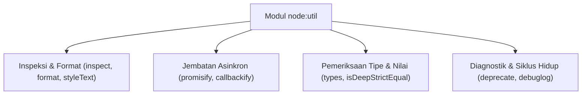

# Util

> Ringkasan
>
> - Fungsi: Menyediakan koleksi utilitas pembantu internal untuk pemformatan string, inspeksi objek mendalam, konversi fungsi asinkron, dan pengecekan tipe data tingkat rendah.
> - Digunakan saat: Memodernisasi fungsi callback warisan ke Promise, mencetak struktur objek yang memiliki referensi melingkar tanpa memicu crash, serta memvalidasi kesetaraan objek kompleks.
> - Aturan praktis: Selalu gunakan `util.promisify` saat mengintegrasikan pustaka berbasis callback `(err, value)` ke dalam basis kode modern berbasis `async/await`.

---

## Tujuan Belajar

- Memformat teks terstruktur menggunakan `util.format()` dengan berbagai penentu format (_specifier_).
- Menginspeksi objek bersarang dan referensi melingkar secara aman menggunakan `util.inspect()`.
- Mengonversi fungsi berbasis callback menjadi Promise menggunakan `util.promisify()` dan sebaliknya via `util.callbackify()`.
- Memeriksa tipe data internal V8 secara akurat memanfaatkan sub-modul `util.types`.
- Menguji kesetaraan mendalam dua struktur data menggunakan `util.isDeepStrictEqual()`.

---

## Konsep

> Modul `node:util` dianalogikan seperti pisau lipat serbaguna (_Swiss Army Knife_) milik seorang teknisi mekanik. Anda tidak menggunakan pisau lipat tersebut untuk membangun seluruh gedung pabrik dari awal. Namun, ketika Anda membutuhkan kaca pembesar untuk membaca nomor seri mikro pada komponen yang rumit (_`util.inspect`_), obeng adaptor untuk menyambungkan sekrup standar lama ke perkakas listrik modern (_`util.promisify`_), atau stempel penanda aus pada suku cadang usang (_`util.deprecate`_), perkakas ini menyediakan solusi bawaan yang siap pakai tanpa harus membeli alat baru dari toko luar.



---

## Referensi

| Item | Fungsi | Catatan |
| :--- | :--- | :--- |
| **`format()`** | Memformat teks menggunakan penentu format placeholder gaya printf | Mendukung `%s` (string), `%d` (angka), `%j` (JSON), dan `%o` (objek) |
| **`inspect()`** | Mengembalikan representasi string terperinci dari objek JavaScript | Aman dari galat referensi melingkar (_circular reference_) dan mendukung opsi kedalaman |
| **`promisify()`** | Mengubah fungsi berbasis callback _error-first_ menjadi fungsi yang mengembalikan Promise | Mengasumsikan argumen terakhir fungsi adalah callback `(err, result)` |
| **`callbackify()`** | Mengubah fungsi berbasis Promise atau `async` menjadi fungsi berbasis callback | Berguna untuk menjaga kompatibilitas ke belakang dengan sistem warisan |
| **`deprecate()`** | Membungkus fungsi dengan peringatan resmi bahwa fungsi telah usang | Menampilkan peringatan ke `process.stderr` hanya saat fungsi pertama kali dipanggil |
| **`types`** | Kumpulan validator tipe internal V8 yang lebih presisi dibanding `typeof` | Mendukung pengujian `isDate`, `isPromise`, `isMap`, `isNativeError`, dan lainnya |
| **`isDeepStrictEqual()`** | Menguji apakah dua nilai atau struktur objek identik secara mendalam | Membandingkan prototipe, enumerable properties, dan nilai primitif |
| **`debuglog()`** | Membuat fungsi logging kondisional berbasis variabel lingkungan `NODE_DEBUG` | Tidak menghasilkan beban I/O saat flag debug terkait tidak diaktifkan |
| **`styleText()`** | Memberikan format warna dan gaya visual ANSI pada teks terminal | Fitur native modern Node.js untuk dekorasi CLI tanpa dependensi eksternal |

### `format()`

Fungsi `format()` menyusun string dengan menggantikan placeholder penentu format (_specifier_) menggunakan nilai argumen yang diberikan. Fungsi ini menjadi fondasi pemformatan pesan pada `console.log`.

```javascript
import util from "node:util";

const pesan = util.format("Pengguna %s (ID: %d) memiliki saldo: $%d", "Santoso", 102, 500);

console.log(pesan);
// Output: Pengguna Santoso (ID: 102) memiliki saldo: $500
```

Kasus lain: Melewatkan placeholder `%j` untuk merender objek ke format JSON langsung di tengah string.

```javascript
import util from "node:util";

const teksJson = util.format("Status event: %j", { aktif: true, kode: 200 });

console.log(teksJson);
// Output: Status event: {"aktif":true,"kode":200}
```

### `inspect()`

Fungsi `inspect()` menghasilkan string diagnostik dari suatu objek, membedah struktur internalnya hingga tingkat kedalaman tertentu. Fungsi ini kebal terhadap referensi melingkar yang biasanya menggagalkan `JSON.stringify`.

```javascript
import util from "node:util";

const dataInduk = { nama: "Induk" };
dataInduk.lingkaran = dataInduk; // Circular reference

const cetak = util.inspect(dataInduk, { depth: 2 });
console.log(cetak.includes("[Circular"));
// Output: true
```

Kasus lain: Menggunakan opsi `depth: null` untuk membuka seluruh struktur hierarki objek bersarang tanpa batas pemotongan.

```javascript
import util from "node:util";

const strukturDalam = { a: { b: { c: { d: "target" } } } };
const hasil = util.inspect(strukturDalam, { depth: null });

console.log(hasil.includes("target"));
// Output: true
```

### `promisify()`

Fungsi `promisify()` mengambil fungsi yang mengikuti konvensi callback _error-first_ Node.js `(err, value)` dan mengembalikannya sebagai fungsi berbasis Promise yang dapat dipanggil dengan `await`.

```javascript
import util from "node:util";

function ambilProfilPengguna(id, callback) {
  if (id <= 0) {
    callback(new Error("ID tidak valid"));
    return;
  }
  callback(null, { id, nama: "Budi" });
}

const ambilProfilAsync = util.promisify(ambilProfilPengguna);
const profil = await ambilProfilAsync(10);

console.log(profil.nama);
// Output: Budi
```

Kasus lain: Menangkap penolakan Promise ketika fungsi callback mengembalikan parameter error.

```javascript
import util from "node:util";

function operasiGagal(callback) {
  callback(new Error("Koneksi gagal"));
}

const operasiAsync = util.promisify(operasiGagal);

try {
  await operasiAsync();
} catch (error) {
  console.log(error.message);
  // Output: Koneksi gagal
}
```

### `callbackify()`

Fungsi `callbackify()` adalah kebalikan dari `promisify`. Fungsi ini membungkus fungsi `async` atau fungsi pengembali Promise agar dapat menerima argumen callback `(err, result)` sebagai parameter penutup.

```javascript
import util from "node:util";

async function hitungDiskonAsync(harga) {
  return harga * 0.9;
}

const hitungDiskonCallback = util.callbackify(hitungDiskonAsync);

hitungDiskonCallback(100000, (err, hasil) => {
  console.log(hasil);
  // Output: 90000
});
```

Kasus lain: Meneruskan galat yang dilempar dari fungsi async ke parameter pertama fungsi callback.

```javascript
import util from "node:util";

async function lemparGalatAsync() {
  throw new Error("Kegagalan komputasi");
}

const fungsiCallback = util.callbackify(lemparGalatAsync);

fungsiCallback((err, _hasil) => {
  console.log(err.message);
  // Output: Kegagalan komputasi
});
```

### `deprecate()`

Fungsi `deprecate()` membungkus fungsi yang sudah tidak direkomendasikan dan mencetak peringatan _deprecation warning_ ke stream `process.stderr` saat pertama kali fungsi tersebut dipanggil oleh runtime.

```javascript
import util from "node:util";

const tambahLama = util.deprecate(
  (a, b) => a + b,
  "tambahLama() telah usang. Gunakan kalkulator modern.",
  "DEP_TAMBAH_001"
);

const hasil = tambahLama(5, 10);
console.log(hasil);
// Output: 15
```

Kasus lain: Pemanggilan kedua dan seterusnya tidak akan mencetak peringatan berulang ke konsol guna mencegah polusi log.

```javascript
import util from "node:util";

const prosesLama = util.deprecate((x) => x * 2, "prosesLama usang");
console.log(prosesLama(4));
// Output: 8
console.log(prosesLama(5));
// Output: 10
```

### `types`

Sub-objek `util.types` menyediakan serangkaian fungsi predikat untuk mengidentifikasi tipe data internal V8 secara akurat, mengatasi keterbatasan operator bawaan `typeof` yang sering kali ambigu.

```javascript
import util from "node:util";

console.log(util.types.isDate(new Date()));
// Output: true
console.log(util.types.isPromise(Promise.resolve()));
// Output: true
console.log(util.types.isMap(new Map()));
// Output: true
```

Kasus lain: Membedakan objek galat native dari objek literal biasa.

```javascript
import util from "node:util";

console.log(util.types.isNativeError(new TypeError("Tipe salah")));
// Output: true
console.log(util.types.isNativeError({ message: "Bukan error native" }));
// Output: false
```

### `isDeepStrictEqual()`

Fungsi `isDeepStrictEqual()` membandingkan dua nilai secara mendalam dan ketat. Fungsi ini memverifikasi kesetaraan struktur objek, elemen array, kesamaan tipe primitif, dan prototipe.

```javascript
import util from "node:util";

const objekA = { tags: ["nodejs", "backend"], konfigurasi: { aktif: true } };
const objekB = { tags: ["nodejs", "backend"], konfigurasi: { aktif: true } };

console.log(util.isDeepStrictEqual(objekA, objekB));
// Output: true
```

Kasus lain: Mendeteksi ketidaksamaan jika urutan elemen dalam array berbeda atau ada perbedaan tipe data primitif.

```javascript
import util from "node:util";

const arrayA = [1, 2, "3"];
const arrayB = [1, 2, 3];

console.log(util.isDeepStrictEqual(arrayA, arrayB));
// Output: false
```

### `debuglog()`

Fungsi `debuglog()` menghasilkan fungsi logging yang hanya akan mencetak pesan ke terminal jika variabel lingkungan `NODE_DEBUG` memuat nama bagian (_section_) yang ditentukan.

```javascript
import util from "node:util";

const debugServer = util.debuglog("http-server");

console.log(typeof debugServer);
// Output: function
```

Kasus lain: Memeriksa properti `enabled` pada fungsi debuglog untuk mengecek apakah logging bagian tersebut sedang aktif.

```javascript
import util from "node:util";

const debugDb = util.debuglog("database");
console.log(typeof debugDb.enabled);
// Output: boolean
```

### `styleText()`

Fungsi `styleText()` menerapkan format warna, garis bawah, atau ketebalan font teks terminal menggunakan kode escape ANSI standar tanpa membutuhkan dependensi pustaka pihak ketiga.

```javascript
import util from "node:util";

const teksTebal = util.styleText("bold", "Pemberitahuan Sistem");

console.log(typeof teksTebal);
// Output: string
console.log(teksTebal.includes("Pemberitahuan Sistem"));
// Output: true
```

Kasus lain: Menerapkan beberapa gaya visual sekaligus menggunakan format array.

```javascript
import util from "node:util";

const teksMerahGarisBawah = util.styleText(["red", "underline"], "Kesalahan Fatal");
console.log(typeof teksMerahGarisBawah);
// Output: string
```

### Perbandingan: `promisify()` vs `callbackify()`

| Karakteristik | `promisify()` | `callbackify()` |
| :--- | :--- | :--- |
| **Masukan Fungsi** | Fungsi berbasis callback konvensional `(..., cb)` | Fungsi berbasis Promise atau `async function` |
| **Keluaran Fungsi** | Mengembalikan Promise (`awaitable`) | Menerima fungsi callback sebagai parameter terakhir |
| **Penanganan Galat** | Melempar eksepsi via penolakan Promise (`reject`) | Meneruskan galat ke argumen pertama callback (`err`) |
| **Skenario Penggunaan** | Memodernisasi pustaka warisan untuk digunakan di ESM | Mempertahankan kompatibilitas pustaka baru bagi konsumen lama |

---

## Kesalahan Umum

### Memakai `promisify` pada Fungsi yang Tidak Mengikuti Standar Callback

Fungsi `util.promisify` mengasumsikan callback selalu berada di parameter terakhir dan menerima argumen `(err, result)`. Jika fungsi legacy tidak mengikuti pola ini (misalnya `(result, err)` atau tidak menerima err), `promisify` akan salah memetakan nilai hasil dan galat.

```javascript
// Salah
function operasiKuno(callback, nilai) {
  callback(nilai); // Parameter callback tidak di akhir dan tanpa error-first
}
const salahPromisify = util.promisify(operasiKuno);
```

```javascript
// Benar
function operasiStandar(nilai, callback) {
  callback(null, nilai); // Mengikuti konvensi (err, result) di parameter akhir
}
const operasiBenar = util.promisify(operasiStandar);
```

### Menggunakan `JSON.stringify` untuk Inspeksi Objek Circular

Mencoba mencetak objek yang mereferensikan dirinya sendiri atau hubungan induk-anak yang melingkar menggunakan `JSON.stringify` akan memicu kegagalan fatal `TypeError: Converting circular structure to JSON`.

```javascript
// Salah
const parent = { name: "Induk" };
parent.self = parent;
console.log(JSON.stringify(parent)); // Melempar TypeError fatal!
```

```javascript
// Benar
import util from "node:util";

const parent = { name: "Induk" };
parent.self = parent;
console.log(util.inspect(parent, { depth: 2 }));
```

### Menggunakan Operator `typeof` untuk Validasi Objek Kompleks

Operator `typeof` mengembalikan string `'object'` untuk tipe Date, RegExp, Map, dan Promise, sehingga rentan menimbulkan kesalahan logika validasi.

```javascript
// Salah
function validasiTanggal(input) {
  return typeof input === "object"; // Masih meloloskan objek biasa {}, [], atau null
}
```

```javascript
// Benar
import util from "node:util";

function validasiTanggal(input) {
  return util.types.isDate(input); // Akurat memvalidasi instance Date V8 native
}
```

---

## Studi Kasus

Skenario: Membangun modul adaptor klien basis data warisan (_legacy database client adapter_) yang memodernisasi fungsi-fungsi berbasis callback kuno menjadi antarmuka modern berbasis `async/await`, memvalidasi tipe data masukan secara presisi menggunakan `util.types`, serta menyediakan representasi log inspeksi yang aman terhadap referensi melingkar.

```javascript
import util from "node:util";

class KlienDatabaseKuno {
  kueri(sql, callback) {
    if (!sql || typeof sql !== "string") {
      callback(new TypeError("Perintah SQL harus berupa string valid"));
      return;
    }
    // Simulasi respons basis data yang memiliki referensi relasional melingkar
    const baris = { id: 1, kueri: sql };
    const transaksi = { idTrx: "TRX-99", entri: baris };
    baris.transaksi = transaksi; // Hubungan melingkar

    callback(null, [baris]);
  }
}

class ModernDatabaseAdapter {
  #klienKuno;
  #kueriAsync;

  constructor(klienKuno) {
    this.#klienKuno = klienKuno;
    // Konversi metode callback ke Promise dengan binding konteks instance
    this.#kueriAsync = util.promisify(this.#klienKuno.kueri.bind(this.#klienKuno));
  }

  async eksekusiKueri(sql) {
    const hasil = await this.#kueriAsync(sql);
    return hasil;
  }

  cetakAuditHasil(hasil) {
    // Inspeksi aman tanpa risiko crash akibat circular structure
    return util.inspect(hasil, { depth: 3, compact: true });
  }
}

const adaptor = new ModernDatabaseAdapter(new KlienDatabaseKuno());
const data = await adaptor.eksekusiKueri("SELECT * FROM pengguna");

console.log(Array.isArray(data));
// Output: true
console.log(data[0].id);
// Output: 1

const logTercetak = adaptor.cetakAuditHasil(data);
console.log(logTercetak.includes("[Circular"));
// Output: true
```

Desain ini dipilih karena memadukan `util.promisify` untuk menjembatani integrasi basis kode modern, sekaligus mengamankan pencatatan log audit dari ancaman galat circular reference menggunakan `util.inspect`.

---

## Latihan Mandiri

### Soal 1 (Dasar)

Buat fungsi `susunPesanAudit(kodeModul, namaTindakan, payloadData)` yang menggunakan `util.format` untuk merangkai string log terstruktur dengan format `"[MODUL:%s] Tindakan '%s' dieksekusi dengan payload: %j"`.

Contoh masukan:

```javascript
susunPesanAudit("AUTH", "LOGIN_GAGAL", { ip: "127.0.0.1", percobaan: 3 });
```

Contoh keluaran yang diharapkan:

```javascript
"[MODUL:AUTH] Tindakan 'LOGIN_GAGAL' dieksekusi dengan payload: {\"ip\":\"127.0.0.1\",\"percobaan\":3}"
```

Batasan: Gunakan modul bawaan `node:util` tanpa string concatenation manual.

### Soal 2 (Menengah)

Buat fungsi `moderenisasiKlien(klienCallback)` yang menerima objek dengan metode callback legacy `ambilData(kunci, callback)` dan `simpanData(kunci, nilai, callback)`. Fungsi harus mengembalikan objek baru yang memiliki metode modern `ambilDataAsync(kunci)` dan `simpanDataAsync(kunci, nilai)` berbasis Promise menggunakan `util.promisify`. Selain itu, tambahkan peringatan usang via `util.deprecate` jika pemanggil masih mengakses metode callback aslinya.

Contoh masukan:

```javascript
const klienLama = {
  ambilData(kunci, cb) { cb(null, "nilai-" + kunci); },
  simpanData(kunci, val, cb) { cb(null, true); }
};

const klienModern = moderenisasiKlien(klienLama);
await klienModern.ambilDataAsync("pengaturan");
```

Contoh keluaran yang diharapkan:

```javascript
'nilai-pengaturan'
```

Batasan: Gunakan `util.promisify` dan `util.deprecate` dari `node:util`.

### Soal 3 (Menantang)

Buat fungsi penganalisis integritas status aplikasi (_state change auditor_) bernama `auditPerubahanStatus(statusLama, statusBaru)`.

Ketentuan pemrosesan:

- Gunakan `util.isDeepStrictEqual` untuk memeriksa apakah kedua status benar-benar identik. Jika ya, kembalikan objek `{ mengalamiPerubahan: false, ringkasan: 'Status identik' }`.
- Jika mengalami perubahan, periksa kunci-kunci pada level pertama:
  - Bandingkan kesamaan nilai pada masing-masing kunci menggunakan `util.isDeepStrictEqual`.
  - Jika nilainya berupa objek khusus V8 (seperti `Date`, `Map`, atau `Promise`), gunakan `util.types` untuk mencatat tipe spesifiknya ke dalam metadata laporan.
  - Jika objek memuat referensi melingkar (_circular reference_), gunakan `util.inspect` dengan batasan kedalaman `depth: 2` untuk menghasilkan representasi string ringkas tanpa melempar galat runtime.
- Kembalikan objek `{ mengalamiPerubahan: true, daftarKunciBerubah: [...], representasiInspeksi: '<string>' }`.

Contoh masukan 1:

```javascript
const s1 = { tanggal: new Date("2026-01-01"), counter: 5 };
const s2 = { tanggal: new Date("2026-01-01"), counter: 5 };
auditPerubahanStatus(s1, s2);
```

Contoh keluaran 1:

```javascript
{
  mengalamiPerubahan: false,
  ringkasan: 'Status identik'
}
```

Contoh masukan 2:

```javascript
const objA = { peran: "tamu" };
const objB = { peran: "admin", waktu: new Date("2026-10-12") };
objB.diri = objB; // Circular reference
auditPerubahanStatus(objA, objB);
```

Contoh keluaran 2:

```javascript
{
  mengalamiPerubahan: true,
  daftarKunciBerubah: [ 'peran', 'waktu', 'diri' ],
  representasiInspeksi: "{ peran: 'admin', waktu: 2026-10-12T00:00:00.000Z, diri: [Circular] }"
}
```

Batasan: Wajib menggunakan `util.isDeepStrictEqual`, `util.types`, dan `util.inspect`. Dilarang menggunakan dependensi eksternal dari NPM.

---

## Navigasi

[Sebelumnya: Report](../19-report/README.md) | [Selanjutnya: Debugger](../21-debugger/README.md) | [Daftar Isi](../README.md)
