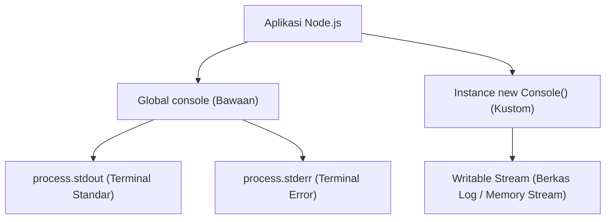

# Console

> Ringkasan
> - Fungsi: Menyediakan sarana pencetakan pesan diagnostik sistem, penataan tabel data, pengukuran durasi waktu, serta pembuatan instance logger kustom ke Writable Stream.
> - Digunakan saat: Menampilkan informasi status eksekusi program di terminal, mengukur lama waktu eksekusi kode, atau mengalirkan catatan log ke berkas disk tanpa perlu library luar.
> - Aturan praktis: Gunakan `new Console({ stdout, stderr })` untuk mengarahkan catatan log ke berkas penyimpanan, dan hindari memanggil `console.log` berlebihan pada rute server berbeban tinggi karena penulisan terminal dapat memblokir proses secara sinkron.

---

## Tujuan Belajar

- Membedakan saluran aliran target antara `console.log` (`stdout`) dan `console.error` (`stderr`).
- Menampilkan struktur data objek dan array secara rapi menggunakan `console.table()`.
- Mengukur durasi eksekusi fungsi menggunakan pasangan metode `console.time()` dan `console.timeEnd()`.
- Mengarahkan aliran catatan log ke Writable Stream kustom menggunakan kelas `Console`.
- Menelusuri rantai hierarki pemanggilan fungsi secara mendalam menggunakan `console.trace()`.

---

## Konsep

Modul `node:console` bisa kita bayangkan seperti sistem pengeras suara dan buku catatan administrasi di sebuah kantor.

Metode `console.log` berfungsi seperti pengeras suara di lobi gedung: menyiarkan pengumuman informasi umum kepada seluruh staf di saluran utama (_`process.stdout`_). Metode `console.error` berfungsi seperti sirene darurat: membunyikan peringatan bahaya ke saluran khusus yang dipantau oleh tim pengawas (_`process.stderr`_).

Sementara itu, membuat instance `new Console({ stdout: streamBerkas })` bertindak seperti mesin juru ketik otomatis: pesan tidak hanya disiarkan lewat suara di udara, tetapi langsung dicatat rapi dengan tinta permanen di atas buku arsip (_berkas log di disk_) untuk keperluan peninjauan di masa mendatang.



---

## Referensi

| Item | Fungsi | Catatan |
| :--- | :--- | :--- |
| **`log()`** | Menuliskan pesan informasi umum ke saluran standar (`stdout`) | Mendukung penentu format placeholder printf seperti `%s` dan `%d` |
| **`error()`** | Menuliskan pesan error ke saluran error standar (`stderr`) | Memisahkan pesan error agar tidak tercampur dengan pipa data normal |
| **`warn()`** | Menuliskan pesan peringatan ke saluran error standar (`stderr`) | Memiliki target aliran dan perilaku yang sama dengan `console.error` |
| **`table()`** | Menampilkan data objek atau array dalam format visual tabel dua dimensi | Membantu peninjauan data terstruktur langsung di layar terminal |
| **`time()` / `timeEnd()`** | Memulai dan mengakhiri stopwatch internal untuk mengukur durasi milidetik | Menghitung lama waktu eksekusi kode dengan presisi tinggi |
| **`assert()`** | Menulis pesan error ke `stderr` hanya jika kondisi pengujian bernilai salah | Tidak melempar error dan tidak menghentikan jalannya kode |
| **`count()` / `countReset()`** | Menghitung dan mereset frekuensi pemanggilan suatu label | Berguna untuk menghitung jumlah perulangan atau kemunculan event |
| **`trace()`** | Mencetak pesan beserta seluruh call stack fungsi (_call stack_) ke `stderr` | Menampilkan alur rantai pemanggil tanpa harus melempar error |
| **`new Console()`** | Membuat instance logger terpisah yang terhubung ke Writable Stream | Memungkinkan pengalihan log ke berkas disk atau buffer memori kustom |

### `log()`

Metode `console.log()` mencetak teks string atau representasi objek ke saluran `process.stdout` yang diakhiri dengan karakter baris baru. Metode ini mendukung penggantian placeholder format.

```javascript
console.log('System message: %s (code %d)', 'Ready', 200);
// Output: System message: Ready (code 200)
```

Kasus lain: Mengirimkan beberapa argumen tanpa penentu format akan mencetak seluruh nilai yang dipisahkan oleh satu spasi.

```javascript
console.log('Status', true, [1, 2]);
// Output: Status true [ 1, 2 ]
```

### `error()`

Metode `console.error()` mencetak pesan langsung ke saluran `process.stderr`. Pemisahan ini memungkinkan sistem operasi membelokkan catatan error ke berkas terpisah menggunakan operator pengalihan terminal (`2>`).

```javascript
console.error('Failed to connect to payment gateway');
// Output: Failed to connect to payment gateway
```

Kasus lain: Mengirimkan objek error `Error` ke dalam `console.error` akan mencetak pesan error beserta seluruh jejak call stack fungsi ke `stderr`.

```javascript
const error = new Error('Session expired');
console.error(error.message);
// Output: Session expired
```

### `warn()`

Metode `console.warn()` digunakan untuk mencatat peringatan penting yang belum bersifat merusak. Pada Node.js, metode ini mengalirkan pesannya ke `process.stderr` sama persis seperti `console.error()`.

```javascript
console.warn('Memory remaining: 10%');
// Output: Memory remaining: 10%
```

Kasus lain: Menyelipkan objek pendukung untuk memberikan rincian peringatan sistem.

```javascript
console.warn('Notice:', { action: 'service degradation', level: 'warning' });
// Output: Notice: { action: 'service degradation', level: 'warning' }
```

### `table()`

Metode `console.table()` merapikan daftar array objek atau pasangan kunci-nilai menjadi tabel visual dua dimensi yang enak dibaca di terminal.

```javascript
const userList = [
  { id: 1, name: 'Alice', role: 'Admin' },
  { id: 2, name: 'Bob', role: 'Editor' },
];

console.table(userList, ['id', 'name']);
```

Output:

```text
┌─────────┬────┬─────────┐
│ (index) │ id │  name   │
├─────────┼────┼─────────┤
│    0    │ 1  │ 'Alice' │
│    1    │ 2  │  'Bob'  │
└─────────┴────┴─────────┘
```

Kasus lain: Menampilkan objek tunggal akan merender nama properti beserta nilainya.

```javascript
console.table({ name: 'Server-01', status: 'Active' });
```

### `time()` dan `timeEnd()`

Metode `console.time()` menyalakan penghitung waktu stopwatch dengan label tertentu, dan `console.timeEnd()` menghentikan stopwatch tersebut sekaligus mencetak durasi waktu yang berlalu dalam satuan milidetik ke `stdout`.

```javascript
console.time('MathBenchmark');

let sum = 0;
for (let i = 0; i < 1000; i++) {
  sum += i;
}

console.timeEnd('MathBenchmark');
// Output: MathBenchmark: 0.116ms (durasi bervariasi)
```

Kasus lain: Memanggil `timeEnd()` dengan label yang belum pernah didaftarkan akan memunculkan pesan peringatan di konsol.

```javascript
console.timeEnd('NonExistentTimer');
// Output: Warning: No such label 'NonExistentTimer' for console.timeEnd()
```

### `assert()`

Metode `console.assert()` mengevaluasi suatu kondisi kebenaran. Jika kondisi bernilai salah, pesan error akan dicetak ke `stderr`. Berbeda dengan modul bawaan `node:assert`, metode ini tidak melempar error dan tidak menghentikan jalannya kode.

```javascript
import { Console } from 'node:console';
import { PassThrough } from 'node:stream';

const errorStream = new PassThrough();
let capturedOutput = '';
errorStream.on('data', (chunk) => {
  capturedOutput += chunk.toString('utf-8');
});

const logger = new Console({ stdout: new PassThrough(), stderr: errorStream });
logger.assert(10 > 20, 'Number 10 should not be greater than 20');

console.log(capturedOutput.includes('Assertion failed'));
// Output: true
```

Kasus lain: Jika kondisi evaluasi bernilai benar, `console.assert()` tidak akan mencetak teks apa pun.

```javascript
import { Console } from 'node:console';
import { PassThrough } from 'node:stream';

const errorStream = new PassThrough();
const logger = new Console({ stdout: new PassThrough(), stderr: errorStream });
logger.assert(true, 'This message will not be printed');
```

### `count()` dan `countReset()`

Metode `console.count()` mencatat dan menampilkan berapa kali suatu label telah dipanggil. Metode `console.countReset()` mengembalikan hitungan label tersebut kembali ke angka nol.

```javascript
console.count('connection');
// Output: connection: 1
console.count('connection');
// Output: connection: 2
console.countReset('connection');
console.count('connection');
// Output: connection: 1
```

Kasus lain: Memanggil `count()` tanpa menyertakan label akan menggunakan label default bernama `'default'`.

```javascript
console.count();
// Output: default: 1
console.countReset();
```

### `trace()`

Metode `console.trace()` mencetak pesan diagnostik yang disertai dengan jejak call stack fungsi (_call stack_) ke `process.stderr`. Metode ini sangat berguna untuk mengetahui urutan bagaimana suatu fungsi dipanggil.

```javascript
function innerFunction() {
  console.trace('Execution trace');
}

function outerFunction() {
  innerFunction();
}

outerFunction();
```

Output:

```text
Trace: Execution trace
    at innerFunction (file:///app/index.js:2:11)
    at outerFunction (file:///app/index.js:6:3)
```

Kasus lain: Memanggil `trace()` tanpa argumen pesan hanya akan mencetak baris `Trace:` diikuti call stack fungsinya.

```javascript
console.trace();
```

### `new Console()`

Kelas `Console` dari modul `node:console` memungkinkan kita membuat instance pencatat log terpisah yang mengalirkan pesan ke stream tujuan kustom (seperti berkas disk atau aliran memori) alih-alih terminal global.

```javascript
import { Console } from 'node:console';
import { PassThrough } from 'node:stream';

const outputStream = new PassThrough();
const logger = new Console({ stdout: outputStream });

let result = '';
outputStream.on('data', (chunk) => {
  result += chunk.toString('utf-8');
});

logger.log('Important message to custom stream');
console.log(result.trim());
// Output: Important message to custom stream
```

Kasus lain: Mengaktifkan opsi `ignoreErrors: true` agar kegagalan penulisan pada stream target tidak melempar error runtime ke aplikasi utama.

```javascript
import { Console } from 'node:console';
import { PassThrough } from 'node:stream';

const safeLogger = new Console({
  stdout: new PassThrough(),
  ignoreErrors: true,
});

console.log(typeof safeLogger.log);
// Output: function
```

### Perbandingan: `process.stdout` vs `process.stderr`

| Karakteristik | `process.stdout` (`console.log`) | `process.stderr` (`console.error` / `warn`) |
| :--- | :--- | :--- |
| **Kegunaan Data** | Informasi umum dan hasil kerja normal program | Pesan error, peringatan, dan catatan darurat |
| **Pengalihan Shell** | Dialihkan menggunakan tanda `>` atau `1>` di terminal | Dialihkan secara terpisah menggunakan tanda `2>` |
| **Pipa Data (Pipe)** | Diteruskan ke program penerima berikutnya saat menggunakan pipe `|` | Secara bawaan tidak ikut tersalurkan lewat pipe terminal |
| **Sifat Aliran** | Dapat menunggu jika penampung terminal sistem penuh | Ditulis langsung agar pesan kesalahan darurat tidak hilang |

---

## Kesalahan Umum

### Mengira `console.assert` Melempar Error

Banyak pengembang mengira `console.assert()` akan melempar error dan menghentikan kode seperti fungsi pada modul `node:assert`. Pada kenyataannya, `console.assert()` hanya mencetak teks peringatan ke `stderr` dan baris kode berikutnya akan tetap terus berjalan.

```javascript
// Salah
console.assert(isValidToken, 'Token is invalid!');
// Jika isValidToken bernilai false, baris di bawah ini TETAP BERJALAN!
executeSensitiveTransaction();
```

```javascript
// Benar
if (!isValidToken) {
  throw new Error('Token is invalid!');
}
executeSensitiveTransaction();
```

### Terlalu Banyak Memanggil `console.log` di Alur Permintaan Padat

Memanggil `console.log()` ribuan kali per detik pada server yang sibuk dapat membebani thread dan memperlambat Event Loop saat buffer terminal sistem operasi penuh, membuat performa server menurun drastis.

```javascript
// Salah
function processItems(largeList) {
  for (const item of largeList) {
    console.log('Processing item:', item.id); // Menghambat pemrosesan data dalam jumlah besar
  }
}
```

```javascript
// Benar
function processItems(largeList) {
  // Cukup catat ringkasan jumlah data yang diproses
  console.log('Total items to process:', largeList.length);
}
```

### Lupa Menutup Writable Stream pada Instance `Console` Kustom

Saat membuat `new Console()` yang diarahkan ke berkas penyimpanan (`fs.createWriteStream`), lupa menutup stream saat server dimatikan bisa membuat data log yang masih tertahan di buffer memori hilang dan tidak sempat tersimpan ke disk.

```javascript
// Salah
import { Console } from 'node:console';
import fs from 'node:fs';

const logFile = fs.createWriteStream('audit.log');
const logger = new Console({ stdout: logFile });
logger.log('System shutdown');
// Aliran berkas tidak ditutup, data berisiko hilang saat server mati mendadak
```

```javascript
// Benar
import { Console } from 'node:console';
import fs from 'node:fs';

const logFile = fs.createWriteStream('audit.log');
const logger = new Console({ stdout: logFile });
logger.log('System shutdown');
logFile.end(); // Memastikan seluruh data di buffer tertulis tuntas ke disk
```

---

## Studi Kasus

Skenario: Membangun sistem logger aplikasi terstruktur mandiri (_zero-dependency structured application logger_) yang memisahkan catatan informasi umum dan catatan error ke stream terpisah, menyediakan visualisasi tabel performa, mengukur durasi tugas dengan stopwatch bawaan, dan menjamin isolasi log tanpa mencemari terminal global.

```javascript
import { Console } from 'node:console';
import { PassThrough } from 'node:stream';

class StructuredLogger {
  #infoStream;
  #errorStream;
  #logger;

  constructor() {
    this.#infoStream = new PassThrough();
    this.#errorStream = new PassThrough();

    this.#logger = new Console({
      stdout: this.#infoStream,
      stderr: this.#errorStream,
      colorMode: false,
    });
  }

  info(message, metadata = {}) {
    this.#logger.log('[INFO] %s %j', message, metadata);
  }

  error(message, errorDetail = {}) {
    this.#logger.error('[ERROR] %s %j', message, errorDetail);
  }

  table(data) {
    this.#logger.table(data);
  }

  getInfoLogs() {
    return this.#infoStream.read()?.toString('utf-8') || '';
  }

  getErrorLogs() {
    return this.#errorStream.read()?.toString('utf-8') || '';
  }
}

const appLogger = new StructuredLogger();

appLogger.info('Authentication service initialized', { port: 3000 });
appLogger.error('Failed to validate JWT token', { code: 'TOKEN_EXPIRED' });

const infoOutput = appLogger.getInfoLogs();
console.log(infoOutput.includes('[INFO] Authentication service'));
// Output: true

const errorOutput = appLogger.getErrorLogs();
console.log(errorOutput.includes('[ERROR] Failed to validate JWT'));
// Output: true
```

Desain ini memisahkan aliran log secara bersih ke dalam stream terpisah menggunakan kelas `Console` bawaan tanpa memerlukan modul luar, mempermudah pengujian unit melalui stream in-memory, serta menjaga pemisahan standar antara informasi normal dan pesan kesalahan.

---

## Latihan Mandiri

### Soal 1 (Dasar)

Buat fungsi `measureExecutionTime(timerLabel, actionFn)` yang menerima label teks dan sebuah fungsi sinkron. Fungsi harus memulai penghitung waktu menggunakan `console.time(timerLabel)`, mengeksekusi `actionFn()`, menghentikan penghitung waktu via `console.timeEnd(timerLabel)`, dan mengembalikan nilai hasil eksekusi dari `actionFn()`.

Contoh input:

```javascript
const action = () => 40 + 2;
measureExecutionTime('ComputeValue', action);
```

Contoh output yang diharapkan:

```javascript
42
```

Batasan: Gunakan metode bawaan `console.time()` dan `console.timeEnd()`.

### Soal 2 (Menengah)

Buat fungsi `printTabularReport(employeeList, selectedColumns)` yang menerima array objek data karyawan dan array string nama kolom yang ingin ditampilkan. Gunakan `console.table()` untuk menampilkan data hanya pada kolom yang dipilih. Jika array data kosong, cetak pesan peringatan `'Empty data'` ke konsol menggunakan `console.warn()`.

Contoh input:

```javascript
const data = [
  { id: 'E01', name: 'Alice', salary: 8000000, department: 'IT' },
  { id: 'E02', name: 'Bob', salary: 9000000, department: 'Finance' }
];
printTabularReport(data, ['id', 'name']);
```

Contoh output yang diharapkan:

```text
┌─────────┬───────┬─────────┐
│ (index) │  id   │  name   │
├─────────┼───────┼─────────┤
│    0    │ 'E01' │ 'Alice' │
│    1    │ 'E02' │  'Bob'  │
└─────────┴───────┴─────────┘
```

Batasan: Gunakan modul bawaan `node:console` tanpa library pemformat tabel eksternal.

### Soal 3 (Menantang)

Buat sistem pencatat riwayat audit mandiri (_isolated transaction audit logger_) bernama `createAuditLogger(targetStream)`. Fungsi ini menerima sebuah Writable Stream dan mengembalikan objek pengelola audit.

Ketentuan pemrosesan:
- Buat instance `new Console()` yang mengarahkan output `stdout` dan `stderr` ke `targetStream` dengan opsi `colorMode: false`.
- Objek pengelola memiliki metode `recordTransaction(transactionId, status, amount)` yang mencatat pesan dengan pola `"[TRX:%s] Status: %s, Amount: %d"`.
- Memiliki metode `trackFrequency(category)` yang memanfaatkan `count()` untuk menghitung berapa kali kategori transaksi tersebut muncul.
- Memiliki metode `verifyIntegrity(condition, errorMessage)` yang menggunakan `assert()` untuk mencatat ketidaksesuaian tanpa menghentikan aplikasi.
- Memiliki metode `printSummary(summaryList)` yang memformat array rekap ke dalam bentuk tabel via `table()`.
- Seluruh pencatatan harus mengalir murni ke `targetStream` tanpa memancarkan teks ke konsol terminal global.

Contoh input:

```javascript
import { PassThrough } from 'node:stream';

const target = new PassThrough();
let accumulatedLogs = '';
target.on('data', (chunk) => {
  accumulatedLogs += chunk.toString('utf-8');
});

const auditor = createAuditLogger(target);
auditor.recordTransaction('TRX-101', 'SUCCESS', 500000);
auditor.verifyIntegrity(false, 'Balance mismatch detected');
```

Contoh output yang diharapkan:

```javascript
accumulatedLogs.includes('[TRX:TRX-101]') === true &&
accumulatedLogs.includes('Assertion failed: Balance mismatch detected') === true
```

Batasan: Wajib menggunakan instance kustom dari `node:console`. Dilarang menggunakan library logging eksternal dari NPM.

---

## Navigasi

[Sebelumnya: Debugger](../21-debugger/README.md) | [Daftar Isi](../README.md)
