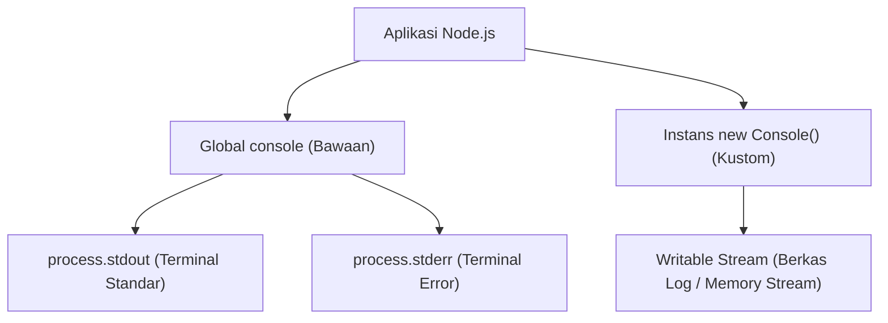

# Console

> Ringkasan
>
> - Fungsi: Menyediakan fasilitas pencetakan diagnostik sistem, inspeksi tabular, pengukuran durasi waktu, serta pembuatan instans logger kustom ke Writable Stream.
> - Digunakan saat: Menampilkan informasi status eksekusi di terminal, mengukur latensi algoritma, atau mengalirkan berkas log terisolasi ke sistem penyimpanan tanpa pustaka pihak ketiga.
> - Aturan praktis: Buat instans `new Console({ stdout, stderr })` untuk mengarahkan luaran log ke berkas disk, dan hindari pemanggilan `console.log` secara berlebihan di alur aplikasi berbeban tinggi karena penulisan terminal dapat memblokir proses secara sinkron.

---

## Tujuan Belajar

- Mengidentifikasi perbedaan aliran target antara `console.log` (`stdout`) dan `console.error` (`stderr`).
- Memvisualisasikan struktur objek dan array secara rapi menggunakan `console.table()`.
- Mengukur durasi efisiensi fungsi menggunakan pasangan metode `console.time()` dan `console.timeEnd()`.
- Mengarahkan aliran log ke Writable Stream kustom menggunakan kelas `Console`.
- Menelusuri hierarki pemanggilan fungsi secara mendalam menggunakan `console.trace()`.

---

## Konsep

> Modul `node:console` dianalogikan seperti sistem pengumuman dan buku jurnal administrasi kantor. Metode `console.log` berfungsi seperti pengeras suara di lobi gedung: menyiarkan informasi umum kepada seluruh staf di saluran utama (_`process.stdout`_). Metode `console.error` berfungsi seperti sirene bahaya: memancarkan peringatan genting ke saluran terpisah yang khusus didengarkan oleh tim pengawas (_`process.stderr`_). Pembuatan instans `new Console({ stdout: streamBerkas })` bertindak seperti mesin pencatat otomatis: seluruh pesan tidak hanya disiarkan di udara, tetapi langsung ditulis tinta permanen di atas buku arsip (_berkas log di disk_) untuk keperluan audit di kemudian hari.



---

## Referensi

| Item | Fungsi | Catatan |
| :--- | :--- | :--- |
| **`log()`** | Menulis pesan informasi umum ke aliran luaran standar (`stdout`) | Mendukung penentu format placeholder printf seperti `%s` dan `%d` |
| **`error()`** | Menulis pesan galat fatal ke aliran luaran galat standar (`stderr`) | Memisahkan pesan kesalahan agar tidak tercampur dengan pipa data normal |
| **`warn()`** | Menulis pesan peringatan ke aliran luaran galat standar (`stderr`) | Memiliki target aliran dan karakteristik yang identik dengan `console.error` |
| **`table()`** | Menampilkan koleksi objek atau array dalam format visual tabel dua dimensi | Membantu peninjauan data terstruktur langsung di antarmuka terminal |
| **`time()` / `timeEnd()`** | Memulai dan mengakhiri stopwatch internal untuk mengukur durasi milidetik | Menghitung durasi eksekusi algoritma dengan presisi tinggi |
| **`assert()`** | Menulis pesan galat ke `stderr` hanya jika nilai pengujian bernilai salah | Tidak melempar eksepsi JavaScript dan tidak menghentikan jalannya kode |
| **`count()` / `countReset()`** | Menghitung dan mereset frekuensi eksekusi suatu label di alur kode | Berguna untuk menghitung siklus iterasi atau frekuensi pemicuan event |
| **`trace()`** | Mencetak pesan beserta seluruh jejak tumpukan fungsi (_call stack_) ke `stderr` | Menunjukkan rantai hierarki pemanggil tanpa harus melempar error |
| **`new Console()`** | Menginisialisasi instans logger mandiri yang terhubung ke Writable Stream | Memungkinkan pengalihan log ke berkas disk atau buffer memori kustom |

### `log()`

Metode `console.log()` mencetak string atau representasi objek ke aliran `process.stdout` yang diakhiri dengan karakter baris baru. Metode ini mendukung substitusi penentu format (_specifier_).

```javascript
console.log("Pesan sistem: %s (kode %d)", "Siap", 200);
// Output: Pesan sistem: Siap (kode 200)
```

Kasus lain: Melewatkan beberapa argumen tanpa penentu format akan mencetak seluruh nilai yang dipisahkan oleh satu spasi.

```javascript
console.log("Status", true, [1, 2]);
// Output: Status true [ 1, 2 ]
```

### `error()`

Metode `console.error()` mencetak pesan langsung ke aliran `process.stderr`. Pemisahan ini memungkinkan terminal atau sistem operasi membelokkan luaran galat ke berkas terpisah via operator pengalihan (`2>`).

```javascript
console.error("Gagal menghubungkan ke gateway pembayaran");
// Output: Gagal menghubungkan ke gateway pembayaran
```

Kasus lain: Melewatkan objek galat `Error` ke dalam `console.error` akan mencetak pesan galat beserta seluruh jejak tumpukan stack trace ke `stderr`.

```javascript
const galat = new Error("Sesi kadaluarsa");
console.error(galat.message);
// Output: Sesi kadaluarsa
```

### `warn()`

Metode `console.warn()` digunakan untuk mencatat peringatan penting yang belum bersifat fatal. Pada Node.js, metode ini mengalirkan datanya ke `process.stderr` persis seperti `console.error()`.

```javascript
console.warn("Kapasitas memori tersisa 10%");
// Output: Kapasitas memori tersisa 10%
```

Kasus lain: Menyematkan objek konteks peringatan untuk memberikan rincian peringatan sistem.

```javascript
console.warn("Pemberitahuan:", { aksi: "degradasi layanan", level: "waspada" });
// Output: Pemberitahuan: { aksi: 'degradasi layanan', level: 'waspada' }
```

### `table()`

Metode `console.table()` memformat array of object atau objek pasangan kunci-nilai menjadi representasi visual tabel dua dimensi yang rapi dan mudah dibaca manusia.

```javascript
const daftarPengguna = [
  { id: 1, nama: "Budi", peran: "Admin" },
  { id: 2, nama: "Santoso", peran: "Editor" },
];

console.table(daftarPengguna, ["id", "nama"]);
```

Output:

```text
┌─────────┬────┬───────────┐
│ (index) │ id │   nama    │
├─────────┼────┼───────────┤
│    0    │ 1  │  'Budi'   │
│    1    │ 2  │ 'Santoso' │
└─────────┴────┴───────────┘
```

Kasus lain: Menampilkan objek primitif tunggal akan merender indeks properti beserta nilainya.

```javascript
console.table({ nama: "Server-01", status: "Aktif" });
```

### `time()` dan `timeEnd()`

Metode `console.time()` memulai pewaktu internal dengan label tertentu, dan `console.timeEnd()` menghentikan pewaktu tersebut sembari mencetak durasi waktu yang berlalu dalam milidetik ke `stdout`.

```javascript
console.time("ProsesMatematika");

let total = 0;
for (let i = 0; i < 1000; i++) {
  total += i;
}

console.timeEnd("ProsesMatematika");
// Output: ProsesMatematika: 0.05ms (durasi bervariasi)
```

Kasus lain: Memanggil `timeEnd()` dengan nama label yang belum pernah didaftarkan pada `time()` akan mencetak peringatan bahwa timer tidak ditemukan.

```javascript
console.timeEnd("LabelTidakAda");
// Output: Warning: No such label 'LabelTidakAda' for console.timeEnd()
```

### `assert()`

Metode `console.assert()` mengevaluasi kondisi kebenaran (_truthiness_). Jika kondisi bernilai false, pesan galat dicetak ke `stderr`. Berbeda dengan modul `node:assert`, metode ini tidak melempar galat dan tidak menghentikan proses.

```javascript
import { Console } from "node:console";
import { PassThrough } from "node:stream";

const streamGalat = new PassThrough();
let penampung = "";
streamGalat.on("data", (chunk) => {
  penampung += chunk.toString("utf-8");
});

const logger = new Console({ stdout: new PassThrough(), stderr: streamGalat });
logger.assert(10 > 20, "Angka 10 seharusnya tidak lebih besar dari 20");

console.log(penampung.includes("Assertion failed"));
// Output: true
```

Kasus lain: Jika kondisi evaluasi bernilai true, `console.assert()` tidak melakukan tindakan apa pun dan tidak menghasilkan output.

```javascript
import { Console } from "node:console";
import { PassThrough } from "node:stream";

const streamGalat = new PassThrough();
const logger = new Console({ stdout: new PassThrough(), stderr: streamGalat });
logger.assert(true, "Pesan ini tidak akan tercetak");
```

### `count()` dan `countReset()`

Metode `console.count()` mencatat dan menampilkan berapa kali suatu label telah dipanggil. Metode `console.countReset()` mengembalikan hitungan label tersebut kembali ke angka nol.

```javascript
console.count("koneksi");
// Output: koneksi: 1
console.count("koneksi");
// Output: koneksi: 2
console.countReset("koneksi");
console.count("koneksi");
// Output: koneksi: 1
```

Kasus lain: Memanggil `count()` tanpa argumen label akan menggunakan label bawaan berlabel `'default'`.

```javascript
console.count();
// Output: default: 1
console.countReset();
```

### `trace()`

Metode `console.trace()` mencetak pesan diagnostik yang disertai dengan tumpukan tumpukan panggilan fungsi (_stack trace_) saat ini ke `process.stderr`. Metode ini berguna untuk mengetahui alur bagaimana suatu fungsi dipanggil.

```javascript
function fungsiDalam() {
  console.trace("Jejak eksekusi");
}

function fungsiLuar() {
  fungsiDalam();
}

fungsiLuar();
```

Output:

```text
Trace: Jejak eksekusi
    at fungsiDalam (file:///app/index.js:2:11)
    at fungsiLuar (file:///app/index.js:6:3)
```

Kasus lain: Memanggil `trace()` tanpa argumen pesan hanya akan mencetak header `Trace:` diikuti susunan tumpukan fungsi.

```javascript
console.trace();
```

### `new Console()`

Kelas `Console` dari modul bawaan `node:console` memungkinkan pembuatan instans logger terisolasi yang mengalirkan pesan ke stream luaran kustom (seperti berkas disk atau soket jaringan) alih-alih terminal global.

```javascript
import { Console } from "node:console";
import { PassThrough } from "node:stream";

const streamOut = new PassThrough();
const logger = new Console({ stdout: streamOut });

let hasil = "";
streamOut.on("data", (chunk) => {
  hasil += chunk.toString("utf-8");
});

logger.log("Catatan penting ke stream kustom");
console.log(hasil.trim());
// Output: Catatan penting ke stream kustom
```

Kasus lain: Mengaktifkan opsi `ignoreErrors: true` agar kegagalan penulisan pada stream target tidak melempar galat runtime ke aplikasi utama.

```javascript
import { Console } from "node:console";
import { PassThrough } from "node:stream";

const loggerAman = new Console({
  stdout: new PassThrough(),
  ignoreErrors: true,
});

console.log(typeof loggerAman.log);
// Output: function
```

### Perbandingan: `process.stdout` vs `process.stderr`

| Karakteristik | `process.stdout` (`console.log`) | `process.stderr` (`console.error` / `warn`) |
| :--- | :--- | :--- |
| **Peruntukan Data** | Data hasil normal dan pesan informasi alur program | Pesan kesalahan, peringatan, dan informasi diagnostik |
| **Operator Shell** | Dialihkan menggunakan operator pengalihan `>` atau `1>` | Dialihkan secara terpisah menggunakan operator `2>` |
| **Pemrosesan Pipe** | Diteruskan ke program penerima berikutnya saat menggunakan pipe `|` | Secara bawaan tidak ikut tersalurkan melalui pipe shell standar |
| **Perilaku Pemblokiran** | Dapat memblokir pada stream berkas atau terminal Windows | Dituliskan secara langsung untuk menjamin perekaman insiden darurat |

---

## Kesalahan Umum

### Mengira `console.assert` Melempar Galat Pengecualian

Banyak pengembang mengira `console.assert()` melempar galat seperti fungsi `assert()` pada modul `node:assert`. Pada kenyataannya, `console.assert()` hanya mencetak teks peringatan ke `stderr` dan program tetap melanjutkan eksekusi baris berikutnya.

```javascript
// Salah
console.assert(tokenValid, "Token tidak valid!");
// Jika tokenValid bernilai false, kode di bawah ini TETAP BERJALAN!
eksekusiTransaksiSensitif();
```

```javascript
// Benar
if (!tokenValid) {
  throw new Error("Token tidak valid!");
}
eksekusiTransaksiSensitif();
```

### Membanjiri Alur Kritis Permintaan dengan `console.log` Sinkron

Pemanggilan `console.log()` dalam jumlah ribuan per detik pada aplikasi server dapat membebani thread dan memblokir Event Loop saat buffer terminal sistem operasi penuh, menurunkan throughput server secara drastis.

```javascript
// Salah
function prosesTiapItem(daftarBesar) {
  for (const item of daftarBesar) {
    console.log("Memproses item:", item.id); // Menghambat pemrosesan jutaan data
  }
}
```

```javascript
// Benar
function prosesTiapItem(daftarBesar) {
  // Gunakan pencatatan agregat berkala atau level debug kondisional
  console.log("Total item yang akan diproses:", daftarBesar.length);
}
```

### Lupa Menutup Writable Stream pada Instans Kustom `Console`

Ketika membuat instans `new Console()` yang dikaitkan dengan stream berkas disk (`fs.createWriteStream`), lupa menutup stream saat aplikasi dimatikan dapat menyebabkan data log yang masih tertahan di buffer memori tidak sempat ditulis ke disk.

```javascript
// Salah
import { Console } from "node:console";
import fs from "node:fs";

const berkas = fs.createWriteStream("audit.log");
const logger = new Console({ stdout: berkas });
logger.log("Sistem berhenti");
// Berkas stream tidak ditutup, buffer berisiko hilang saat proses berhenti mendadak
```

```javascript
// Benar
import { Console } from "node:console";
import fs from "node:fs";

const berkas = fs.createWriteStream("audit.log");
const logger = new Console({ stdout: berkas });
logger.log("Sistem berhenti");
berkas.end(); // Menjamin seluruh buffer dialirkan tuntas ke media disk
```

---

## Studi Kasus

Skenario: Membangun sistem logger aplikasi terstruktur mandiri (_zero-dependency structured application logger_) yang memisahkan luaran informasi umum dan luaran galat ke stream terpisah, menyediakan pencatatan tabel metrik performa, mengukur durasi tugas dengan timer bawaan, dan menjamin isolasi log tanpa mencemari terminal global.

```javascript
import { Console } from "node:console";
import { PassThrough } from "node:stream";

class LoggerTerstruktur {
  #streamInfo;
  #streamGalat;
  #logger;

  constructor() {
    this.#streamInfo = new PassThrough();
    this.#streamGalat = new PassThrough();

    this.#logger = new Console({
      stdout: this.#streamInfo,
      stderr: this.#streamGalat,
      colorMode: false,
    });
  }

  info(pesan, metadata = {}) {
    this.#logger.log("[INFO] %s %j", pesan, metadata);
  }

  galat(pesan, detailError = {}) {
    this.#logger.error("[ERROR] %s %j", pesan, detailError);
  }

  tabel(data) {
    this.#logger.table(data);
  }

  ambilLogInfo() {
    return this.#streamInfo.read()?.toString("utf-8") || "";
  }

  ambilLogGalat() {
    return this.#streamGalat.read()?.toString("utf-8") || "";
  }
}

const sistemLog = new LoggerTerstruktur();

sistemLog.info("Layanan autentikasi diinisialisasi", { port: 3000 });
sistemLog.galat("Gagal memvalidasi token JWT", { kode: "TOKEN_EXPIRED" });

const teksInfo = sistemLog.ambilLogInfo();
console.log(teksInfo.includes("[INFO] Layanan autentikasi"));
// Output: true

const teksGalat = sistemLog.ambilLogGalat();
console.log(teksGalat.includes("[ERROR] Gagal memvalidasi token"));
// Output: true
```

Desain ini dipilih karena mengisolasi penulisan log ke dalam stream terpisah menggunakan kelas `Console` native tanpa ketergantungan pada paket eksternal, memudahkan pengujian unit melalui stream in-memory, serta menjaga pemisahan baku antara informasi normal dan catatan galat.

---

## Latihan Mandiri

### Soal 1 (Dasar)

Buat fungsi `pantauDurasiFungsi(labelWaktu, fungsiAksi)` yang menerima label string dan sebuah fungsi sinkron. Fungsi harus memulai pewaktu menggunakan `console.time(labelWaktu)`, mengeksekusi `fungsiAksi()`, menghentikan pewaktu via `console.timeEnd(labelWaktu)`, dan mengembalikan nilai hasil eksekusi dari `fungsiAksi()`.

Contoh masukan:

```javascript
const aksi = () => 40 + 2;
pantauDurasiFungsi("HitungNilai", aksi);
```

Contoh keluaran yang diharapkan:

```javascript
42
```

Batasan: Gunakan metode bawaan `console.time()` dan `console.timeEnd()`.

### Soal 2 (Menengah)

Buat fungsi `cetakLaporanTabular(daftarKaryawan, kolomPilihan)` yang menerima array of object data karyawan dan array string nama kolom yang ingin ditampilkan. Gunakan `console.table()` untuk merender data hanya berdasarkan kolom yang dipilih. Jika array data kosong, cetak pesan peringatan `'Data kosong'` ke konsol menggunakan `console.warn()`.

Contoh masukan:

```javascript
const data = [
  { nip: "K01", nama: "Ahmad", gaji: 8000000, departemen: "IT" },
  { nip: "K02", nama: "Siti", gaji: 9000000, departemen: "Keuangan" }
];
cetakLaporanTabular(data, ["nip", "nama"]);
```

Contoh keluaran yang diharapkan:

```text
┌─────────┬───────┬─────────┐
│ (index) │  nip  │  nama   │
├─────────┼───────┼─────────┤
│    0    │ 'K01' │ 'Ahmad' │
│    1    │ 'K02' │ 'Siti'  │
└─────────┴───────┴─────────┘
```

Batasan: Gunakan modul bawaan `node:console` tanpa pustaka pemformat tabel eksternal.

### Soal 3 (Menantang)

Buat sistem pencatat riwayat audit mandiri (_isolated transaction audit logger_) bernama `buatLoggerAudit(streamTarget)`. Fungsi ini menerima sebuah Writable Stream dan mengembalikan objek pengelola audit.

Ketentuan pemrosesan:

- Buat instans `new Console()` yang mengarahkan luaran `stdout` dan `stderr` ke `streamTarget`.
- Objek pengelola memiliki metode `catatTransaksi(idTrx, status, nominal)` yang mencatat pesan format `"[TRX:%s] Status: %s, Nominal: %d"`.
- Memiliki metode `hitungFrekuensi(kategori)` yang memanfaatkan `count()` untuk menghitung berapa kali kategori transaksi tersebut muncul.
- Memiliki metode `verifikasiIntegritas(kondisi, pesanGalat)` yang menggunakan `assert()` untuk mencatat ketidaksesuaian tanpa menghentikan aplikasi.
- Memiliki metode `cetakRingkasan(daftarRekap)` yang memformat array rekap ke dalam bentuk tabel via `table()`.
- Seluruh pencatatan harus mengalir murni ke `streamTarget` tanpa memancarkan teks ke konsol terminal global.

Contoh masukan:

```javascript
import { PassThrough } from "node:stream";

const target = new PassThrough();
let akumulasiLog = "";
target.on("data", (chunk) => {
  akumulasiLog += chunk.toString("utf-8");
});

const auditor = buatLoggerAudit(target);
auditor.catatTransaksi("TRX-101", "BERHASIL", 500000);
auditor.verifikasiIntegritas(false, "Saldo tidak seimbang");
```

Contoh keluaran yang diharapkan:

```javascript
akumulasiLog.includes("[TRX:TRX-101]") === true &&
akumulasiLog.includes("Assertion failed: Saldo tidak seimbang") === true
```

Batasan: Wajib menggunakan `node:console` instans kustom. Dilarang menggunakan logging library eksternal dari NPM.

---

## Navigasi

[Sebelumnya: Debugger](../21-debugger/README.md) | [Daftar Isi](../README.md)
