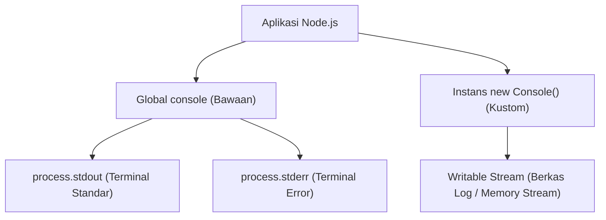

# Console

> Ringkasan
> - Fungsi: Menyediakan fasilitas pencetakan diagnostik sistem, inspeksi tabular, pengukuran durasi waktu, serta pembuatan instans logger kustom ke Writable Stream.
> - Digunakan saat: Menampilkan informasi status eksekusi di terminal, mengukur latensi algoritma, atau mengalirkan berkas log terisolasi ke sistem penyimpanan tanpa pustaka pihak ketiga.
> - Aturan praktis: Buat instans `new Console({ stdout, stderr })` untuk mengarahkan luaran log ke berkas disk, dan hindari pemanggilan `console.log` secara berlebihan di alur aplikasi berbeban tinggi karena penulisan terminal dapat memblokir proses secara sinkron.

---

## Tujuan Belajar

- Mengidentifikasi perbedaan aliran target antara `console.log` (`stdout`) dan `console.error` (`stderr`).
- Memvisualisasikan struktur objek dan array secara rapi menggunakan `console.table()`.
- Mengukur durasi efisiensi fungsi menggunakan pasangan metode `console.time()` dan `console.timeEnd()`.
- Mengarahkan aliran log ke Writable Stream kustom menggunakan kelas `Console`.
- Menelusuri hierarki pemanggilan fungsi secara mendalam menggunakan `console.trace()`.

---

## Konsep

> Modul `node:console` dianalogikan seperti sistem pengumuman dan buku jurnal administrasi kantor. Metode `console.log` berfungsi seperti pengeras suara di lobi gedung: menyiarkan informasi umum kepada seluruh staf di saluran utama (_`process.stdout`_). Metode `console.error` berfungsi seperti sirene bahaya: memancarkan peringatan genting ke saluran terpisah yang khusus didengarkan oleh tim pengawas (_`process.stderr`_). Pembuatan instans `new Console({ stdout: streamBerkas })` bertindak seperti mesin pencatat otomatis: seluruh pesan tidak hanya disiarkan di udara, tetapi langsung ditulis tinta permanen di atas buku arsip (_berkas log di disk_) untuk keperluan audit di kemudian hari.



---

## Referensi

| Item | Fungsi | Catatan |
| :--- | :--- | :--- |
| **`log()`** | Menulis pesan informasi umum ke aliran luaran standar (`stdout`) | Mendukung penentu format placeholder printf seperti `%s` dan `%d` |
| **`error()`** | Menulis pesan galat fatal ke aliran luaran galat standar (`stderr`) | Memisahkan pesan kesalahan agar tidak tercampur dengan pipa data normal |
| **`warn()`** | Menulis pesan peringatan ke aliran luaran galat standar (`stderr`) | Memiliki target aliran dan karakteristik yang identik dengan `console.error` |
| **`table()`** | Menampilkan koleksi objek atau array dalam format visual tabel dua dimensi | Membantu peninjauan data terstruktur langsung di antarmuka terminal |
| **`time()` / `timeEnd()`** | Memulai dan mengakhiri stopwatch internal untuk mengukur durasi milidetik | Menghitung durasi eksekusi algoritma dengan presisi tinggi |
| **`assert()`** | Menulis pesan galat ke `stderr` hanya jika nilai pengujian bernilai salah | Tidak melempar eksepsi JavaScript dan tidak menghentikan jalannya kode |
| **`count()` / `countReset()`** | Menghitung dan mereset frekuensi eksekusi suatu label di alur kode | Berguna untuk menghitung siklus iterasi atau frekuensi pemicuan event |
| **`trace()`** | Mencetak pesan beserta seluruh jejak tumpukan fungsi (_call stack_) ke `stderr` | Menunjukkan rantai hierarki pemanggil tanpa harus melempar error |
| **`new Console()`** | Menginisialisasi instans logger mandiri yang terhubung ke Writable Stream | Memungkinkan pengalihan log ke berkas disk atau buffer memori kustom |

### `log()`

Metode `console.log()` mencetak string atau representasi objek ke aliran `process.stdout` yang diakhiri dengan karakter baris baru. Metode ini mendukung substitusi penentu format (_specifier_).

```javascript
console.log('System message: %s (code %d)', 'Ready', 200);
// Output: System message: Ready (code 200)
```

Kasus lain: Melewatkan beberapa argumen tanpa penentu format akan mencetak seluruh nilai yang dipisahkan oleh satu spasi.

```javascript
console.log('Status', true, [1, 2]);
// Output: Status true [ 1, 2 ]
```

### `error()`

Metode `console.error()` mencetak pesan langsung ke aliran `process.stderr`. Pemisahan ini memungkinkan terminal atau sistem operasi membelokkan luaran galat ke berkas terpisah via operator pengalihan (`2>`).

```javascript
console.error('Failed to connect to payment gateway');
// Output: Failed to connect to payment gateway
```

Kasus lain: Melewatkan objek galat `Error` ke dalam `console.error` akan mencetak pesan galat beserta seluruh jejak tumpukan stack trace ke `stderr`.

```javascript
const error = new Error('Session expired');
console.error(error.message);
// Output: Session expired
```

### `warn()`

Metode `console.warn()` digunakan untuk mencatat peringatan penting yang belum bersifat fatal. Pada Node.js, metode ini mengalirkan datanya ke `process.stderr` persis seperti `console.error()`.

```javascript
console.warn('Memory remaining: 10%');
// Output: Memory remaining: 10%
```

Kasus lain: Menyematkan objek konteks peringatan untuk memberikan rincian peringatan sistem.

```javascript
console.warn('Notice:', { action: 'service degradation', level: 'warning' });
// Output: Notice: { action: 'service degradation', level: 'warning' }
```

### `table()`

Metode `console.table()` memformat array of object atau objek pasangan kunci-nilai menjadi representasi visual tabel dua dimensi yang rapi dan mudah dibaca manusia.

```javascript
const userList = [
  { id: 1, name: 'Alice', role: 'Admin' },
  { id: 2, name: 'Bob', role: 'Editor' },
];

console.table(userList, ['id', 'name']);
```

Output:

```text
┌─────────┬────┬─────────┐
│ (index) │ id │  name   │
├─────────┼────┼─────────┤
│    0    │ 1  │ 'Alice' │
│    1    │ 2  │  'Bob'  │
└─────────┴────┴─────────┘
```

Kasus lain: Menampilkan objek primitif tunggal akan merender indeks properti beserta nilainya.

```javascript
console.table({ name: 'Server-01', status: 'Active' });
```

### `time()` dan `timeEnd()`

Metode `console.time()` memulai pewaktu internal dengan label tertentu, dan `console.timeEnd()` menghentikan pewaktu tersebut sembari mencetak durasi waktu yang berlalu dalam milidetik ke `stdout`.

```javascript
console.time('MathBenchmark');

let sum = 0;
for (let i = 0; i < 1000; i++) {
  sum += i;
}

console.timeEnd('MathBenchmark');
// Output: MathBenchmark: 0.116ms (durasi bervariasi)
```

Kasus lain: Memanggil `timeEnd()` dengan nama label yang belum pernah didaftarkan pada `time()` akan mencetak peringatan bahwa timer tidak ditemukan.

```javascript
console.timeEnd('NonExistentTimer');
// Output: Warning: No such label 'NonExistentTimer' for console.timeEnd()
```

### `assert()`

Metode `console.assert()` mengevaluasi kondisi kebenaran (_truthiness_). Jika kondisi bernilai false, pesan galat dicetak ke `stderr`. Berbeda dengan modul `node:assert`, metode ini tidak melempar galat dan tidak menghentikan proses.

```javascript
import { Console } from 'node:console';
import { PassThrough } from 'node:stream';

const errorStream = new PassThrough();
let capturedOutput = '';
errorStream.on('data', (chunk) => {
  capturedOutput += chunk.toString('utf-8');
});

const logger = new Console({ stdout: new PassThrough(), stderr: errorStream });
logger.assert(10 > 20, 'Number 10 should not be greater than 20');

console.log(capturedOutput.includes('Assertion failed'));
// Output: true
```

Kasus lain: Jika kondisi evaluasi bernilai true, `console.assert()` tidak melakukan tindakan apa pun dan tidak menghasilkan output.

```javascript
import { Console } from 'node:console';
import { PassThrough } from 'node:stream';

const errorStream = new PassThrough();
const logger = new Console({ stdout: new PassThrough(), stderr: errorStream });
logger.assert(true, 'This message will not be printed');
```

### `count()` dan `countReset()`

Metode `console.count()` mencatat dan menampilkan berapa kali suatu label telah dipanggil. Metode `console.countReset()` mengembalikan hitungan label tersebut kembali ke angka nol.

```javascript
console.count('connection');
// Output: connection: 1
console.count('connection');
// Output: connection: 2
console.countReset('connection');
console.count('connection');
// Output: connection: 1
```

Kasus lain: Memanggil `count()` tanpa argumen label akan menggunakan label bawaan berlabel `'default'`.

```javascript
console.count();
// Output: default: 1
console.countReset();
```

### `trace()`

Metode `console.trace()` mencetak pesan diagnostik yang disertai dengan tumpukan panggilan fungsi (_stack trace_) saat ini ke `process.stderr`. Metode ini berguna untuk mengetahui alur bagaimana suatu fungsi dipanggil.

```javascript
function innerFunction() {
  console.trace('Execution trace');
}

function outerFunction() {
  innerFunction();
}

outerFunction();
```

Output:

```text
Trace: Execution trace
    at innerFunction (file:///app/index.js:2:11)
    at outerFunction (file:///app/index.js:6:3)
```

Kasus lain: Memanggil `trace()` tanpa argumen pesan hanya akan mencetak header `Trace:` diikuti susunan tumpukan fungsi.

```javascript
console.trace();
```

### `new Console()`

Kelas `Console` dari modul bawaan `node:console` memungkinkan pembuatan instans logger terisolasi yang mengalirkan pesan ke stream luaran kustom (seperti berkas disk atau soket jaringan) alih-alih terminal global.

```javascript
import { Console } from 'node:console';
import { PassThrough } from 'node:stream';

const outputStream = new PassThrough();
const logger = new Console({ stdout: outputStream });

let result = '';
outputStream.on('data', (chunk) => {
  result += chunk.toString('utf-8');
});

logger.log('Important message to custom stream');
console.log(result.trim());
// Output: Important message to custom stream
```

Kasus lain: Mengaktifkan opsi `ignoreErrors: true` agar kegagalan penulisan pada stream target tidak melempar galat runtime ke aplikasi utama.

```javascript
import { Console } from 'node:console';
import { PassThrough } from 'node:stream';

const safeLogger = new Console({
  stdout: new PassThrough(),
  ignoreErrors: true,
});

console.log(typeof safeLogger.log);
// Output: function
```

### Perbandingan: `process.stdout` vs `process.stderr`

| Karakteristik | `process.stdout` (`console.log`) | `process.stderr` (`console.error` / `warn`) |
| :--- | :--- | :--- |
| **Peruntukan Data** | Data hasil normal dan pesan informasi alur program | Pesan kesalahan, peringatan, dan informasi diagnostik |
| **Operator Shell** | Dialihkan menggunakan operator pengalihan `>` atau `1>` | Dialihkan secara terpisah menggunakan operator `2>` |
| **Pemrosesan Pipe** | Diteruskan ke program penerima berikutnya saat menggunakan pipe `|` | Secara bawaan tidak ikut tersalurkan melalui pipe shell standar |
| **Perilaku Pemblokiran** | Dapat memblokir pada stream berkas atau terminal Windows | Dituliskan secara langsung untuk menjamin perekaman insiden darurat |

---

## Kesalahan Umum

### Mengira `console.assert` Melempar Galat Pengecualian

Banyak pengembang mengira `console.assert()` melempar galat seperti fungsi `assert()` pada modul `node:assert`. Pada kenyataannya, `console.assert()` hanya mencetak teks peringatan ke `stderr` dan program tetap melanjutkan eksekusi baris berikutnya.

```javascript
// Salah
console.assert(isValidToken, 'Token is invalid!');
// Jika isValidToken bernilai false, kode di bawah ini TETAP BERJALAN!
executeSensitiveTransaction();
```

```javascript
// Benar
if (!isValidToken) {
  throw new Error('Token is invalid!');
}
executeSensitiveTransaction();
```

### Membanjiri Alur Kritis Permintaan dengan `console.log` Sinkron

Pemanggilan `console.log()` dalam jumlah ribuan per detik pada aplikasi server dapat membebani thread dan memblokir Event Loop saat buffer terminal sistem operasi penuh, menurunkan throughput server secara drastis.

```javascript
// Salah
function processItems(largeList) {
  for (const item of largeList) {
    console.log('Processing item:', item.id); // Menghambat pemrosesan ribuan data
  }
}
```

```javascript
// Benar
function processItems(largeList) {
  // Gunakan pencatatan agregat berkala atau level debug kondisional
  console.log('Total items to process:', largeList.length);
}
```

### Lupa Menutup Writable Stream pada Instans Kustom `Console`

Ketika membuat instans `new Console()` yang dikaitkan dengan stream berkas disk (`fs.createWriteStream`), lupa menutup stream saat aplikasi dimatikan dapat menyebabkan data log yang masih tertahan di buffer memori tidak sempat ditulis ke disk.

```javascript
// Salah
import { Console } from 'node:console';
import fs from 'node:fs';

const logFile = fs.createWriteStream('audit.log');
const logger = new Console({ stdout: logFile });
logger.log('System shutdown');
// Berkas stream tidak ditutup, buffer berisiko hilang saat proses berhenti mendadak
```

```javascript
// Benar
import { Console } from 'node:console';
import fs from 'node:fs';

const logFile = fs.createWriteStream('audit.log');
const logger = new Console({ stdout: logFile });
logger.log('System shutdown');
logFile.end(); // Menjamin seluruh buffer dialirkan tuntas ke media disk
```

---

## Studi Kasus

Skenario: Membangun sistem logger aplikasi terstruktur mandiri (_zero-dependency structured application logger_) yang memisahkan luaran informasi umum dan luaran galat ke stream terpisah, menyediakan pencatatan tabel metrik performa, mengukur durasi tugas dengan timer bawaan, dan menjamin isolasi log tanpa mencemari terminal global.

```javascript
import { Console } from 'node:console';
import { PassThrough } from 'node:stream';

class StructuredLogger {
  #infoStream;
  #errorStream;
  #logger;

  constructor() {
    this.#infoStream = new PassThrough();
    this.#errorStream = new PassThrough();

    this.#logger = new Console({
      stdout: this.#infoStream,
      stderr: this.#errorStream,
      colorMode: false,
    });
  }

  info(message, metadata = {}) {
    this.#logger.log('[INFO] %s %j', message, metadata);
  }

  error(message, errorDetail = {}) {
    this.#logger.error('[ERROR] %s %j', message, errorDetail);
  }

  table(data) {
    this.#logger.table(data);
  }

  getInfoLogs() {
    return this.#infoStream.read()?.toString('utf-8') || '';
  }

  getErrorLogs() {
    return this.#errorStream.read()?.toString('utf-8') || '';
  }
}

const appLogger = new StructuredLogger();

appLogger.info('Authentication service initialized', { port: 3000 });
appLogger.error('Failed to validate JWT token', { code: 'TOKEN_EXPIRED' });

const infoOutput = appLogger.getInfoLogs();
console.log(infoOutput.includes('[INFO] Authentication service'));
// Output: true

const errorOutput = appLogger.getErrorLogs();
console.log(errorOutput.includes('[ERROR] Failed to validate JWT'));
// Output: true
```

Desain ini dipilih karena mengisolasi penulisan log ke dalam stream terpisah menggunakan kelas `Console` native tanpa ketergantungan pada paket eksternal, memudahkan pengujian unit melalui stream in-memory, serta menjaga pemisahan baku antara informasi normal dan catatan galat.

---

## Latihan Mandiri

### Soal 1 (Dasar)

Buat fungsi `measureExecutionTime(timerLabel, actionFn)` yang menerima label string dan sebuah fungsi sinkron. Fungsi harus memulai pewaktu menggunakan `console.time(timerLabel)`, mengeksekusi `actionFn()`, menghentikan pewaktu via `console.timeEnd(timerLabel)`, dan mengembalikan nilai hasil eksekusi dari `actionFn()`.

Contoh masukan:
```javascript
const action = () => 40 + 2;
measureExecutionTime('ComputeValue', action);
```

Contoh keluaran yang diharapkan:
```javascript
42
```

Batasan: Gunakan metode bawaan `console.time()` dan `console.timeEnd()`.

### Soal 2 (Menengah)

Buat fungsi `printTabularReport(employeeList, selectedColumns)` yang menerima array of object data karyawan dan array string nama kolom yang ingin ditampilkan. Gunakan `console.table()` untuk merender data hanya berdasarkan kolom yang dipilih. Jika array data kosong, cetak pesan peringatan `'Empty data'` ke konsol menggunakan `console.warn()`.

Contoh masukan:
```javascript
const data = [
  { id: 'E01', name: 'Alice', salary: 8000000, department: 'IT' },
  { id: 'E02', name: 'Bob', salary: 9000000, department: 'Finance' }
];
printTabularReport(data, ['id', 'name']);
```

Contoh keluaran yang diharapkan:
```text
┌─────────┬───────┬─────────┐
│ (index) │  id   │  name   │
├─────────┼───────┼─────────┤
│    0    │ 'E01' │ 'Alice' │
│    1    │ 'E02' │  'Bob'  │
└─────────┴───────┴─────────┘
```

Batasan: Gunakan modul bawaan `node:console` tanpa pustaka pemformat tabel eksternal.

### Soal 3 (Menantang)

Buat sistem pencatat riwayat audit mandiri (_isolated transaction audit logger_) bernama `createAuditLogger(targetStream)`. Fungsi ini menerima sebuah Writable Stream dan mengembalikan objek pengelola audit.

Ketentuan pemrosesan:
- Buat instans `new Console()` yang mengarahkan luaran `stdout` dan `stderr` ke `targetStream` dengan opsi `colorMode: false`.
- Objek pengelola memiliki metode `recordTransaction(transactionId, status, amount)` yang mencatat pesan format `"[TRX:%s] Status: %s, Amount: %d"`.
- Memiliki metode `trackFrequency(category)` yang memanfaatkan `count()` untuk menghitung berapa kali kategori transaksi tersebut muncul.
- Memiliki metode `verifyIntegrity(condition, errorMessage)` yang menggunakan `assert()` untuk mencatat ketidaksesuaian tanpa menghentikan aplikasi.
- Memiliki metode `printSummary(summaryList)` yang memformat array rekap ke dalam bentuk tabel via `table()`.
- Seluruh pencatatan harus mengalir murni ke `streamTarget` tanpa memancarkan teks ke konsol terminal global.

Contoh masukan:
```javascript
import { PassThrough } from 'node:stream';

const target = new PassThrough();
let accumulatedLogs = '';
target.on('data', (chunk) => {
  accumulatedLogs += chunk.toString('utf-8');
});

const auditor = createAuditLogger(target);
auditor.recordTransaction('TRX-101', 'SUCCESS', 500000);
auditor.verifyIntegrity(false, 'Balance mismatch detected');
```

Contoh keluaran yang diharapkan:
```javascript
accumulatedLogs.includes('[TRX:TRX-101]') === true &&
accumulatedLogs.includes('Assertion failed: Balance mismatch detected') === true
```

Batasan: Wajib menggunakan `node:console` instans kustom. Dilarang menggunakan logging library eksternal dari NPM.

---

## Navigasi

[Sebelumnya: Debugger](../21-debugger/README.md) | [Daftar Isi](../README.md)
