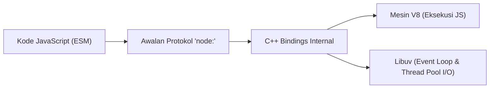

# Core Modules dan Runtime Architecture

Dokumentasi ini merangkum arsitektur internal runtime Node.js serta library modul bawaan (_Standard Library / Core Modules_) yang tersedia langsung tanpa perlu menginstal dependensi pihak ketiga dari NPM.

---

## Fondasi Arsitektur: Standard Library Node.js

Standard library adalah kumpulan API resmi Node.js yang tersedia secara native untuk menangani kebutuhan dasar aplikasi seperti sistem operasi, file system, jaringan, dan manipulasi data biner.

Standard library menyerupai aplikasi bawaan pabrik pada laptop baru (seperti kalkulator, penampil jam, dan terminal). Seluruh modul ini sudah terpasang sejak awal dan terhubung langsung ke mesin V8 serta Libuv melalui lapisan perantara internal (_C++ bindings_).



### Standar Protokol `node:`

Saat mengimpor modul bawaan di Node.js modern, selalu sertakan awalan protokol `node:` (contoh: `node:fs/promises` atau `node:path`):

1. **Keamanan:** Melindungi aplikasi dari serangan _dependency confusion_ akibat paket tiruan di registry NPM.
2. **Kinerja:** Mempercepat resolusi impor karena Node.js langsung mengambil binding internal tanpa memindai folder `node_modules`.
3. **Kejelasan:** Membedakan modul resmi runtime dengan library eksternal secara eksplisit.

```javascript
import { isBuiltin, builtinModules } from "node:module";

console.log(isBuiltin("node:fs"));
// Output: true
console.log(isBuiltin("express"));
// Output: false
console.log(builtinModules.includes("path"));
// Output: true
```

---

## Panduan Alur Belajar

Kurikulum modul inti ini dibagi menjadi tiga kelompok materi:

- **01 sampai 12 (Fondasi):** Pelajari secara berurutan. Materi ini adalah fondasi esensial backend Node.js dan disajikan dalam format lengkap dengan studi kasus serta latihan bertahap 3 level.
- **13 sampai 18 (Pendukung):** Pelajari sesuai kebutuhan proyek. Materi ini disajikan dalam format lengkap dengan studi kasus serta latihan mandiri 3 level untuk memperdalam fitur pendukung runtime.
- **19 sampai 23 (Eksplorasi):** Topik eksplorasi tingkat rendah (networking tingkat rendah, multi-proses, diagnosa crash, dan debugging) yang disajikan dalam format ringkas 1 halaman dan dapat dipelajari saat dibutuhkan.

---

## Daftar Materi Pembelajaran

### 1. Materi Fondasi (Baca Berurutan)

| No  | Materi                                  | Tingkat | Deskripsi                                                                                                            |
| :-- | :-------------------------------------- | :------ | :------------------------------------------------------------------------------------------------------------------- |
| 01  | [Globals](01-globals/README.md)         | Fondasi | Cakupan objek global bawaan `globalThis`, Web Standards API, `structuredClone`, dan `AbortController`.               |
| 02  | [Process](02-process/README.md)         | Fondasi | Siklus hidup objek `process`, variabel lingkungan `process.env`, parsing argumen CLI, dan metrik memori RAM.         |
| 03  | [Path](03-path/README.md)               | Fondasi | Normalisasi path file lintas platform (POSIX dan Windows), resolusi absolut, dan proteksi _path traversal_.          |
| 04  | [URL](04-url/README.md)                 | Fondasi | Standar WHATWG URL API, pemecahan komponen alamat, manipulasi kueri `URLSearchParams`, dan proteksi _open redirect_. |
| 05  | [File System](05-file-system/README.md) | Fondasi | Operasi file dan direktori berbasis `node:fs/promises`, kode error sistem, dan pola penulisan atomik.                |
| 06  | [Events](06-events/README.md)           | Fondasi | Pola Event-Driven Architecture native via `EventEmitter`, pengelolaan listener, dan mitigasi kebocoran memori.       |
| 07  | [Buffer](07-buffer/README.md)           | Fondasi | Alokasi dan manipulasi data biner mentah di luar V8 heap, serta konversi encoding UTF-8, Base64, dan Hex.            |
| 08  | [Stream](08-stream/README.md)           | Fondasi | Pengolahan stream data kontinu (Readable, Writable, Transform) dan manajemen backpressure via `pipeline`.            |
| 09  | [Timer](09-timer/README.md)             | Fondasi | Fase Event Loop Libuv, antrean tugas mikro, penjadwalan fungsi asinkron, dan modul `timers/promises`.                |
| 10  | [HTTP](10-http/README.md)               | Fondasi | Pembuatan HTTP server native, parsing header dan stream body, serta pemanggilan client request via `fetch()`.        |
| 11  | [Util](11-util/README.md)               | Fondasi | Utilitas pembantu internal, jembatan asinkron `util.promisify`, inspeksi objek, dan komparasi nilai mendalam.        |
| 12  | [Crypto](12-crypto/README.md)           | Fondasi | Kriptografi bawaan: pembuatan string acak aman, hashing data SHA-256, HMAC, dan pencegahan timing attack.            |

### 2. Materi Pendukung (Baca Sesuai Kebutuhan)

| No  | Materi                                        | Tingkat   | Deskripsi                                                                                             |
| :-- | :-------------------------------------------- | :-------- | :---------------------------------------------------------------------------------------------------- |
| 13  | [OS](13-os/README.md)                         | Pendukung | Informasi spesifikasi komputer host, jenis arsitektur CPU, kapasitas RAM, dan kuota paralelisme core. |
| 14  | [Worker Threads](14-worker-threads/README.md) | Pendukung | Paralelisme multi-thread untuk komputasi CPU berat tanpa memblokir Event Loop utama.                  |
| 15  | [Zlib](15-zlib/README.md)                     | Pendukung | Kompresi dan dekompresi data streaming menggunakan algoritma Gzip, Deflate, dan Brotli.               |
| 16  | [Readline](16-readline/README.md)             | Pendukung | Pembacaan input interaktif baris demi baris dari terminal dan file stream via `readline/promises`.    |
| 17  | [Console](17-console/README.md)               | Pendukung | Pencetakan diagnostik, format tabular, dan pembuatan instance logger kustom ke file disk stream.      |
| 18  | [Child Process](18-child-process/README.md)   | Pendukung | Menjalankan perintah eksternal sistem operasi memakai fungsi `spawn` dan `exec`.                      |

### 3. Materi Eksplorasi (Boleh Dilewati Dulu)

| No  | Materi                            | Tingkat    | Deskripsi                                                                                          |
| :-- | :-------------------------------- | :--------- | :------------------------------------------------------------------------------------------------- |
| 19  | [Net](19-net/README.md)           | Eksplorasi | Pemrograman jaringan soket TCP tingkat rendah berbasis client-server dua arah.                     |
| 20  | [DNS](20-dns/README.md)           | Eksplorasi | Resolusi nama domain ke alamat IP, perbedaan `lookup` vs `resolve`, dan query DNS record.          |
| 21  | [Cluster](21-cluster/README.md)   | Eksplorasi | Penskalaan multi-proses memanfaatkan seluruh core CPU dengan pola Primary-Worker dan port sharing. |
| 22  | [Report](22-report/README.md)     | Eksplorasi | Pembuatan laporan diagnostik menyeluruh dalam format JSON untuk investigasi crash.                 |
| 23  | [Debugger](23-debugger/README.md) | Eksplorasi | Titik henti program `debugger`, inspeksi nilai variabel runtime, dan integrasi V8 Inspector.       |

---

## Navigasi

[Selanjutnya: Package Management](../02-package-management/README.md) | [Daftar Isi Utama](../README.md)
